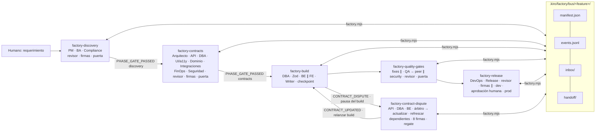

# Diseño Fase B — Fábrica SDLC multi-agente de BorondoTours

Fecha: 2026-10-12. Iteración: 4 (revisión de la iteración 3 en `design-review.json`/`design-review.md`: 1 HIGH, 8 MEDIUM y 12 LOW; todos atendidos, ver "Respuestas a la revisión" al final. La iteración 3 había atendido la revisión previa de 3 HIGH, 10 MEDIUM y 14 LOW).
Verificado por lectura en la iteración 3: `apps/web/.astro/` tiene 6 archivos versionados (los regenera `astro check`); `@playwright/test` 1.61.1 exporta `./cli` y `./package.json`; `packages/db` no tiene `drizzle.config.*` y su `generate` es `drizzle-kit generate`; existen `apps/web/test/` (setup y smoke) y `apps/web/tests/` (fixtures); `apps/web/src/lib/` tiene `api/`, `fig/runtime/` e `i18n/`, y `apps/web/src/styles/` tiene `fig-runtime.css`; los scripts `infra:*` de la raíz usan `--template-file infra/template.yaml`; `.gitignore` no ignora `.aws-sam/`.
Insumos: `research.md` (Fase A), `protocolo-usuario.md`, steering 00-07, 10-18, `docs/DECISIONES-PENDIENTES.md`, `docs/04-Tech-Design/Mapa-Repositorio.md`, `.kiro/agents/figma-sync.json`, `.kiro/hooks/*.json`, `packages/contracts/src/schemas/shared.ts`, `apps/web/package.json`, `apps/web/playwright.config.ts`, `package.json` raíz y de `services/*` y `packages/*`, `infra/samconfig.toml`, `.gitignore`, `~/.kiro/settings/mcp.json` (solo nombres).
Verificado por lectura en la iteración 2: solo existe `apps/web/eslint.config.js`; `services/*` y `packages/contracts` tienen `lint: eslint src/`; `packages/db` no tiene lint ni test; `packages/domain` y `packages/ui` tienen `test` y `typecheck` sin lint; en `apps/web`, `test` es `vitest` (modo watch) y `test:run` es `vitest run`; `playwright.config.ts` usa el reporter `list` (o `github` en CI); `samconfig.toml` tiene los entornos `default`, `staging` y `prod`, ninguno fija perfil AWS; `test-results/` está en `.gitignore`; los textos i18n viven en `apps/web/src/lib/i18n/`.

## 0. Visión general

La fábrica convierte el protocolo del usuario (17 roles en 5 fases, Context Bus, contratos firmados y renegociación) en piezas nativas de Kiro que viven en el repo y sobreviven a cualquier chat. El Context Bus es una carpeta versionada, `.kiro/factory/`, con un directorio por feature que guarda artefactos tipados, un `manifest.json` con estado, versiones, hashes y firmas, y un `events.jsonl` append-only encadenado por hash. Toda escritura sobre manifest, eventos, inbox, índice y estado de bucles pasa por un único CLI sin dependencias (`node .kiro/factory/scripts/factory.mjs`), que valida esquemas, calcula hashes, aplica transiciones de estado, toma un lock y notifica a los suscriptores. El CLI también calcula las dependencias entre artefactos a partir de un grafo fijo y acíclico del registro, así que la obsolescencia no depende del criterio de cada agente. Los 22 agentes `sdlc-*` no tienen estado: al empezar leen status, inbox y handoff de su rol; al terminar publican con el CLI y dejan handoff. Cualquier agente que cargue la misma ficha de rol puede retomar el trabajo, y el respaldo registrado de un rol puede escribir como ese rol sin trámite previo (el CLI registra el relevo). Las fases se encadenan con recetas de workflow (`.kiro/workflows/factory-*.workflow.json`): cada fase tiene un bucle `repeat` con el revisor al final, firmas en paralelo y una puerta (`factory.mjs gate`) que es la regla verificable por script. La Fase 3 no arranca si la puerta de contratos no pasa: lo impiden el paso inicial de la receta, una comprobación de solo lectura que cada agente de Fase 3 ejecuta antes de tocar código y el propio CLI, que rechaza publicar artefactos de una fase todavía no habilitada. Fuera de las recetas solo hay avisos: un hook advisory informa si alguien edita código de una feature sin contratos firmados, pero nunca bloquea. Todo se adapta al stack real (Drizzle, SAM/CDK pendiente, Astro + kit `bt-*`, vitest/Playwright, CloudWatch, vault Obsidian) y lo que no está en el stack queda como propuesta en `DECISIONES-PENDIENTES`.



## 1. Decisiones clave

**Bus como carpeta y CLI como único escritor.** Kiro no trae memoria vectorial con suscripciones, así que el bus es una carpeta en git (decisión 1 del orquestador). El riesgo de una carpeta compartida es la corrupción por escrituras concurrentes (las ramas `parallel` corren a la vez) y la edición a mano de archivos de control. Por eso los archivos de control (`manifest.json`, `events.jsonl`, `inbox/*.md`, `disputes/*.json` y todo `state/`, incluido el índice derivado `state/index.json`) solo los escribe el CLI, bajo lock exclusivo, con escritura atómica (archivo temporal + rename). La regla no queda solo en el procedimiento: todos los perfiles de permisos niegan `fs_write` sobre esas rutas (§4.6), y el CLI no se ve afectado porque escribe desde un proceso lanzado por shell. Los agentes escriben únicamente el contenido de sus artefactos (un productor por artefacto, así no hay dos escritores del mismo archivo) y su propio `handoff/<role>.md`. Se descartó que cada agente edite el manifest con `fs_write`: no es atómico, no calcula hashes y una rama paralela pisaría a otra. También se descartó un servicio o base de datos: rompe "versionable" y agrega infraestructura.

**CLI en Node puro (.mjs + JSDoc + `@ts-check`).** Node ≥22 ya es requisito del repo, así que el script corre sin build, sin instalar nada y en Windows y en CI por igual. Se tipa con JSDoc y se verifica con `tsc --checkJs` (TypeScript 5.5 ya está en la raíz y `@types/node` está hoisteado por `shamefully-hoist=true`). Se descartó un paquete `packages/factory` en TS: obligaría a compilar antes de cada hook y receta, y mete la fábrica en el pipeline de turbo del producto. También se descartó PowerShell, que no corre en CI Linux. Tests con `node:test` (incluido en Node). Cero dependencias nuevas.

**Validación en dos capas.** El CLI valida la estructura de forma determinista: un subconjunto de JSON Schema 2020-12 implementado en el propio script, más reglas por tipo (snake_case, `created_by` en tablas financieras, sin soft delete, prefijo `/api/v1/`, campos de tarjeta prohibidos, etc.) y reglas de trazabilidad entre artefactos. El `sdlc-artifact-reviewer` hace la revisión semántica al final de cada bucle. YAML y Markdown no se parsean con una librería (no hay parser en el stack). Para el YAML se define un "YAML canónico de la fábrica" (subconjunto de bloque, §6.5) que `lib/yaml-lite.mjs` lee lo suficiente para asociar los campos de un mismo ítem (`EC ↔ storyRef ↔ testLevel`, `operationId ↔ x-bt-rbac ↔ x-bt-compliance`); lo que sale del subconjunto en los bloques que el CLI lee es `E_SCHEMA`. Para el Markdown el CLI comprueba encabezados obligatorios y bloques marcados. El resto lo revisa el agente. Así no entra ninguna librería YAML.

**Puerta de Fase 3: una regla y cuatro mecanismos** (decisión 6). La regla verificable es `factory.mjs gate --phase contracts`: todos los artefactos requeridos de Fase 2 están `signed` (o `waived` con justificación), el hash vigente coincide con el firmado, las dependencias no están obsoletas y no hay disputas abiertas. Sale con 0 o 2. Los mecanismos que la hacen cumplir son: (a) el paso `init` de toda receta de Fase 3 o posterior ejecuta `run start`, que reevalúa la puerta requerida; si sale con 2, el conductor señala `error` (nunca `success`) y el workflow se detiene. (b) Como (a) depende de que las señales funcionen en agentes custom (V6), `PROTOCOL.md` agrega el paso 2b: en los modos que lista §8.1 2b (todos los roles salvo conductor y revisor), el agente ejecuta `gate --phase contracts --check` (solo lectura) y, si no sale con 0, termina con `RESULT=blocked` sin tocar código. (c) `publish` rechaza con `E_PHASE` un artefacto cuya fase es posterior a `feature.phase`, así que ningún reporte de build entra al bus antes de la puerta. (d) El hook `factory-contract-advisory` solo avisa. Ningún hook bloquea: los dos hooks de la fábrica son `PostFileSave` de tipo `command`, que según la doc no bloquean, y además el comando siempre sale con 0. La puerta solo es verificable si el actor al que contiene no puede saltarla, así que los comandos que registran decisiones humanas (`waive`, `approve`, `feature --status`, `verify --rechain`, `run start --takeover` y cualquier `--by human:`) están negados en el shell de todos los agentes (§4.6). El agente deja el comando exacto en `PENDING_HUMAN_COMMAND=pnpm factory …` y señala `warning`; el humano lo ejecuta en su terminal, que no está sujeta a los permisos del agente.

**Agentes sin estado y reemplazables** (decisión 2). La identidad operativa de un rol vive en tres archivos versionados: la ficha `roles/<role>.md`, el `PROTOCOL.md` común y la entrada del rol en `registry/agents.json`. El agente JSON solo los referencia en `resources` y lleva un prompt corto. El CLI acepta como agente de un rol a `assignments[role]` si existe; si no, al `primaryAgent` o al `backupAgent` registrados. La primera vez que escribe el respaldo, el CLI fija `assignments[role]=<respaldo>` y emite `AGENT_HANDOFF` con `reason: takeover`. "Si un agente ya no está" cubre tres casos: (1) se cerró el chat, y lo resuelve el arranque sin estado; (2) el agente se rompió o se borró, y en una receta basta con cambiar el campo `agent` del paso por el respaldo registrado (el CLI lo acepta sin `reassign` previo, porque cada prompt de paso declara el rol y la ficha que debe leer); (3) se quiere usar un agente distinto del primario y del respaldo, y el conductor ejecuta `reassign` (perfil compatible), que además libera el claim del rol. Si el primario caído dejó un claim vigente, el respaldo lo pisa con `claim --takeover --reason <txt>` y queda evento. Un respaldo solo es compatible si su perfil contiene al del primario en escritura y en shell (§9.1), así que puede ejecutar los comandos centrales del rol. Para no perder la revisión por dos agentes distintos, el CLI rechaza con `E_SIGNER` la cofirma de un agente que es el productor del hash vigente, aunque firme con otro rol.

**Dependencias calculadas, no declaradas.** El CLI deriva `dependsOn` de cada artefacto a partir de `dependsOnTypes` en `registry/artifact-types.json`, con las versiones vigentes y omitiendo los tipos `waived` o no planificados. El grafo es fijo y acíclico (lo verifica `registry check` con un orden topológico). Las lecturas en sentido contrario (el arquitecto lee el costo y las amenazas, api-contract lee el modelo de datos) se declaran en `feedbackFrom`: se leen pero no generan obsolescencia. Una objeción a un artefacto aguas arriba se expresa con `sign --reject` o como hallazgo del revisor. Se descartó dejar `--depends` libre en `publish`: genera ciclos (`c4-model ↔ cost-estimate`, `openapi ↔ data-model`) que impiden que la puerta pase, o directamente omite la obsolescencia. Si un tipo de `dependsOnTypes` está planificado, no `waived` y todavía no tiene versión publicada, `publish` falla con `E_DEPENDENCY` (exit 2): un artefacto nunca se publica contra una dependencia que aún no existe, y las recetas ordenan los pasos según el grafo.

**Refresco sin re-firma.** La idempotencia de `publish` usa la clave `(contentHash, dependsOnDigest)`. Si un artefacto aguas arriba sube de versión y el contenido dependiente sigue siendo válido, su productor lo republica sin cambios: el CLI sube `version`, conserva el estado y las firmas (que ligan el `contentHash`) y emite solo `ARTIFACT_PUBLISHED` con `refreshOnly: true` (nunca `CONTRACT_UPDATED`, que exige un hash nuevo). Así no hay ediciones cosméticas que invaliden firmas ni avisos de "ajustar" sin cambios.

**Decisiones pendientes: cuándo bloquean.** Construir sobre lo que ya está en código (Hono en `services/*`, Astro en `apps/*`, SAM en `infra/template.yaml`) no bloquea y se registra como `{ref:"#1", blocking:false}`. Bloquea solo si la feature exige elegir una opción: introducir NestJS o una SPA con Vite, crear recursos solo en CDK (`infra/lib`), crear una app ERP o B2B fuera de Astro o modificar ADR-011. `blocking:true` exige un `reason` de al menos 20 caracteres y deja la puerta en rojo hasta `HUMAN_APPROVAL decision:#n`.

**Una puerta = un archivo de control de bucle fijo.** `stopCondition.fileCheck` necesita una ruta estática, y la feature es dinámica. Cada bucle escribe en `.kiro/factory/state/<loop>.json` (por ejemplo `discovery.review.json`) con `loopStatus: continue|stop`. Ese estado es solo control de flujo: las puertas nunca lo leen, leen el manifest. En consecuencia, por copia de trabajo corre una sola receta principal a la vez (más una de disputa). Para escalar a varias features en paralelo se usa un `git worktree` por feature (el repo ya tiene `.worktrees/`): cada worktree tiene su propio `state/`. Para que los merges de esas ramas no choquen, todo lo compartido entre features es derivado o va en un archivo por entrada: el índice vive en `state/index.json` (ignorado por git y reconstruible) y la memoria en `memory/lessons/<fecha>-<feature>.md` y `memory/proposals/<fecha>-<feature>-<slug>.md`. Cada rama de feature solo agrega archivos bajo `bus/<feature>/` y `memory/`.

**Recetas idempotentes y que siempre cierran.** Cada paso empieza comprobando si su trabajo ya está hecho: artefacto producido y no obsoleto (`signed`, `published` o un `draft` sin rechazos abiertos), inbox sin acciones pendientes y, según el tipo, una huella igual a la actual. Los reportes de build en modo `build` comparan su `ownFingerprint`, calculada solo sobre los archivos que ese paso cambió, así un paso no se re-ejecuta por lo que tocaron los demás. Los reportes de calidad y el veredicto comparan la `codeFingerprint` de todo el alcance. Si todo coincide, el paso responde `RESULT: skipped` sin tocar nada. Relanzar una receta después de un fallo es seguro y barato, y esa es la vía de recuperación estándar, también después de una disputa en build. El último nodo de cada receta es del conductor y siempre ejecuta `run finish`; si una receta muere a mitad de camino, el siguiente `run start` sobre la misma feature cierra la corrida anterior como `superseded`. Los workflows no tienen saltos hacia atrás ni condicionales.

**Skills de workspace.** Kiro soporta `.kiro/skills/<name>/SKILL.md` (research A3), así que se crean diez skills `bt-*`: nueve adaptadas de ECC (MIT) y una inspirada en wshobson (MIT), con atribución. Los agentes las reciben vía `resources: skill://`.

**MCP en dos niveles** (decisión 8). Nivel A: servidores del `mcp.json` de usuario que no son de powers y ya se usan en este workspace (`@figma-bridge`, `@playwright`). Nivel B: servidores `power-*` que figuran en el `mcp.json` de usuario con ese nombre (por ejemplo `power-cloud-architect-awspricing`). No está validado que un agente custom pueda referenciarlos como `@power-…`. Por eso cada agente funciona sin MCP de nivel B y, si no está disponible, lo deja anotado en su artefacto. Quedan excluidos por diseño `aws-mcp` y `power-cloud-architect-awsapi` (pueden mutar AWS; se prefiere AWS CLI con `--profile` y permiso `ask`), los MCP de Obsidian (hasta rotar la clave, #11), Postman y ClickUp (publican datos del proyecto a terceros) y GitHub (comentar PRs automáticamente es una acción sobre un sistema compartido).

## 2. Stack de la fábrica (bloqueado al aprobar)

| Pieza | Tecnología | Nota |
|---|---|---|
| CLI del bus | Node ≥22, ESM `.mjs`, JSDoc + `// @ts-check`, `node:util.parseArgs`, `node:crypto` (sha256, randomUUID), `node:child_process.execFileSync` sin shell y con argumentos en arreglo (solo `git` y, en `run-e2e`, `process.execPath` con el `cli.js` de `@playwright/test`), espera síncrona con `Atomics.wait` (reintentos de lock y `claim --wait-ms`) | Sin dependencias |
| Tests del CLI | `node:test` + `node:assert/strict`, temp dirs con `fs.mkdtempSync`; `scripts/tests/run.mjs` lista los `*.test.mjs` con `fs.readdirSync` y lanza `process.execPath --test <archivos>` (sin depender de que el shell expanda globs en Windows); con `--coverage` agrega `--experimental-test-coverage` y `--test-coverage-lines=80` (F-20) | `pnpm factory:test` |
| YAML del bus | "YAML canónico de la fábrica" (§6.5) leído por `lib/yaml-lite.mjs` (solo el subconjunto; no es un parser general) | Sin librería YAML |
| Typecheck del CLI | `tsc -p .kiro/factory/scripts/tsconfig.json` (`allowJs`, `checkJs`, `noEmit`, `strict`) | `pnpm factory:typecheck` |
| Esquemas | JSON Schema 2020-12, subconjunto soportado: `type`, `required`, `properties`, `additionalProperties:false`, `items`, `enum`, `const`, `pattern`, `minLength`, `maxLength`, `minimum`, `maximum`, `minItems`, `$ref` local `#/$defs/*` | Las demás keywords se ignoran; los esquemas no deben usarlas |
| Agentes | Kiro IDE 1.0 JSON (`name`, `description`, `model`, `tools`, `includeMcpJson`, `mcpServers`, `resources`, `permissions`, `toolsSettings.subagent`, `prompt`). Prohibido el campo `hooks` | Ver §15 V2 |
| Recetas | Kiro workflows `.workflow.json` (`step`, `sequence`, `repeat`, `parallel`) | Ver §15 V1 |
| Hooks | v1 `.json`, `PostFileSave`, `action.type: command` | Sin archivos heredados `.kiro.hook` |
| Skills | `SKILL.md` (frontmatter `name`, `description`) | `.kiro/skills/bt-*` |
| Steering | `19-fabrica-agentes.md` con `inclusion: auto` | — |

## 3. Estructura exacta de archivos

### 3.1 `.kiro/factory/`

```
.kiro/factory/
  README.md                       # para humanos: qué es, cómo lanzar recetas, activar hooks, reemplazar agentes, límites
  PROTOCOL.md                     # protocolo operativo común (resource de TODOS los agentes sdlc-*)
  THIRD_PARTY.md                  # atribuciones y textos de licencia (MIT/MIT-0)
  registry/
    agents.json                   # rol -> agente primario/respaldo, perfil + profileExtras, consume/produce/suscribe/cofirma, MCP, steering, skills
    artifact-types.json           # tipo -> archivo canónico, formato, fase, productor (o producerBySlug), cofirmantes, aplicabilidad,
                                  #        dependsOnTypes (grafo acíclico), feedbackFrom, validación
    profiles.json                 # perfiles de permisos por capability (fs_read, fs_write, shell, web, subagent) y compatibilidad de respaldo
    recipes.json                  # receta -> workflow, bucles (con approvalThreshold y allowedOwnerRoles), puerta requerida/producida, exclusividad
  schemas/                        # JSON Schema 2020-12 (subconjunto §2)
    manifest.schema.json  event.schema.json  index.schema.json  dispute.schema.json  review.schema.json
    loop-state.schema.json  registry-agents.schema.json  registry-artifact-types.schema.json
    registry-profiles.schema.json  registry-recipes.schema.json
    prd.schema.json  compliance-requirements.schema.json  cost-estimate.schema.json  data-model.schema.json
    threat-model.schema.json  design-tokens.schema.json  a11y-rules.schema.json  domain-rules.schema.json
    integrations.schema.json  build-report.schema.json  quality-report.schema.json  quality-verdict.schema.json
    ops-plan.schema.json  release-plan.schema.json  release-report.schema.json
  templates/                      # ejemplos válidos; los tests los usan como fixtures (si un esquema cambia, el test obliga a actualizar el ejemplo)
    PRD.example.json  EdgeCases.example.yml  Compliance_Requirements.example.json  C4-Model.template.md
    ADR-DRAFT.template.md  Cost_Estimate.example.json  openapi.example.yaml  DataModel.example.json
    ThreatModel.example.json  DesignTokens.example.json  a11y_rules.example.json  DomainRules.example.json
    Integrations.example.json  BuildReport.example.json  QualityReport.example.json  QualityVerdict.example.json
    OpsPlan.example.json  ReleasePlan.example.json  ReleaseReport.example.json  review.example.json
    handoff.template.md  dispute-position.template.md
  roles/                          # fichas de rol (una por rol; 22 archivos)
    conductor.md  artifact-reviewer.md  product-manager.md  business-analyst.md  compliance-officer.md
    solutions-architect.md  finops.md  api-contract.md  data-modeler.md  security-architect.md  uiux-a11y.md
    domain-rules.md  integrations.md  backend.md  frontend.md  content-seo.md  tech-writer.md
    peer-reviewer.md  security-auditor.md  qa-e2e.md  devops-sre.md  release-manager.md
  scripts/
    factory.mjs                   # despachador de subcomandos (sin lógica de negocio)
    tsconfig.json
    lib/  args.mjs paths.mjs ids.mjs hash.mjs lock.mjs fsx.mjs registry.mjs permissions.mjs manifest.mjs
          transitions.mjs deps.mjs plan.mjs modes.mjs scope.mjs events.mjs inbox.mjs handoff.mjs validate.mjs
          yaml-lite.mjs rules.mjs trace.mjs gates.mjs disputes.mjs runs.mjs loops.mjs index.mjs
          lifecycle.mjs fingerprint.mjs toolcheck.mjs e2e.mjs scan.mjs advise.mjs guard.mjs output.mjs
    tests/ run.mjs  *.test.mjs  fixtures/ (p. ej. playwright-report.example.json)  (ver §14)
  memory/
    lessons/<yyyy-mm-dd>-<feature>.md               # una lección por archivo al cerrar una receta (escribe el conductor)
    proposals/<yyyy-mm-dd>-<feature>-<slug>.md      # una propuesta por archivo (steering, agentes, decisiones); nunca se aplican solas
  bus/
    <feature-id>/
      manifest.json  events.jsonl  # solo CLI
      .lock                       # lock de la feature (ignorado por git)
      inbox/<role>.md             # lo escribe solo el CLI
      handoff/<role>.md           # lo escribe el agente del rol y lo registra el CLI
      01-discovery/  02-contracts/ (adr-drafts/)  03-build/  04-quality/  05-release/
      reviews/<loop>-<iteration>.json  reviews/sign-<role>-<fileSafeId>.md
      disputes/<dispute-id>.json  disputes/<dispute-id>/round-<n>-<role>.md  disputes/<dispute-id>/resolution-<n>.md
  state/                          # IGNORADO por git: todo lo derivado o local a la copia de trabajo (solo CLI)
    index.json                    # índice derivado de bus/*/manifest.json (index --rebuild; advise y status --all lo reconstruyen solos)
    cli-writes.json               # {"<ruta relativa>": "sha256:…"}: último hash escrito por el CLI en cada archivo de control (lo usa guard-bus)
    active-run.json  dispute-run.json  <loop>.json
    .lock  .index.lock            # locks de state/ y del índice
```

Orden fijo de locks cuando una operación toma varios: feature (`bus/<id>/.lock`) → índice (`state/.index.lock`) → state (`state/.lock`). Nunca al revés, así no hay interbloqueo.

### 3.2 Fuera de `.kiro/factory/`

| Ruta | Acción |
|---|---|
| `.kiro/agents/sdlc-*.json` (22) | Crear |
| `.kiro/agents/figma-sync.json` | Modificar: agregar `resources` (steering 12, 13, 18) y una frase al prompt (§8.4) |
| `.kiro/workflows/factory-{discovery,contracts,build,quality-gates,release,feature-e2e,contract-dispute}.workflow.json` | Crear |
| `.kiro/hooks/factory-contract-advisory.json`, `.kiro/hooks/factory-bus-guard.json` | Crear con `enabled: false` (se activan tras V3, §15) |
| `.kiro/skills/bt-*/SKILL.md` (10) | Crear (§11) |
| `.kiro/steering/19-fabrica-agentes.md` | Crear (§12) |
| `.kiro/steering/00-documentation-map.md` | Agregar una fila a la tabla |
| `.kiro/steering/17-estado-del-proyecto.md` | Agregar una fila `.kiro/factory` (fábrica SDLC: bus, CLI con tests, 22 agentes, 7 recetas; hooks deshabilitados hasta V3) y sumar #16-#32 a la línea de pendientes abiertos; actualizar la fecha de verificación (§12) |
| `docs/04-Tech-Design/Mapa-Repositorio.md` §7 | Agregar un bullet `.kiro/factory` + `.kiro/workflows` |
| `docs/DECISIONES-PENDIENTES.md` | Agregar filas #16-#32 al final (§13.2), sin tocar las existentes |
| `package.json` raíz | Agregar scripts `factory`, `factory:test`, `factory:typecheck` (§6.6) |
| `.gitignore` | Agregar `.kiro/factory/state/`, `.kiro/factory/bus/**/.lock`, `.kiro/factory/**/*.tmp-*` y `.aws-sam/` (lo genera `sam build --template-file infra/template.yaml` en la raíz y hoy no está ignorado) |
| `.gitattributes` (nuevo) | Una sola regla: `.kiro/factory/** text eol=lf` |

## 4. Modelo de datos del bus

Convenciones: timestamps ISO-8601 UTC (`2026-10-12T15:04:05.000Z`); rutas relativas al repo con `/`; hashes `sha256:<hex>` sobre el contenido con BOM eliminado y `CRLF→LF` (así un `autocrlf` de git no invalida firmas); IDs de evento y de disputa UUID v4 (`crypto.randomUUID()`), con los prefijos `evt_` y `dsp_`.

### 4.1 Identificadores validados

| Campo | Regla | Al fallar |
|---|---|---|
| `feature-id` | Obligatorio salvo en `init --title` sin `--feature` (lo deriva el CLI, ver abajo). `^[a-z0-9]+(?:-[a-z0-9]+)*$`, 3-64 chars (sin `.`, `/`, `\`, por eso no hay path traversal) | `E_ARGS`, exit 1 |
| `role` | Debe existir en `registry/agents.json` | `E_ARGS` |
| `agent` | `^sdlc-[a-z0-9-]+$` o `figma-sync`. En `claim/publish/sign/dispute/handoff/loop` el agente debe ser válido para el rol: `manifest.assignments[role]` si existe; si no, el `primaryAgent` **o** el `backupAgent` del registro. La primera escritura del respaldo fija `assignments[role]` y emite `AGENT_HANDOFF` (`reason: takeover`). Un agente distinto de esos tres solo entra con `reassign`. En `sign`, además, el agente no puede ser el `producer.agent` del hash vigente, aunque firme con otro rol, ni puede firmar un hash que ya firmó con otro rol (una firma por agente y por hash, F-02) | `E_SIGNER`, exit 1 |
| `human` | `^human:[A-Za-z0-9._-]{1,40}$` (solo `approve`, `waive`, `feature --status`, `verify --rechain`, `run start --takeover`, `run finish --by`, `claim --takeover --by`, `dispute resolve --by`). Estos comandos están negados en el shell de todos los agentes (§4.6): los ejecuta el humano con `pnpm factory …` | `E_ARGS` |
| `type` | Clave de `registry/artifact-types.json` | `E_ARGS` |
| `slug` (tipos múltiples) | `^[a-z0-9-]{3,48}$` | `E_ARGS` |
| `--*-file` | Debe resolverse dentro de `.kiro/factory/bus/<feature>/` (`path.resolve` + prefijo), ≤1 MB | `E_ARGS` |
| `scopePaths[]` (del PRD) | Relativas, sin `..`, bajo `apps/`, `services/`, `packages/` o `infra/`, terminadas en `/` (prefijo de directorio) o archivo exacto; máximo 30. Se rechaza la raíz de una app (`^apps/[^/]+/$`): mete en la huella archivos generados (`apps/web/.astro/` está versionado y lo regenera `astro check`) y no delimita nada. Además, `fingerprint` excluye siempre cualquier segmento `.astro/`. Un `scopePaths` bajo `infra/` exige la capa `infra` | `E_SCHEMA` al publicar el PRD |
| `fileSafeId` (derivado) | `ids.mjs#fileSafeId(id) = id.replaceAll(':', '--')`. Todo nombre de archivo derivado de un id de artefacto lo usa (`reviews/sign-<role>-<fileSafeId>.md`), porque `:` no es válido en Windows (o crea un flujo alternativo NTFS) | — |
| `pendingDecisions[]` (en el artefacto) | `ref` `^#\d{1,3}$`; `blocking` booleano; `reason` obligatorio, ≤300 chars, y ≥20 chars si `blocking:true` | `E_RULE` (`pending-decision-reason`) |
| `--reason` / `--note` | ≤500 chars; los saltos de línea se reemplazan por espacio; se rechaza si `scan` detecta un secreto | `E_RULE` |
| Archivo de artefacto | Existe en la ruta canónica, ≤2 MB, UTF-8 | `E_NOT_FOUND` / `E_SCHEMA` |

Derivación del `feature-id` (`ids.mjs#slugify(title, existingIds)`, la usa `init --title <t>` sin `--feature`): primeras 6 palabras del título → `normalize('NFD')` → quitar marcas diacríticas (`/\p{M}/gu`, así `ñ` queda `n` y `á` queda `a`) → minúsculas → `[^a-z0-9]+` a `-` → quitar `-` de los extremos → recortar a 64 caracteres sin dejar `-` final. Si queda con menos de 3 caracteres, `E_ARGS`. Si el id ya existe en `bus/`, agrega `-2`, `-3`… (recortando antes para no pasar de 64). Ejemplo: "Segundo cobro del saldo en Split Fare" → `segundo-cobro-del-saldo-en-split`. El CLI imprime `FEATURE_ID=<id>`; el conductor no deriva ids a mano.

### 4.2 `manifest.json` (uno por feature; lo escribe solo el CLI)

```json
{
  "schemaVersion": 1,
  "feature": {
    "id": "split-fare-segundo-cobro",
    "title": "Segundo cobro del saldo en Split Fare",
    "specRefs": ["docs/01-Specs/Spec-C-Checkout.md#RF-C06b"],
    "status": "active",
    "phase": "contracts",
    "layers": ["ui", "api", "data", "domain-finance", "integrations"],
    "declaredScopePaths": ["services/3-bookings/", "services/4-payments/", "packages/domain/src/split-fare/", "apps/web/src/pages/checkout/"],
    "scopePaths": ["apps/web/e2e/", "apps/web/src/lib/api/mocks/", "apps/web/src/lib/fig/", "apps/web/src/lib/i18n/", "apps/web/src/pages/checkout/", "apps/web/src/styles/", "apps/web/test/", "apps/web/tests/", "packages/contracts/src/", "packages/db/drizzle/", "packages/db/src/", "packages/domain/src/", "packages/ui/src/", "services/3-bookings/", "services/4-payments/"],
    "createdAt": "2026-10-12T15:00:00.000Z",
    "createdBy": "sdlc-conductor"
  },
  "artifacts": [
    {
      "id": "openapi",
      "type": "openapi",
      "path": ".kiro/factory/bus/split-fare-segundo-cobro/02-contracts/openapi.yaml",
      "phase": "contracts",
      "required": true,
      "signable": true,
      "version": 2,
      "status": "signed",
      "hash": "sha256:…",
      "producer": { "role": "api-contract", "agent": "sdlc-api-contract" },
      "dependsOn": [
        { "id": "prd", "version": 3, "hash": "sha256:…" }, { "id": "edge-cases", "version": 2, "hash": "sha256:…" },
        { "id": "compliance-requirements", "version": 1, "hash": "sha256:…" }, { "id": "c4-model", "version": 2, "hash": "sha256:…" }
      ],
      "consumers": ["backend", "frontend", "qa-e2e", "tech-writer", "security-auditor"],
      "requiredSigners": ["api-contract", "data-modeler", "security-architect", "backend", "frontend"],
      "signatures": [ { "role": "backend", "agent": "sdlc-backend", "hash": "sha256:…", "at": "…" } ],
      "rejections": [],
      "pendingDecisions": [ { "ref": "#1", "blocking": false, "reason": "Se construye sobre Hono existente en services/3-bookings" } ],
      "waiver": null,
      "plannedAt": "…",
      "history": [ { "version": 1, "hash": "sha256:…", "dependsOnDigest": "sha256:…", "refreshOnly": false, "at": "…" } ],
      "updatedAt": "…"
    }
  ],
  "gates": {
    "discovery": { "status": "passed", "at": "…", "reasons": [] },
    "contracts": { "status": "not_run", "at": null, "reasons": [] },
    "build": { "status": "not_run", "at": null, "reasons": [] },
    "quality": { "status": "not_run", "at": null, "reasons": [], "codeFingerprint": null },
    "release": { "status": "not_run", "at": null, "reasons": [] }
  },
  "assignments": {},
  "claims": [ { "role": "backend", "agent": "sdlc-backend", "since": "…", "expiresAt": "…" } ],
  "disputes": [ { "id": "dsp_…", "artifact": "openapi", "status": "agreed", "changes": [ { "id": "openapi", "versionAtResolution": 2, "hashAtResolution": "sha256:…" } ], "resolvedAt": "…" } ],
  "approvals": [ { "what": "release-prod", "by": "human:<nombre>", "at": "…", "note": "…" } ],
  "lastEvent": { "id": "evt_…", "hash": "sha256:…" }
}
```

- `id` de artefacto: igual al tipo si el tipo es único (`prd`) o `type:slug` si es múltiple (`adr-draft:webhook-idempotency`, `build-report:backend`, `quality-report:peer`, `release-report:dev`).
- `feature.status`: `active | paused | done | cancelled` (ciclo de vida en `lib/lifecycle.mjs`):
  - `init` la crea `active`.
  - `feature --feature <id> --status active|paused|cancelled --reason <txt> --by human:<n>` la cambia (solo humano, negado a los agentes) y emite `FEATURE_STATUS_CHANGED`. `cancelled` es terminal: no admite volver a `active`.
  - Cuando pasa la puerta de release, el CLI fija `status: done` y `phase: done`, con el mismo evento (`by: rule:release`).
  - Las puertas exigen `active` (C2). `paused`, `done` y `cancelled` silencian el advisory (§10.1).
- `feature.phase`: `discovery | contracts | build | quality | release | done`. Solo avanza, y solo a la fase siguiente, cuando pasa la puerta de la fase actual. Nunca retrocede: cada puerta vuelve a verificar las anteriores (puertas acumulativas, §7).
- `feature.declaredScopePaths` es lo que declara el PRD; lo usa el advisory. `feature.scopePaths` es el alcance efectivo que calcula el CLI (`lib/scope.mjs`) al publicar el PRD: lo declarado más las rutas de cada capa, deduplicado (una ruta contenida en otra se elimina) y ordenado. La huella de código y la regla de alcance de las puertas (C5) usan el efectivo. Rutas por capa:
  - `api` → `packages/contracts/src/`.
  - `data` → `packages/db/src/` y `packages/db/drizzle/` (salida por defecto de `drizzle-kit generate`; si #32 fija otro `out`, se cambia aquí).
  - `domain-finance` → `packages/domain/src/`.
  - `ui` → `packages/ui/src/`, `apps/web/e2e/`, `apps/web/src/lib/i18n/`, `apps/web/src/lib/fig/` (kit en `runtime/ui-kit.ts`, textos en `i18n.ts` e `i18n-content.ts`, snapshots en `__snapshots__/`), `apps/web/src/styles/` (bloque KIT de `fig-runtime.css`, steering 18), `apps/web/src/lib/api/mocks/`, `apps/web/test/` y `apps/web/tests/`.
  - `content-seo` → `apps/web/src/lib/i18n/`.
  - `infra` → `infra/`. Todo lo que está bajo `infra/` entra en la `iacFingerprint` y nunca en la `codeFingerprint` (§6.1).
  - Los tests de cada servicio o paquete que no estén bajo un directorio declarado los declara el PM (ficha, §9.2).
- `dependsOn` lo calcula el CLI en cada `publish` desde `dependsOnTypes` (§4.6): versión y hash vigentes de cada artefacto de esos tipos que esté planificado y no `waived`. El agente no lo declara. Si uno de esos tipos está planificado, no `waived` y sin versión publicada, `publish` falla con `E_DEPENDENCY` y lista los ids faltantes (no se publica contra una dependencia inexistente). `history[].dependsOnDigest` es el sha256 de esa lista (ids, versiones y hashes, ordenados) y forma parte de la clave de idempotencia (§4.3).
- `disputes[]` es un resumen de `disputes/<dsp>.json` para `status` y las puertas: `{id, artifact, status, changes[]?, resolvedAt?}` (§4.5).
- `rejections[]`: `{role, agent, hash, at, category: ambiguity|incorrect|incomplete|non_compliant|cost|other, reasonFile}`. Un rechazo queda resuelto cuando se publica un hash distinto. `cost` lo usa finops al rechazar un C4 caro sin justificación.
- `pendingDecisions[]`: `{ref: "#1"|"#2"|"#15"|"#16"…, blocking: boolean, reason}`. El CLI los copia del artefacto al publicar: campo `pendingDecisions` en los JSON y bloque ```` ```json bt-pending-decisions ```` dentro de `## Decisiones pendientes afectadas` en `C4-Model.md` y en los ADR borrador. Criterio de bloqueo en §1 ("Decisiones pendientes: cuándo bloquean") y en la ficha del arquitecto. Las bloqueantes hacen fallar la puerta de la fase del artefacto hasta `HUMAN_APPROVAL decision:<#n>`.
- El contenido de los artefactos no lleva `version`: la versión vive solo en el manifest.

### 4.3 Máquina de estados del artefacto (la aplica `lib/transitions.mjs`)

```mermaid
stateDiagram-v2
  [*] --> pending: planPhase (requerido según applicableWhen)
  [*] --> waived: planPhase (no aplica: by rule:scope)
  [*] --> draft: publish sin planificar (solo optional o multiple, required:false, signable)
  [*] --> published: publish sin planificar (solo optional o multiple, required:false, no signable)
  pending --> waived: waive (humano) o planPhase (dejó de aplicar)
  waived --> pending: waive --undo (humano) o planPhase (vuelve a aplicar, solo si by rule:scope)
  pending --> draft: publish (signable)
  pending --> published: publish (no signable)
  draft --> draft: publish (hash nuevo, version+1) o refresco (mismo hash, dependsOn nuevo)
  draft --> draft: sign (firma parcial; ARTIFACT_SIGNED complete:false)
  draft --> draft: sign --reject (agrega rejections[]; SIGNATURE_REJECTED)
  draft --> signed: sign (última firma sobre el hash vigente; ARTIFACT_SIGNED complete:true)
  signed --> draft: publish (hash nuevo; SIGNATURE_INVALIDATED)
  signed --> signed: refresco (mismo hash, dependsOn nuevo; firmas conservadas)
  signed --> draft: sign --reject (un cofirmante retira su firma; SIGNATURE_REJECTED)
  published --> published: publish (hash nuevo) o refresco
  draft --> disputed: dispute open
  signed --> disputed: dispute open
  disputed --> disputed: refresco (mismo hash, dependsOn nuevo)
  disputed --> draft: publish con hash nuevo tras dispute agreed (artefacto en resolution.changes)
  disputed --> signed: dispute resolve (rejected, o agreed sin este artefacto en changes; firmas completas sobre el hash vigente)
  disputed --> draft: dispute resolve (rejected, o agreed sin este artefacto en changes; firmas incompletas)
  draft --> superseded: supersede (reemplazado por otro id)
  signed --> superseded: supersede
```



- **Firmas**: `sign` del mismo rol sobre el mismo hash es idempotente (exit 0, `already-signed`, sin evento). Un rechazo sobre un `draft` no cambia el estado: queda en `rejections[]` hasta que se publique un hash distinto, y mientras tanto la puerta falla (`rejected:<id> por <rol>`). El productor no puede cofirmar su propio hash con otro rol (`E_SIGNER`, §4.1).
- **Disputa `agreed` con el artefacto en `changes`**: el artefacto sigue `disputed` hasta que su productor publique un hash distinto del `hashAtResolution`. Republicar el mismo contenido es un refresco (o `unchanged`) y no lo saca de `disputed`. Si las partes concluyen que no hace falta cambiarlo, el humano enmienda la resolución a `rejected` (§6.1 `dispute resolve --by human`).
- **Idempotencia y refresco** (clave `(contentHash, dependsOnDigest)`):
  - Mismo hash y mismas dependencias: no hace nada, sale con 0 e imprime `unchanged`.
  - Mismo hash y dependencias nuevas (un artefacto aguas arriba subió de versión): `version+1`, se conservan el estado y las firmas (ligan el `contentHash`), se emite solo `ARTIFACT_PUBLISHED` con `payload.refreshOnly: true` (nunca `CONTRACT_UPDATED` ni `SIGNATURE_INVALIDATED`) y los cofirmantes reciben un aviso informativo (sin acción requerida). Si el artefacto estaba `disputed`, el refresco no cambia el estado.
  - Hash nuevo: `version+1` y la transición que corresponda.
- **Fase habilitada**: `publish` falla con `E_PHASE` (exit 2) si la fase del tipo es posterior a `feature.phase`. Ejemplo: un `build-report` con la feature en `contracts`.
- **Dependencia sin publicar**: `publish` falla con `E_DEPENDENCY` (exit 2) si un tipo de `dependsOnTypes` está planificado, no `waived` y sin versión publicada (§4.2). El orden de los pasos de las recetas sigue el grafo para que no ocurra (§9.6).
- **Planificación** (`lib/plan.mjs#planPhase(manifest, phase)`, idempotente): para cada tipo de la fase con `applicableWhen` evaluado sobre `feature.layers`, agrega una entrada `pending` (requerida) o `waived` (`by: rule:scope`). Nunca borra entradas ni toca artefactos ya producidos. Una entrada `pending` que deja de aplicar pasa a `waived` (`rule:scope`); una `waived` por `rule:scope` que vuelve a aplicar pasa a `pending`. Los waivers humanos nunca se revierten solos. Emite `ARTIFACTS_PLANNED` solo si algo cambió.
- Al publicar, el productor firma automáticamente el nuevo hash. Un artefacto signable necesita al menos un cofirmante distinto del productor (lo valida `registry check`).
- Una transición no listada produce `E_TRANSITION` (exit 1). Publicar un tipo requerido que no está planificado (porque su fase no se planificó todavía) es `E_PHASE`, no `E_TRANSITION`.
- `superseded` es terminal y deja `supersededBy` en la entrada.

### 4.4 `events.jsonl` (append-only, una línea JSON por evento)

```json
{"id":"evt_2b1c…","ts":"2026-10-12T15:10:00.000Z","type":"CONTRACT_UPDATED","feature":"split-fare-segundo-cobro","actor":{"role":"api-contract","agent":"sdlc-api-contract"},"artifact":"openapi","version":3,"hash":"sha256:…","payload":{"dispute":"dsp_…","previousVersion":2},"prev":"sha256:<hash de la línea anterior>"}
```

| Tipo | Lo emite | Payload mínimo | Notifica (inbox) |
|---|---|---|---|
| `FEATURE_CREATED` | `init` | `title`, `specRefs` | conductor |
| `ARTIFACTS_PLANNED` | `init`, `gate` (vía `planPhase`, solo si algo cambió) | `phase`, `added[]`, `waived[]`, `restored[]` | conductor y productores de lo agregado |
| `RUN_STARTED` / `RUN_FINISHED` | `run start/finish` (y `run start`, que cierra la corrida previa de la misma feature) | `recipe`, `runId`, `result: ok|failed|aborted|superseded` | — |
| `ARTIFACT_PUBLISHED` | `publish` | `previousVersion`, `dependsOn`, `refreshOnly` | suscriptores y consumidores del tipo (si `refreshOnly`, solo aviso informativo a los cofirmantes) |
| `CONTRACT_UPDATED` | `publish` con hash nuevo (`refreshOnly:false`) de un artefacto de fase `contracts` cuya versión anterior estaba `signed` o `disputed`. Un refresco nunca lo emite | `previousVersion`, `previousHash`, `dispute?` | consumidores (acción "ajustar") |
| `SIGNATURE_INVALIDATED` | `publish` con hash nuevo sobre `signed`, o sobre `disputed` o `draft` con firmas de cofirmantes | `previousHash`, `signers` | cofirmantes |
| `ARTIFACT_SIGNED` | `sign` | `complete: boolean` | productor |
| `SIGNATURE_REJECTED` | `sign --reject` | `category`, `reasonFile` | productor y conductor |
| `ARTIFACT_WAIVED` / `ARTIFACT_SUPERSEDED` | `waive` / `supersede` | `reason`, `by` | conductor |
| `PHASE_GATE_PASSED` / `PHASE_GATE_FAILED` | `gate` (nunca `gate --check`) | `phase`, `reasons[]`, `advanced: boolean` | conductor; si avanzó, roles de la fase siguiente; si falló, una acción `rehacer` (`forModes` del modo productor) en el inbox de cada productor citado en `reasons[]` (artefacto `stale`, `partial`, `blocked`, `pending` o con `decision: pending`), para que al relanzar la receta ese paso no se salte (F-01) |
| `LOOP_VERDICT` | `loop verdict` | `loop`, `iteration`, `verdict`, `reviewFile`, `threshold` | dueño de cada hallazgo (`ownerRole`) |
| `CONTRACT_DISPUTE` | `dispute open` | `dispute`, `reasonFile`, `parties` | partes y conductor |
| `DISPUTE_ROUND` / `DISPUTE_RESOLVED` | `dispute round/resolve` | `round`, `verdict`, `changes[]`, `resolutionFile`, `by` (rol o `human:…`), `amended: boolean` | partes, productores de `changes[]` y conductor |
| `DISPUTE_CLOSED` | `dispute close` | `dispute`, `verdict` | partes y conductor |
| `FEATURE_STATUS_CHANGED` | `feature --status` (humano) y la puerta de release (`done`) | `from`, `to`, `reason`, `by` (`human:…` o `rule:release`) | conductor |
| `AGENT_HANDOFF` | `handoff`, `reassign`, `claim --takeover` y la primera escritura del respaldo | `reason: session_end|reassigned|takeover`, `from`, `to`, `handoffHash?`, `note?` | conductor y nuevo asignado |
| `HUMAN_APPROVAL` | `approve` | `what`, `by`, `note` | conductor |
| `CHAIN_REBUILT` | `verify --rechain --by human:…` | `brokenAt`, `by` | conductor |

Cadena: `prev` es el sha256 de la línea anterior tal como está escrita (sin `\n`); el primer evento lleva `"prev":"GENESIS"`. `manifest.lastEvent.hash` guarda el hash de la última línea, para detectar truncados. Los eventos nunca llevan contenido de artefactos, solo ids, versiones, hashes, rutas y notas cortas.

### 4.5 Otros archivos de control

- **`state/index.json`** (derivado, ignorado por git): `{schemaVersion:1, builtAt, sources:{<id>:{manifestMtimeMs}}, features:{<id>:{status, phase, gates:{<phase>:status}, declaredScopePaths[], scopePaths[], updatedAt}}}`. Lo leen `advise` y `status --all` sin abrir cada manifest. Se reconstruye con `factory.mjs index --rebuild` (lee `bus/*/manifest.json`). `advise` y `status --all` lo reconstruyen solos si falta, si es inválido, si hay una feature nueva o borrada, o si algún manifest tiene un `mtime` mayor que el registrado. Las mutaciones del CLI lo actualizan al final (lock de índice). Como es derivado, nunca entra en conflicto de merge y `verify` no lo compara.
- **`state/cli-writes.json`** (solo CLI): `{"<ruta relativa POSIX>": "sha256:…"}` con el hash que dejó el CLI en cada archivo de control que escribió. Se actualiza dentro del lock de state, después de escribir el archivo. Si falta, `guard-bus` no avisa por archivos de control (evita falsos positivos tras un clon).
- **`inbox/<role>.md`** (solo CLI). Cada ítem lleva `forModes` (los modos del rol en los que esa acción debe atenderse); así un aviso de "ajustar el código" no se puede cerrar en el modo firma (F-07):
  ```markdown
  # Inbox: backend · split-fare-segundo-cobro
  <!-- Escrito solo por factory.mjs. No editar a mano. -->
  - [ ] evt_2b1c… 2026-10-12T15:10:00Z CONTRACT_UPDATED openapi v3 (sha256:ab12…) forModes=[build,fix] — Acción: ajustar la implementación a v3.
  - [x] evt_9f00… 2026-10-12T14:00:00Z LOOP_VERDICT contracts.review r1 F-003 (medium) forModes=[contract] — Acción: ver reviews/contracts.review-1.json
  ```
  `forModes` por tipo de acción: `CONTRACT_UPDATED` dirigido a consumidores de código → `["build","fix"]`; hallazgos del revisor y rechazos → el modo productor del rol (`contract`, `build`, `fix`, `gate`, `release`…); resoluciones de disputa con el artefacto en `changes` → el modo que produce ese artefacto; `rehacer` de `PHASE_GATE_FAILED` → el modo productor citado; avisos de refresco (`refreshOnly`) → sin acción, cualquier modo. Se marca con `inbox --ack <eventId> --mode <m>` o `--ack-all --mode <m>`, que solo tocan los ítems cuyo `forModes` incluye `<m>`.
- **`handoff/<role>.md`** (lo escribe el agente y luego ejecuta `handoff`): frontmatter `role`, `agent`, `feature`, `updatedAt`, `lastEventId`, y estos encabezados, que `handoff` valida: `## Estado`, `## Hecho`, `## Pendiente`, `## Decisiones y supuestos`, `## Bloqueos`, `## Siguiente paso`, `## Artefactos tocados`; y uno opcional, `## Propuestas` (§8.4).
- **`disputes/<dsp-id>.json`** (solo CLI): `{id, feature, artifact, artifactVersion, artifactHash, raisedBy:{role,agent}, reasonFile, parties[], status: open|in_negotiation|agreed|rejected|escalated|closed, rounds:[{n, positions:[{role, file, hash}], verdict?}], resolution:{verdict, changes:[{id, versionAtResolution, hashAtResolution}], file, by: <rol>|human:<n>, at, amended}?, escalatedAt?, createdAt, closedAt?}`.
  - Las posiciones de cada ronda las escriben las partes en `disputes/<id>/round-<n>-<role>.md`. La resolución del árbitro va en `disputes/<id>/resolution-<n>.md`.
  - `changes[]` son los artefactos que la resolución obliga a cambiar. Con `agreed` es obligatorio y no vacío, y solo admite tipos producidos por las partes (`openapi`, `data-model`). Con `rejected` queda vacío.
  - Regla `dispute-settled` (la evalúan la puerta de contracts y `dispute close`): una disputa `agreed` está saldada si cada id de `changes[]` tiene un hash distinto de `hashAtResolution` y está `signed`. Una `rejected` está saldada si su artefacto ya no está `disputed`.
  - Estados que bloquean la puerta de contracts: `open`, `in_negotiation`, `escalated` y `agreed` sin saldar. `rejected`, `agreed` saldada y `closed` no bloquean.
- **`reviews/<loop>-<iteration>.json`** (lo escribe el revisor y lo registra `loop verdict`): `{loop, feature, iteration, verdict: approved|changes_requested|agreed|rejected|escalated, codeFingerprint? (solo quality), findings:[{id:"F-001", artifact, severity: info|low|medium|high|critical, location, issue, requiredChange, ownerRole, originalRole?}], debt:[F-…], summary}`.
  - Umbral de aprobación por bucle (`approvalThreshold` en `recipes.json`, lo valida `loop verdict`): `discovery.review`, `contracts.review` y `release.review` usan `medium` (para aprobar no puede haber hallazgos `medium` o superiores); `quality.review` usa `high` (aprueba sin hallazgos `high` o `critical`; los `medium` y `low` van a `debt[]` y pasan a `QualityVerdict.debt[]` y a la lección del conductor).
  - `ownerRole` permitido por bucle (`allowedOwnerRoles` en `recipes.json`): debe ser un rol con paso dentro del bucle. En `quality.review`: `backend, integrations, frontend, domain-rules, data-modeler, tech-writer, qa-e2e, peer-reviewer, security-auditor`. Un hallazgo cuyo dueño natural no tiene paso lo reasigna el revisor y deja `originalRole`: `api-contract` (Zod) → `backend`; `content-seo` y `uiux-a11y` → `frontend` (si toca piezas del kit, el frontend deja `figmaSync.status: pending` en su reporte). `loop verdict` rechaza con `E_SCHEMA` un `ownerRole` fuera de la lista.
- **`state/<loop>.json`** (solo CLI): `{loop, recipe, feature, runId, iteration, loopStatus: continue|stop, verdict, reviewFile, updatedAt}`. `run start` lo reinicia a `{loopStatus:"continue", iteration:0}`, así un valor viejo de otra corrida no corta el bucle.
- **`state/active-run.json`** y **`state/dispute-run.json`**: `{runId, recipe, feature, dispute?, startedAt, by}`. Son dos ranuras independientes: las recetas principales usan `active-run.json` y `contract-dispute` usa `dispute-run.json`. Un `run start` de la receta de disputa nunca cierra la corrida principal de la misma feature, que queda pausada en `checkpoint-build` o en `gate-contracts` esperando la disputa; `run finish` solo cierra la ranura de su receta. Como las dos corridas usan el mismo agente conductor en el rol `conductor`, el claim del conductor usa la clave `conductor:<runId>` en lugar de solo `conductor` (F-15): así el `handoff` del `close` de la receta de disputa libera solo el claim de la corrida de disputa y no el de la corrida principal pausada. El resto de los roles no comparten corridas, así que su clave de claim sigue siendo el rol. Reglas de `run start` (dentro de cada ranura):
  - Misma feature con una corrida previa abierta (la receta anterior murió a mitad de camino): la cierra con `RUN_FINISHED result: superseded` y abre la nueva.
  - Otra feature con corrida abierta de menos de 24 h: `E_RUN_ACTIVE` (exit 3), salvo `--takeover --by human:…`. Con más de 24 h, la cierra como `superseded` con aviso.
  - `run finish` borra el archivo y emite `RUN_FINISHED`. Es idempotente: sin corrida abierta, sale con 0 e imprime `no-active-run`.

### 4.6 Registros

**`registry/agents.json`**: `{schemaVersion:1, roles:[…], dormant:[…]}`. Ejemplo de entrada:

```json
{
  "role": "api-contract",
  "title": "API Contract Manager",
  "protocolNumber": 6,
  "phase": "contracts",
  "primaryAgent": "sdlc-api-contract",
  "backupAgent": "sdlc-backend",
  "profile": "contract",
  "profileExtras": {},
  "roleCard": ".kiro/factory/roles/api-contract.md",
  "modes": {
    "contract": { "artifacts": ["openapi"], "doneWhen": "signed-or-no-pending-signatures" },
    "sign": { "artifacts": [], "doneWhen": "no-missing-signatures-of-role" },
    "zod": { "artifacts": ["build-report:api-contract"], "doneWhen": "build-report-complete" },
    "dispute": { "artifacts": [], "doneWhen": "position-in-current-round-or-resolved" }
  },
  "produces": ["openapi"],
  "consumes": ["prd", "edge-cases", "compliance-requirements", "c4-model", "data-model", "threat-model"],
  "subscribes": ["data-model", "threat-model"],
  "cosigns": ["data-model"],
  "mcp": [ { "server": "power-cloud-architect-context7", "tier": "B", "required": false } ],
  "steering": ["00", "01", "02", "03", "04", "05", "06", "17", "16"],
  "skills": ["bt-api-contract-openapi"],
  "globalSkills": [],
  "active": true
}
```

- `consumes` es lo que el rol lee para trabajar (incluye docs del vault). No define obsolescencia: eso lo hace `dependsOnTypes` del tipo producido.
- `profileExtras: {tools?: string[], fsWrite?: string[], shell?: string[], capabilities?: string[], subagents?: string[], excludeSubagents?: string[]}` agrega permisos puntuales al perfil (ver perfiles más abajo). Nunca quita deny de la base. Extras definidos:
  - compliance-officer y security-architect: `{tools:["web"], capabilities:["web_fetch","web_search"]}`.
  - uiux-a11y: `{tools:["subagent"], capabilities:["subagent"], subagents:["figma-sync"]}`.
  - qa-e2e: `{fsWrite:["apps/web/e2e/**"]}`.
  - conductor: `{capabilities:["subagent"], subagents:["sdlc-*"], excludeSubagents:["sdlc-conductor","sdlc-devops-sre","sdlc-release-manager"]}` (modo chat-run, §9.2; el tag `subagent` ya está en su perfil).

`dormant[]` guarda la ficha mínima de `mobile-expo` (`{role, title, phase:"F3", reason, activateWhen}`), sin agente ni recetas.

**`modes` por rol (F-01: la idempotencia del paso 6 la decide el CLI, no el agente).** `modes` es un mapa `{<mode>: {artifacts: ["<id o tipo:slug>"], doneWhen: "<regla>"}}`. `artifacts` son los artefactos que ese modo produce o cierra (no los de contrato que el rol ya firmó en otra fase); así un rol que produjo `openapi` en modo `contract` no se cree "terminado" en modo `zod` por tener `openapi` firmado. `registry check` exige `artifacts` y `doneWhen` en cada modo de cada rol. Reglas `doneWhen` (las evalúa `lib/plan.mjs`/`status`):

| `doneWhen` | Cumplido cuando |
|---|---|
| `signed-or-no-pending-signatures` | el artefacto de contrato del modo está `signed` (o `draft` sin rechazos abiertos del rol) |
| `no-missing-signatures-of-role` (`*.sign`) | el rol no tiene firmas pendientes sobre los hashes vigentes que debe cofirmar |
| `build-report-complete` | `BuildReport.status ∈ {complete, skipped}` |
| `verdict-pass` (gates de calidad) | el `QualityReport.<gate>` del rol está `published` con `verdict: pass` y su `codeFingerprint` es la actual |
| `position-in-current-round-or-resolved` (`*.dispute`) | el rol tiene posición en la ronda actual, o la disputa está resuelta |
| `deploy-done` (`devops-sre.deploy-dev`) | `ReleaseReport.dev.deploy.status ∈ {deployed, skipped}` |
| `telemetry-decided` (`*.telemetry`) | `ReleaseReport.<env>.decision ∈ {promote, rollback, skipped}` |
| `prod-approved` (`release-manager.prod-approval`, sin artefacto) | existe `HUMAN_APPROVAL release-prod` |

Modos del resto de roles con más de un artefacto (resumen; el registro los lleva completos):

| Rol.modo | `artifacts` | `doneWhen` |
|---|---|---|
| `data-modeler.build` | `[build-report:data-modeler]` | `build-report-complete` |
| `data-modeler.contract` | `[data-model]` (`dbml-view` opcional) | `signed-or-no-pending-signatures` |
| `backend.build`, `.fix` | `[build-report:backend]` | `build-report-complete` |
| `frontend.build`, `.fix` | `[build-report:frontend]` | `build-report-complete` |
| `uiux-a11y.design-qa` | `[build-report:uiux-a11y]` | `build-report-complete` |
| `uiux-a11y.contract` | `[design-tokens, a11y-rules]` | `signed-or-no-pending-signatures` |
| `domain-rules.build`, `.fix` | `[build-report:domain-rules]` | `build-report-complete` |
| `integrations.build`, `.fix` | `[build-report:integrations]` | `build-report-complete` |
| `content-seo.build`, `.fix` | `[build-report:content-seo]` | `build-report-complete` |
| `tech-writer.build`, `.fix` | `[build-report:tech-writer]` | `build-report-complete` |
| `api-contract.zod` | `[build-report:api-contract]` | `build-report-complete` |
| `qa-e2e.gate` | `[quality-report:qa]` | `verdict-pass` |
| `peer-reviewer.gate` | `[quality-report:peer]` | `verdict-pass` |
| `security-auditor.gate` | `[quality-report:security]` | `verdict-pass` |
| `devops-sre.release`, `.sign` | `[ops-plan]` (`release`) / `[]` (`sign`) | `signed-or-no-pending-signatures` / `no-missing-signatures-of-role` |
| `devops-sre.deploy-dev` | `[release-report:dev]` | `deploy-done` |
| `devops-sre.telemetry` | `[release-report:dev]` | `telemetry-decided` |
| `release-manager.release`, `.sign` | `[release-plan]` (`release`) / `[]` (`sign`) | `signed-or-no-pending-signatures` / `no-missing-signatures-of-role` |
| `release-manager.prod-approval` | `[]` | `prod-approved` |
| `release-manager.telemetry` | `[release-report:prod]` | `telemetry-decided` |
| `*.contract` (PM, BA, compliance, architect, finops, security-architect, domain-rules) | el o los artefactos de contrato del rol | `signed-or-no-pending-signatures` |

`status --feature <id> --role <r> --mode <m> --json` devuelve `{applicable, skippable, reasons[]}`:
- `applicable:false` si todos los `artifacts` del modo están `waived` o no planificados (p. ej. `data-modeler-build` en una feature sin capa `data`, o `qa-e2e` sin EC `e2e`). El paso termina con `RESULT=skipped` sin producir ni publicar, así se evita el `E_TRANSITION` de `waived → draft`.
- `skippable:true` exige todo: no `stale`, inbox del modo vacío (sin acciones `forModes` del modo), huella igual (la `ownFingerprint` en `build`/`fix`; además la `inputFingerprint` en `uiux-a11y.design-qa` y `tech-writer.build`/`fix`, para que no salten sobre código ajeno recién cambiado, F-11; la `codeFingerprint` en los gates de calidad) y `doneWhen` cumplido. Así `telemetry-dev` con `decision: pending` da `skippable:false`, y un `BuildReport.status: partial|blocked` no se salta nunca.

**`registry/artifact-types.json`**: ejemplo de entrada:

```json
{
  "type": "openapi",
  "file": "02-contracts/openapi.yaml",
  "multiple": false,
  "format": "yaml",
  "phase": "contracts",
  "signable": true,
  "producerRole": "api-contract",
  "cosigners": ["data-modeler", "security-architect", "backend", "frontend"],
  "subscribers": ["backend", "frontend", "qa-e2e", "tech-writer", "security-auditor", "security-architect"],
  "applicableWhen": { "layersAny": ["api"] },
  "dependsOnTypes": ["prd", "edge-cases", "compliance-requirements", "c4-model"],
  "feedbackFrom": ["data-model", "threat-model"],
  "disputeParties": ["api-contract", "data-modeler", "backend"],
  "validation": {
    "schema": null,
    "yaml": "canonical-openapi",
    "requiredTopLevelKeys": ["openapi", "info", "paths", "components"],
    "requiredHeadings": [],
    "rules": ["openapi-version-3-1", "api-v1-prefix", "rbac-per-operation", "no-card-data"]
  }
}
```

- `applicableWhen` admite `{always:true}`, `{layersAny:[…]}` o `{optional:true}` (tipos que nunca se planifican como requeridos, como `adr-draft` y `dbml-view`).
- En los tipos múltiples, `producerBySlug` reemplaza a `producerRole` (`quality-report`: `{peer: peer-reviewer, security: security-auditor, qa: qa-e2e}`; `release-report`: `{dev: devops-sre, prod: release-manager}`; `build-report`: el slug es el rol).
- `dependsOnTypes` admite `<tipo>` (todos los ids vigentes de ese tipo) o `<tipo>:<slug>`.

**Grafo de dependencias** (`dependsOnTypes`; `registry check` exige que sea acíclico con un orden topológico):

| Tipo | dependsOnTypes | feedbackFrom (se lee, no deja obsoleto) |
|---|---|---|
| `prd` | — | `edge-cases`, `compliance-requirements` |
| `edge-cases` | `prd` | — |
| `compliance-requirements` | `prd`, `edge-cases` | — |
| `c4-model` | `prd`, `edge-cases`, `compliance-requirements` | `cost-estimate`, `threat-model` |
| `adr-draft` | `c4-model` | `threat-model` |
| `openapi` | `prd`, `edge-cases`, `compliance-requirements`, `c4-model` | `data-model`, `threat-model` |
| `data-model` | `prd`, `compliance-requirements`, `c4-model`, `openapi` | `threat-model` |
| `dbml-view` | `data-model` | — |
| `design-tokens`, `a11y-rules` | `prd`, `compliance-requirements` | — |
| `domain-rules` | `prd`, `edge-cases`, `compliance-requirements` | — |
| `integrations` | `c4-model`, `openapi` | `threat-model` |
| `threat-model` | `c4-model`, `openapi`, `data-model`, `integrations` | — |
| `cost-estimate` | `c4-model`, `data-model` | — |
| `build-report:data-modeler` | `data-model` | — |
| `build-report:api-contract` | `openapi` | — |
| `build-report:domain-rules` | `domain-rules` | — |
| `build-report:integrations` | `integrations`, `openapi` | — |
| `build-report:backend` | `openapi`, `data-model`, `threat-model`, `domain-rules`, `integrations` | — |
| `build-report:frontend`, `build-report:uiux-a11y` | `openapi`, `design-tokens`, `a11y-rules` | — |
| `build-report:content-seo` | `prd`, `design-tokens` | — |
| `build-report:tech-writer` | `prd`, `c4-model`, `openapi`, `data-model` | — |
| `quality-report:peer` | — (lo ata la huella de código) | — |
| `quality-report:security` | `threat-model`, `compliance-requirements` | — |
| `quality-report:qa` | `edge-cases`, `a11y-rules` | — |
| `quality-verdict` | `quality-report` | — |
| `ops-plan` | `c4-model`, `cost-estimate`, `threat-model`, `quality-verdict` | — |
| `release-plan` | `ops-plan`, `quality-verdict` | — |
| `release-report:dev` | `ops-plan`, `release-plan` | — |
| `release-report:prod` | `release-plan`, `release-report:dev` | — |

Los tipos no planificados o `waived` se omiten al calcular `dependsOn` (por ejemplo, `integrations` en una feature sin esa capa). Los reportes de build no dependen entre sí: la coherencia del código la ata la `codeFingerprint`, no el grafo.

**`registry/profiles.json`** (abstracto). `lib/permissions.mjs#renderPermissions(agentName, profileId, extras)` lo traduce a `permissions.rules` de Kiro (`{capability, match, effect, exclude?}`). Toma el nombre del agente porque parte del render es por agente (F-02): fija la identidad en el shell para que un agente no pueda declararse otro (ver "Identidad del agente", abajo). `registry check` exige tres cosas: que el bloque de cada agente sea idéntico a lo renderizado con su nombre y sus `profileExtras`, que `tools ⊆ profile.tools ∪ extras.tools`, y que estén presentes todos los deny obligatorios de la base. Deny gana sobre allow y ask. Un comando de shell que no coincide con ninguna regla cae en el comportamiento por defecto del IDE (pedir aprobación); dentro de un paso de workflow eso puede fallar (V7) y el agente termina con `RESULT=blocked` dejando el comando exacto para el humano.

*Base común a todos los perfiles (deny obligatorios):*

| Capability | allow | deny |
|---|---|---|
| `fs_read` | `**` | `.env`, `.env.*`, `**/.env`, `**/.env.*` (con `exclude: [".env.example", "**/.env.example"]`), `**/*.pem`, `**/*.key` |
| `fs_write` | según perfil | Control del bus: `.kiro/factory/bus/**/manifest.json`, `.kiro/factory/bus/**/events.jsonl`, `.kiro/factory/bus/**/inbox/**`, `.kiro/factory/bus/**/disputes/*.json`, `.kiro/factory/bus/**/.lock`, `.kiro/factory/state/**`. Definición de la fábrica y de Kiro: `.kiro/factory/{registry,schemas,scripts,roles,templates}/**`, `.kiro/factory/*.md`, `.kiro/{agents,hooks,steering,workflows,skills,settings}/**`. Repo: `.github/**`, `.git/**`, `**/package.json`, `pnpm-lock.yaml`, `pnpm-workspace.yaml`, `turbo.json` (las dependencias solo cambian con `pnpm add`, que es `ask`). Vault: `docs/.obsidian/**` (configuración del plugin, cuyo secreto está pendiente de rotar, #11) y `docs/02-ADRs/ADR-012*` (reservado para #1). Secretos: `.env`, `.env.*`, `**/.env*` (salvo `.env.example`), `**/*.pem`, `**/*.key` |
| `shell` | `node .kiro/factory/scripts/factory.mjs *`, `git status*`, `git diff*`, `git log*`, `git show*`, `git rev-parse*`, `git ls-files*` | Acciones humanas de la fábrica (el deny gana sobre el allow de `factory.mjs *`; el `*` inicial cubre variantes de ruta como `./.kiro/…` o `.kiro\…`): `*--by human:*`, `*factory.mjs approve*`, `*factory.mjs waive*`, `*factory.mjs feature *`, `*factory.mjs verify*--rechain*`, `*factory.mjs run start*--takeover*`, `pnpm factory*`, `pnpm run factory*`. Identidad del agente (F-02; render por agente): `*--agent=*` y, por cada otro agente `Y`, `*--agent Y` y `*--agent Y *`. Reasignación (todos salvo `conductor`): `*factory.mjs reassign*`. Encadenado y sustitución (los agentes ejecutan un comando por invocación, §8.2): `*;*`, `*&&*`, `*||*`, `*|*`, `*$(*`, `` *`* ``. Git que muta: `git commit*`, `git push*`, `git reset*`, `git clean*`, `git checkout*`, `git switch*`, `git restore*`, `git rebase*`, `git merge*`, `git stash*`, `git tag*`, `git worktree*`, `git config*`. AWS: `*787565887675*`, `*461299757352*`, `aws *` (excepciones solo en ops), `sam deploy*` (excepción solo en ops), `sam delete*`, `sam sync*`, `*--config-env prod*`, `*--config-env staging*`, `pnpm infra:deploy*`, `cdk *`, `npx cdk*`, `pnpm cdk*`, `pnpm exec cdk*`, `aws cloudformation delete-stack*`. Base de datos: `pnpm db:migrate*`, `pnpm --filter @borondo/db run migrate*`, `pnpm --filter @borondo/db migrate*`, `pnpm --filter @borondo/db run seed*`, `drizzle-kit push*`, `drizzle-kit migrate*`. Borrado recursivo: `rm -r*`, `Remove-Item*-Recurse*`, `rmdir /s*`, `del /s*`. Red saliente: `curl *`, `wget *`, `Invoke-WebRequest*`, `Invoke-RestMethod*`, `iwr *`, `irm *` |
| `web_fetch`, `web_search` | — | `*` (salvo extras) |
| `subagent` | — | `*` (salvo extras) |

*Por perfil (se suma a la base):*

| Perfil | tools | `fs_write` allow | `shell` allow | `shell` ask | Respaldo compatible |
|---|---|---|---|---|---|
| `conductor` | read, write, shell, subagent | `.kiro/factory/bus/**`, `.kiro/factory/memory/**` | — | — | conductor, analyst (excepción: sin `memory/`; deja la lección en su handoff) |
| `analyst` | read, write, shell | `.kiro/factory/bus/**` | — | — | cualquiera |
| `contract` | read, write, shell | `.kiro/factory/bus/**`, `packages/contracts/**` | `pnpm --filter @borondo/contracts run lint`, `pnpm --filter @borondo/contracts run typecheck`, `pnpm --filter @borondo/contracts run test`, `pnpm --filter @borondo/contracts exec vitest run*` | `pnpm add*`, `pnpm install*`, `pnpm remove*` | contract, developer |
| `developer` | read, write, shell | `.kiro/factory/bus/**`, `apps/**`, `services/**`, `packages/**`, `docs/**` | `pnpm --filter * run lint`, `pnpm --filter * run typecheck`, `pnpm --filter * run test`, `pnpm --filter * run test:run`, `pnpm --filter * run test:coverage`, `pnpm --filter * run build`, `pnpm --filter @borondo/db run generate`, `pnpm --filter * exec vitest run*`, `pnpm --filter * exec eslint *`, `pnpm audit*`, `pnpm --filter @borondo/web run test:e2e*` | `pnpm add*`, `pnpm install*`, `pnpm remove*`, `docker compose*` | developer |
| `writer` | read, write, shell | `.kiro/factory/bus/**`, `docs/**` (deny propio: `docs/03-Knowledge/Modelo-Datos-Core.md`, cuyo dueño es data-modeler) | — | — | writer, developer |
| `auditor` | read, write, shell | `.kiro/factory/bus/**` | `pnpm --filter * run lint`, `pnpm --filter * run typecheck`, `pnpm --filter * run test`, `pnpm --filter * run test:run`, `pnpm --filter * run test:coverage`, `pnpm --filter * exec vitest run*`, `pnpm --filter * exec eslint *`, `pnpm audit*` (Playwright se lanza con `factory.mjs run-e2e`, cubierto por la base) | `docker compose*` | auditor, developer |
| `ops` | read, write, shell | `.kiro/factory/bus/**`, `infra/**` (deny propio: `infra/lib/**`, que es CDK, hasta `HUMAN_APPROVAL decision:#15`, F-12), `docs/06-Operaciones/**` | `sam validate*`, `sam build*`, `pnpm infra:build`, `cfn-lint *`, `cfn-guard *` | `sam deploy --config-env default --template-file infra/template.yaml --profile AdministratorAccess-232025404765 --no-confirm-changeset`, `aws * --profile AdministratorAccess-232025404765*`, `aws sso login --profile AdministratorAccess-232025404765` | ops |

En `ops`, los deny `aws *` y `sam deploy*` de la base se renderizan con `exclude` igual a los tres comandos `ask` de la tabla, así que solo esos pasan. Todo lo demás de AWS queda negado: `--config-env prod` y `staging`, cualquier `cdk`, los perfiles de prod (787565887675) y root (461299757352), `pnpm infra:deploy:dev` y `pnpm infra:deploy:prod`. Los dos scripts de pnpm se niegan porque ningún entorno de `infra/samconfig.toml` fija perfil y desplegarían con las credenciales activas, que podrían ser las de prod; el comando permitido fija `--profile` de dev de forma explícita. Si V2 muestra que `exclude` no está soportado, el render omite las excepciones: ops pierde el despliegue a dev (lo hace el humano) y el resultado sigue siendo seguro. La telemetría de prod la consulta el humano con comandos de solo lectura que prepara `sdlc-release-manager` (§9.5).

*Deny de un comando que cuelga* (F-13): los perfiles `developer` y `auditor` niegan el comando exacto `pnpm --filter @borondo/web run test`, porque en `apps/web` el script `test` es `vitest` en modo watch y colgaría el paso; para la web se usa `run test:run`. En los demás paquetes `test` es `vitest run`, así que el allow `pnpm --filter * run test` sigue valiendo para ellos. El deny gana sobre el allow.

*Compatibilidad de respaldo* (columna "Respaldo compatible"; la verifica `registry check` sobre el render de cada pareja primario → respaldo, con sus `profileExtras`): `fs_write.allow(respaldo) ⊇ fs_write.allow(primario)`, `shell.allow(respaldo) ⊇ shell.allow(primario)` y `shell.ask(respaldo) ⊇ shell.ask(primario)`. Una regla P del primario está cubierta si alguna regla B del respaldo, convertida a regex de glob, acepta el texto literal de P (así `pnpm --filter * run lint` cubre `pnpm --filter @borondo/contracts run lint`). Los extras `web` y `subagent` no cuentan: su falta es una degradación documentada (§9.1). Única excepción: conductor → analyst (sin `memory/`).

*Deny de las acciones humanas*: con ellos, ningún agente puede registrar un `waive`, un `approve` ni un `--by human:`, así que no puede hacer pasar la puerta de Fase 3 ni C3 por su cuenta. Si V2 confirma que `ask` tiene precedencia sobre `allow`, se puede cambiar `deny` por `ask` en los pasos interactivos, pero el diseño no lo necesita: el humano ejecuta `PENDING_HUMAN_COMMAND` en su terminal.

*Identidad del agente, por agente* (F-02): sin esto, `--role` y `--agent` serían libres y `sdlc-backend` podría firmar `openapi` como `--role frontend --agent sdlc-frontend`, o cofirmar el mismo hash con dos roles, y las firmas cruzadas de la puerta de Fase 3 dejarían de ser verificables. `renderPermissions(agentName, …)` agrega a cada agente, en `shell`:
- deny de `*--agent=*` (prohíbe la forma `--agent=valor` que escaparía al match literal), y
- por cada agente registrado `Y` distinto de `agentName`, deny de `*--agent Y` y `*--agent Y *`.

Así cada agente solo puede pasar `--agent <su-propio-nombre>`, y el CLI ya limita sus `--role` a los roles para los que ese agente es asignado, primario o respaldo (§4.1). No hace falta negar `--role`: con la identidad fija, un `--role` que el agente no puede asumir da `E_SIGNER`.

*Deny de `reassign`*: todos los perfiles salvo `conductor` niegan `*factory.mjs reassign*` en `shell`. Solo el conductor reasigna roles; sin esto, cualquier agente de perfil compatible podría reasignarse un segundo rol y cofirmar dos veces.

*Firma cruzada del mismo agente* (F-02, en el CLI): además de la exclusión del productor, `sign` rechaza con `E_SIGNER` si el agente ya tiene una firma sobre ese hash con otro rol (una firma por agente y por hash). Así, aunque un agente sea primario de un rol y respaldo de otro, no puede firmar el mismo artefacto dos veces.

`registry check` compara el bloque de permisos de cada agente con `renderPermissions(agentName, profile, extras)`; un bloque que no fije la identidad del agente (salvo el riesgo documentado del modo chat-run del conductor, §9.3) es un error.

**`registry/recipes.json`**:

| Receta | Workflow | Bucles (`approvalThreshold`) | Requiere puerta | Produce puerta | Último nodo (siempre `run finish`) | Exclusiva |
|---|---|---|---|---|---|---|
| `discovery` | `factory-discovery.workflow.json` | `discovery.review` (medium) | — | `discovery` | `gate-discovery` | sí |
| `contracts` | `factory-contracts.workflow.json` | `contracts.review` (medium) | `discovery` | `contracts` | `gate-contracts` | sí |
| `build` | `factory-build.workflow.json` | — | `contracts` | `build` | `checkpoint-build` | sí |
| `quality-gates` | `factory-quality-gates.workflow.json` | `quality.review` (high) | `build` | `quality` | `gate-quality` | sí |
| `release` | `factory-release.workflow.json` | `release.review` (medium) | `quality` | `release` | `close` | sí |
| `feature-e2e` | `factory-feature-e2e.workflow.json` | `discovery.review`, `contracts.review` (medium), `quality.review` (high) | — | `quality` | `q-gate-quality-close` | sí |
| `contract-dispute` | `factory-contract-dispute.workflow.json` | `dispute.negotiation` (sin umbral: veredicto del árbitro) | disputa abierta | (vuelve a pasar `contracts`) | `close` | no (1 a la vez, en `dispute-run.json`) |

Cada bucle declara además `allowedOwnerRoles` (roles con paso dentro del bucle, §4.5). `workflows.test.mjs` verifica que el último nodo de cada receta sea del conductor en modo `gate`, `checkpoint` o `close` y coincida con esta tabla.

## 5. Catálogo de artefactos tipados

| Tipo | Archivo canónico | Formato | Fase | Productor | Cofirmantes | Aplica si | Validación del CLI |
|---|---|---|---|---|---|---|---|
| `prd` | `01-discovery/PRD.json` | json | discovery | product-manager | business-analyst, compliance-officer, solutions-architect | siempre | esquema + `prd-no-blocking-open-questions`, `prd-ac-per-story` |
| `edge-cases` | `01-discovery/EdgeCases.yml` | yaml (canónico) | discovery | business-analyst | product-manager, solutions-architect | siempre | claves `feature`, `stateMachines`, `edgeCases`; `yaml-lite` lee los ítems de `edgeCases` + `edge-case-ids`, `edge-case-fields`, `e2e-requires-ui` |
| `compliance-requirements` | `01-discovery/Compliance_Requirements.json` | json | discovery | compliance-officer | product-manager, solutions-architect | siempre | esquema + `inventory-coverage`, `sensitive-separate-consent` |
| `c4-model` | `02-contracts/C4-Model.md` | md | contracts | solutions-architect | security-architect, finops | siempre | encabezados `## Contexto (C4-1)`, `## Contenedores (C4-2)`, `## Componentes (C4-3)`, `## Requisitos no funcionales`, `## Well-Architected`, `## Decisiones pendientes afectadas`; al menos un bloque ```` ```mermaid ````; bloque ```` ```json bt-pending-decisions ```` (puede ser `[]`) + `pending-decision-reason` |
| `adr-draft` (múltiple) | `02-contracts/adr-drafts/ADR-DRAFT-<slug>.md` | md | contracts | solutions-architect | security-architect | opcional | encabezados del template `docs/Templates/ADR-Nuevo.md` (`## Estado`, `## Contexto`, `## Decisión`, `## Consecuencias`); regla `adr-no-number` (prohíbe `ADR-\d{3}` en el título); bloque `bt-pending-decisions` opcional |
| `cost-estimate` | `02-contracts/Cost_Estimate.json` | json | contracts | finops | solutions-architect | siempre | esquema |
| `openapi` | `02-contracts/openapi.yaml` | yaml (canónico en `paths`) | contracts | api-contract | data-modeler, security-architect, backend, frontend | `api` | claves + `openapi-version-3-1`, `api-v1-prefix`, `no-quoted-path-keys`, `rbac-per-operation`, `compliance-per-operation`, `no-card-data` |
| `data-model` | `02-contracts/DataModel.json` | json | contracts | data-modeler | api-contract, security-architect, backend | `data` | esquema + `snake-case`, `uuid-pk`, `no-soft-delete`, `financial-created-by`, `tenant-operator-id`, `no-card-data` |
| `dbml-view` | `02-contracts/schema.dbml` | text | contracts | data-modeler | — (no signable) | opcional | ninguna (vista documental) |
| `threat-model` | `02-contracts/ThreatModel.json` | json | contracts | security-architect | solutions-architect, compliance-officer | siempre | esquema + `stride-coverage` (≥1 amenaza por cada letra STRIDE o `notApplicable` justificado) |
| `design-tokens` | `02-contracts/DesignTokens.json` | json | contracts | uiux-a11y | frontend | `ui` | esquema + `tokens-exist` (cada `tokensUsed[].name` aparece como `<name>:` en `packages/ui/src/styles/tokens.css`) |
| `a11y-rules` | `02-contracts/a11y_rules.json` | json | contracts | uiux-a11y | frontend | `ui` | esquema |
| `domain-rules` | `02-contracts/DomainRules.json` | json | contracts | domain-rules | backend, solutions-architect | `domain-finance` | esquema + `test-vectors-per-rule` |
| `integrations` | `02-contracts/Integrations.json` | json | contracts | integrations | security-architect, backend | `integrations` | esquema + `no-secret-values` |
| `build-report` (múltiple, slug = rol) | `03-build/BuildReport.<role>.json` | json | build | rol del slug | — | según rol (§7.3) | esquema |
| `quality-report` (múltiple: `peer`, `security`, `qa`) | `04-quality/QualityReport.<gate>.json` | json | quality | peer-reviewer / security-auditor / qa-e2e | — | siempre | esquema |
| `quality-verdict` | `04-quality/QualityVerdict.json` | json | quality | artifact-reviewer | — | siempre | esquema |
| `ops-plan` | `05-release/OpsPlan.json` | json | release | devops-sre | release-manager | siempre | esquema + `iac-requires-infra-layer`, `iac-fingerprint-current` |
| `release-plan` | `05-release/ReleasePlan.json` | json | release | release-manager | devops-sre | siempre | esquema |
| `release-report` (múltiple: `dev`, `prod`) | `05-release/ReleaseReport.<env>.json` | json | release | `dev`: devops-sre; `prod`: release-manager (`producerBySlug`) | — | siempre | esquema |

### 5.1 Campos por esquema

Todos los esquemas JSON exigen `feature` (igual al id de la carpeta, regla `feature-matches`) y admiten `pendingDecisions[]` opcional (§4.1). Ninguno lleva `version`: la versión vive solo en el manifest y un campo `version` en el contenido es `E_SCHEMA` (`additionalProperties:false`). Enums de roles de BT: `SUPER_ADMIN, GERENTE, AGENT, COORD, CLIENT, OPERATOR_ADMIN, OPERATOR_COORD, OPERATOR_AGENT, OPERATOR_GUIDE, OPERATOR_DRIVER`, más `ANONYMOUS` para el público del B2C.

**PRD.json** (INVEST)
- `title`, `problem` (string ≤2000), `goals[]`, `nonGoals[]`, `kpis[]`.
- `specRefs[]`: patrón `^docs/01-Specs/Spec-[A-L]-[^#]+\.md(#RF-[A-L]\d{2}[a-z]?)?$`.
- `scope`: `{apps[], services[], packages[], layers[] ⊂ {ui, api, data, domain-finance, integrations, infra, content-seo, auth-rbac, mobile}, scopePaths[]}`. Si aparece `mobile`, la puerta de discovery falla con "F3 no activa".
- `stories[]`:
  - `id` `^US-\d{3}$`, `asA` (enum de rol), `iWant`, `soThat`.
  - `invest`: `{independent, negotiable, valuable, estimable, small, testable}` booleanos + `notes`.
  - `acceptanceCriteria[]`: `{id ^AC-\d{3}-\d+$, given, when, then}`, al menos 1.
  - `priority` (must|should|could), `size` (S|M|L|XL), `dependsOn[]`, `dataElements[]` (nombres de datos personales que toca).
- `nfr[]`: `{id ^NFR-\d{2}$, category: performance|availability|security|a11y|i18n|privacy|cost|observability, statement, target}`.
- `assumptions[]`.
- `openQuestions[]`: `{id ^Q-\d{2}$, question, blocking:boolean, answer?, answeredBy?}`.

Reglas: `prd-no-blocking-open-questions` (las preguntas bloqueantes deben tener respuesta) y `prd-ac-per-story`. Al publicar el PRD, el CLI copia `scope.layers` y `scope.scopePaths` a `manifest.feature`.

**EdgeCases.yml** (YAML canónico, §6.5)
- `stateMachines[]`: `{id, entity (booking|payment|split_fare_group|refund|tour|tour_edit_request|quote|…), states[], initial, terminal[], transitions[{from, to, event, guard, sideEffects[], idempotencyKey?}], invalidTransitions[{from, event, expectedError}]}`. El CLI no lee este bloque más allá de la clave; lo revisa el revisor.
- `edgeCases[]`: `{id EC-001, storyRef US-…, category: concurrency|idempotency|timeout|validation|authorization|tenant|payment|cancellation|retention|privacy|i18n|a11y|offline|rate-limit, given, when, then, severity: low|medium|high|critical, testLevel: unit|integration|e2e, ownerRole}`. Cada ítem empieza con `  - id: EC-\d{3}` y sus campos van en líneas `    clave: valor` de una sola línea.
- Reglas: `edge-case-ids` (ids únicos y secuenciales), `edge-case-fields` (cada ítem tiene `storyRef`, `category`, `severity`, `testLevel` y `ownerRole` con valores del enum) y `e2e-requires-ui` (`testLevel: e2e` solo si `layers` incluye `ui`, porque Playwright vive en `apps/web`).
- Debe anclarse a las máquinas de estado de BT: booking (confirmada nunca se borra, solo se cancela), Split Fare `HOLD_GROUP`, cancelación escalonada (≥10 d 40%, 5-9 d 60%, <5 d y No Show 100%), webhook OnePay idempotente por `webhook_event_id`, cupos con `SELECT FOR UPDATE` y cotización vigente 72 h.

**Compliance_Requirements.json**
- `dataInventory[]`: `{id ^DI-\d{2}$, element, category: identifying|contact|sensitive|financial|location|technical|document, purpose, legalBasis: consent|contract|legal_obligation|legitimate_interest, consent: none|explicit|separate, retentionDays, retentionSource (steering 07 o Politica-Datos-Personales), storage, encryptedAtRest:boolean, internationalTransfer:boolean}`.
- `requirements[]`: `{id ^CR-\d{3}$, framework: LEY_1581|DEC_1377|LEY_1480|LEY_2300|DIAN|PCI_DSS|GDPR|CCPA|SOC2|ISO27701|WCAG22, applicability: mandatory|evaluate|reference, reference (artículo o control), requirement, control: consent|minimization|retention|encryption|anonymization|access|logging|notice|arco_rights|withdrawal_right|invoice|tokenization|marketing_hours|breach_notification|rnbd, dataRefs[] (DI-…), acceptanceCriteria[], ownerRole, verification: test|review|evidence}`.
- Las etiquetas en español de los enums (identificativo, contacto, sensible…; consentimiento, contrato, obligación legal, interés legítimo; obligatoria, evaluar, referencia; retracto) van en la ficha del compliance-officer y en el template, no en el JSON.
- `pciScope`: `{tokenizedBy:"OnePay.la", cardDataTouches:false, targetSaq, notes}`.
- `openIssues[]`.

Reglas: `inventory-coverage` (cada `DI-*` aparece en algún `dataRefs`), `sensitive-separate-consent` (`category: sensitive` exige `consent: separate`) y `cr-owner-applicable` (F-08): el `ownerRole` de cada `CR-*` debe ser un rol activo para `scope.layers`. Los roles válidos son los de §7.3 (los que tienen build report requerido según la capa), más compliance-officer, security-auditor, tech-writer, qa-e2e con `ui`, data-modeler con `data` y api-contract con `api`. Un `ownerRole` sin artefacto en el alcance (p. ej. `content-seo` en una feature sin esa capa) es `E_RULE`, así el compliance-officer reasigna el requisito a un rol que sí lo pueda verificar en lugar de dejarlo sin dueño o romper la trazabilidad de build.

**Cost_Estimate.json**
- `region` = `us-east-1`, `currency` = `USD`, `pricingSource: mcp-awspricing|manual|aws-calculator`, `pricingDate`, `confidence: high|medium|low` (si es `manual`, a lo sumo `medium`).
- `scenarios[]`: `{name: low|expected|peak, assumptions{}, lineItems[{service, dimension, unit, quantity, unitPriceUsd, monthlyUsd}], monthlyTotalUsd}`.
- `alternatives[]`: `{option, monthlyTotalUsd, tradeoffs, recommended:boolean}`.
- `freeTierConsidered:boolean`, `budgetAlarmUsd`, `verdict: within_budget|over_budget|needs_decision`.

**openapi.yaml** (OpenAPI 3.1; coherente con `packages/contracts/src/schemas/shared.ts`)
- `openapi: 3.1.x`. Todas las rutas bajo `/api/v1/`.
- Respuestas con el sobre `{data, error, meta}` vía `components.schemas.ApiEnvelope<Name>`. Paginación por cursor: `cursor` (string opcional) y `limit` (entero 1-100, por defecto 12), igual que `PaginationSchema`. Errores con `error.code` estable.
- Cada operación lleva `operationId`, `x-bt-rbac: {roles:[…], tenantScope: operator_id|client_self|none}` y `x-bt-compliance: [CR-…]` (lista vacía `[]` si no aplica ningún requisito). Las tres claves van en el estilo de una línea del YAML canónico (`x-bt-rbac: {roles: [OPERATOR_ADMIN], tenantScope: operator_id}`).
- Cada schema de `components` lleva `x-bt-zod: <NombreExportado>`. Convención para los sobres: `ApiEnvelope<Name>` se mapea a `export const ApiEnvelope<Name>Schema = ApiResponseSchema(<Name>Schema)` en el mismo archivo de dominio de `packages/contracts/src/schemas/` (`ApiResponseSchema` es una función genérica de `shared.ts`, así que cada sobre necesita su propio `export const`).
- QUERY (búsquedas complejas, steering 04) no existe como método en 3.1. Se modela como extensión de Path Item `x-bt-query:` que contiene un Operation Object (válido en 3.1 porque admite `x-*`). La migración a OpenAPI 3.2 queda como propuesta (#18).

Reglas del CLI (sobre la vista de `yaml-lite` del bloque `paths`, §6.5):
- `openapi-version-3-1`: `^openapi:\s*["']?3\.1\.\d+`.
- `api-v1-prefix`: cada clave de path (`^  /\S*:\s*$`) empieza con `/api/v1/`; debe haber al menos una.
- `no-quoted-path-keys`: una línea `^  ['"]` dentro de `paths` es `E_RULE` (evita que una clave entre comillas escape a `api-v1-prefix`).
- `rbac-per-operation` y `compliance-per-operation`: cada operación (método HTTP o `x-bt-query` bajo un path) tiene `operationId`, `x-bt-rbac` y `x-bt-compliance`.
- `no-card-data`: prohíbe propiedades `card_?number|cardNumber|pan|cvv|cvc|card_?expiry` en todo el archivo.

**DataModel.json**
- `coreRefs[]`: tablas de `Modelo-Datos-Core.md` que se reutilizan.
- `tables[]`:
  - `name`, `ownerService` (`services/<n>-<name>`), `purpose`, `financial:boolean`, `tenantScoped:boolean`, `complianceRefs[]` (CR-…).
  - `columns[{name, pgType, nullable, default?, pii: none|personal|sensitive|financial, encrypted:boolean, references?, complianceRefs[]?}]`.
  - `primaryKey` (= `["id"]`).
  - `indexes[{name, columns[], unique, method: btree|gin|gist, where?, rationale}]`.
  - `constraints[{kind: check|unique|fk, expression}]`, `statusColumn?`, `retention?{policy, days}`.
- `migrations[]`: `{id, description, reversible:boolean, lockRisk: low|medium|high, backfill?}`.
- `concurrency[]`: `{operation, strategy: select_for_update|optimistic_version|advisory_lock, rationale}`.
- `normalization`: `{form:"3NF", denormalizations[{table, reason}]}`.

Reglas:
- `snake-case`: tablas y columnas `^[a-z][a-z0-9_]*$`.
- `uuid-pk`: la columna `id` es `uuid`.
- `no-soft-delete`: prohíbe `deleted_at` e `is_deleted`.
- `financial-created-by`: `financial:true` exige `created_by`.
- `tenant-operator-id`: `tenantScoped:true` exige `operator_id` y un índice que lo incluya.
- `no-card-data`.

**ThreatModel.json** (STRIDE)
- `assets[]`, `actors[]`, `trustBoundaries[]`.
- `dataFlows[]`: `{id, from, to, data, protocol, crossesBoundary, pii:boolean}`.
- `threats[]`:
  - `{id ^T-\d{3}$, stride: S|T|R|I|D|E, element, description, likelihood: low|medium|high, impact: low|medium|high, risk: low|medium|high|critical}`.
  - `owaspTop10` (patrón `^A(0[1-9]|10):20(21|25)$`), `owaspApi?` (`^API([1-9]|10):2023$`), `nistCsf: GV|ID|PR|DE|RS|RC`.
  - `mitigations[{id ^M-\d{3}$, control, layer, ownerRole, verification: test|review|config, testHint?}]`, `status: open|mitigated|accepted`, `acceptedBy?`. Regla `mitigation-owner-applicable` (F-08): una mitigación con `verification: test` exige un `ownerRole` con build report requerido en el alcance (los de §7.3); devops-sre y otros roles sin build report solo admiten `verification: config|review`, que revisa `release.review` sobre el `OpsPlan`. Si no, `E_RULE`.
- `authorizationMatrix[]`: `{operationId, roles[], tenantScope, tables[] (tablas de DataModel que lee o escribe la operación), negativeTests[]}`.
- `notApplicable[]`: `{stride, reason}`.

**DesignTokens.json**
- `source` = `packages/ui/src/styles/tokens.css`.
- `tokensUsed[]`: `{name (custom property), role}`.
- `tokensProposed[]`: `{name, valueRef (color de marca de steering 12), rationale}`. Los hex solo aparecen aquí y luego en `tokens.css`, nunca en componentes.
- `components[]`: `{name (bt-*), constructor (función de ui-kit.ts), variant?, isNew:boolean}`.
- `figmaSync`: `{required:boolean, status: pending|done|not_needed, summary?}`.

**a11y_rules.json**
- `standard` = `"WCAG 2.2 AA"`.
- `rules[]`: `{id ^A11Y-\d{3}$, sc ("2.4.11"…), level: A|AA, target (página/componente), requirement, verification: axe|playwright|unit|manual, testHint?}`.
- `manualChecks[]`.
- Incluye siempre los criterios nuevos de 2.2: 2.4.11 Focus Not Obscured, 2.5.7 Dragging Movements, 2.5.8 Target Size (BT usa 44 px, por encima del mínimo de 24), 3.2.6 Consistent Help, 3.3.7 Redundant Entry y 3.3.8 Accessible Authentication.

**DomainRules.json**
- `rules[]`: `{id ^DR-\d{3}$, source (steering 05|ADR-007|ADR-009|ADR-010|Modelo-Comisiones|Reglas-Negocio-Detalle), statement, formula, rounding (COP sin decimales o 2 máx.), modulePath (packages/domain/src/…), pure:true, testVectors[{id ^TV-\d{3}$, inputs{}, expected{}}]}`.
- `stateMachineRefs[]` (ids de EdgeCases).
- Regla: `test-vectors-per-rule` (al menos 2 vectores por regla, uno de borde).

**Integrations.json**
- `integrations[]`:
  - `{provider: onepay|siigo|ses|mapbox|google-oauth, direction: inbound|outbound, purpose, auth: hmac_signature|oauth2|iam|api_key}`.
  - `secretNames[]` (nombres en Secrets Manager, nunca valores).
  - `idempotency{key, store}`, `retries{strategy, maxAttempts, dlq: sqs|none}`, `timeoutMs`.
  - `sourceOfTruth`, `piiSent[]`, `sandbox:boolean`, `failureModes[{mode, behavior}]`.
- Regla `no-secret-values`: `scan` sin hallazgos en el archivo.

**BuildReport.\<role\>.json**
- `role`, `mode: build|fix|zod|design-qa`, `status: complete|partial|blocked|skipped`, `skipReason?`.
- `ownFingerprint`: salida de `fingerprint --feature <id> --paths <filesChanged[].path…>` (las borradas cuentan como `deleted`). Es la que usa la idempotencia en modo `build` (§8.1 paso 6). Con `filesChanged` vacío es el hash de la lista vacía.
- `inputFingerprint` (solo los reportes que revisan código ajeno, F-11): `fingerprint --paths` sobre la unión de los `filesChanged[].path` de los reportes que ese rol revisa (`uiux-a11y`: los del `build-report:frontend`; `tech-writer`: los de todos los build reports). La idempotencia del paso 6 exige que coincida para saltar, así `uiux-design-qa` y `tech-writer` se re-ejecutan cuando el frontend o el backend cambian código aunque sus propios `filesChanged` no cambien. Los demás roles no la llevan.
- `codeFingerprint`: huella de todo el alcance al publicar; en build es solo informativa.
- `filesChanged[]` (rutas relativas; las borradas con `deleted:true`: `{path, deleted?}`), `testsAdded[{file, covers[] (US-/AC-/EC-/TV-/M-/CR- ids)}]`.
- `commands[{cmd, exitCode, available:boolean, summary}]`. `available:false` exige `summary` (por ejemplo, `"sin config ESLint (#27)"`, `"sin tests en el paquete; el agente no agregó tests"`).
- `coverage{available, lines?, branches?, threshold:80, met?}`.
- `contractCompliance[{ref (operationId|tabla|DR-…), status: implemented|deviated, note}]`.
- `complianceCovered[]`, `threatMitigations[]`, `disputes[]`, `figmaSync?`, `notes`.

**QualityReport.\<gate\>.json**
- `gate: peer|security|qa`, `codeFingerprint`.
- `tools[{name, cmd, exitCode, available:boolean, summary?}]`.
- `findings[{id, severity: info|low|medium|high|critical, file, line, rule, message, suggestion, ownerRole, status: open|fixed|wontfix, refs[]}]`. `ownerRole` restringido a los `allowedOwnerRoles` de `quality.review` (§4.5).
- `edgeCasesCovered[]` (solo qa: ids `EC-*` con test e2e que pasó), `flaky[]` (solo qa: tests que pasaron solo con reintento).
- `verdict: pass|fail`. Criterio (regla `quality-report-verdict`, la aplica el CLI al publicar): `pass` si y solo si no hay hallazgos `open` de severidad `high` o `critical`. Un `verdict` que no coincide con el criterio es `E_RULE`.

**QualityVerdict.json**
- `codeFingerprint`, `reports[{id, version, verdict}]`, `openBlocking[]` (hallazgos `high` o `critical` abiertos), `debt[]` (hallazgos `medium` y `low` abiertos que no bloquean: `{reportId, findingId, severity, ownerRole}`), `verdict: approved|changes_requested`, `iteration`.
- Regla `quality-verdict-consistent`: `approved` exige `openBlocking` vacío, todos los `reports[].verdict = pass` y la misma `codeFingerprint` en el veredicto y en los tres reportes.

**OpsPlan.json**
- `iac{tool: "sam" (scripts actuales; #15 sin decidir), changes[{file, resource, change}], iacFingerprint (salida `IAC_FINGERPRINT` de `fingerprint`, `null` sin capa `infra`), validations[{tool: sam-validate|cfn-lint|cfn-guard, cmd, exitCode, available, summary?}]}`.
- Reglas: `iac-requires-infra-layer` (si `changes[]` no está vacío, la feature tiene la capa `infra` y cada `file` está bajo `infra/`) e `iac-fingerprint-current` (al publicar, `iacFingerprint` es igual a la actual). Las validaciones IaC (`sam validate`, `cfn-lint`, `cfn-guard`) se ejecutan después del último cambio en `infra/` y se registran aquí; ya no las corre el security-auditor en Fase 4, porque la IaC no existe todavía en ese momento.
- `pipeline{status: proposal, notes}` (#13).
- `observability{logging (estructurado, sin PII), metrics[], alarms[{name, metric, threshold, period, action}], slos[{name, sli, target, windowDays}]}`.
- `environments[]` (dev primero), `costAlarmUsd`, `runbookRefs[]`, `clickOpsFree:boolean`, `clickOpsExceptions[]`, `inventoryUpdated:boolean` (steering 11).
- Es un plan: no lleva resultados de despliegue (van a `ReleaseReport.dev`). Las `validations` se ejecutan y registran antes de publicar, en el bucle de release.

**ReleasePlan.json**
- `strategy: canary|linear|all_at_once` + `justification`.
- `mechanism`: texto (propuesto: alias de Lambda + `DeploymentPreference` de SAM, #22).
- `flags[{key, provider: appconfig_proposal|sam_parameter, default:"off", rolloutPlan}]`.
- `rollbackCriteria[{alarm, action}]`, `goNoGo[{item, status: ok|pending|fail}]`.
- `prodCommands[]`: comandos exactos que ejecuta el humano.
- `telemetryWindowMinutes`, `releaseNotesRef`.

**ReleaseReport.\<env\>.json** (`dev` lo produce devops-sre en `deploy-dev` y `telemetry-dev`; `prod`, release-manager)
- `env: dev|prod`, `commit`, `codeFingerprint`, `iacFingerprint` (la que se desplegó; `null` sin capa `infra`).
- `deploy{status: deployed|skipped|blocked, deployedAt?, commands[{cmd, exitCode, available}], pendingHumanCommand?}`. `blocked` se usa cuando el comando `ask` no pudo ejecutarse dentro del workflow (V7) o faltan credenciales; `pendingHumanCommand` lleva el comando exacto.
- `metrics[{name, value, threshold, ok}]`, `alarmsFired[]`, `decision: pending|promote|rollback|skipped|blocked`, `skipReason?: no_deployable_changes|other`, `source: agent|human_paste`. `deploy-dev` publica con `decision: pending` (o `skipped`/`blocked`), y `telemetry-dev` la cambia a `promote` o `rollback`. La puerta de release no acepta `pending`.
- Los resultados del despliegue a dev se escriben solo aquí, nunca en `OpsPlan.json` (así `deploy-dev` no invalida la firma de `ops-plan`).

### 5.2 Reglas de trazabilidad entre artefactos (`lib/trace.mjs`, las evalúa `gate`)

| Puerta | Regla |
|---|---|
| discovery | Cada `stories[].dataElements[]` del PRD existe en `Compliance.dataInventory[].element`. Cada `edgeCases[].storyRef` (leído con `yaml-lite`) existe en el PRD. Si `layers` no incluye `ui`, ningún EC tiene `testLevel: e2e`. |
| contracts | Cada `operationId` de openapi (incluido `x-bt-query`) aparece en `ThreatModel.authorizationMatrix`. Cada tabla `tenantScoped:true` de DataModel aparece en `tables[]` de al menos una entrada de `authorizationMatrix` con `tenantScope: operator_id`. Cada `CR-*` con `ownerRole: data-modeler` aparece en algún `complianceRefs` de DataModel (tabla o columna), y cada `CR-*` con `ownerRole: api-contract` aparece en algún `x-bt-compliance` de openapi. Cada tabla de `authorizationMatrix[].tables[]` existe en DataModel (o en `coreRefs`). |
| build | Cada valor de `x-bt-zod` existe como `export const <valor>` en `packages/contracts/src/**` (los sobres `ApiEnvelope<Name>` declaran `x-bt-zod: ApiEnvelope<Name>Schema`, según la convención de §5.1). Cada `TV-*` aparece en `BuildReport.domain-rules.testsAdded[].covers`. Cada `M-*` con `verification:test` aparece en algún `threatMitigations` (su `ownerRole` tiene build report requerido, por `mitigation-owner-applicable`). Cada `CR-*` cuyo `ownerRole` tiene build report requerido aparece en el `complianceCovered` de ese reporte (sin otra lectura posible: los `CR-*` cuyo dueño no produce build report los verifica compliance, security-auditor o `release.review`, según el rol, F-08). |
| quality | Cada `EC-*` con `testLevel:e2e` aparece en `QualityReport.qa.edgeCasesCovered`. |

## 6. CLI `factory.mjs`

Uso: `node .kiro/factory/scripts/factory.mjs <comando> [opciones]` (o `pnpm factory <comando> …`). Opciones globales: `--root <dir>` (por defecto, la raíz del repo resuelta desde la ubicación del script; los tests la usan para trabajar en un directorio temporal), `--json` (salida estructurada `{ok, code, message, details}` por stdout) y `--debug` (stack trace por stderr).

### 6.1 Comandos

| Comando | Quién | Efecto |
|---|---|---|
| `init [--feature <id>] [--title <t>] [--spec <ref>]…` | conductor | Crea la carpeta de la feature, `manifest.json`, `events.jsonl` (`FEATURE_CREATED`), `inbox/` y `handoff/`, ejecuta `planPhase(discovery)` (deja `prd`, `edge-cases` y `compliance-requirements` en `pending`, con `ARTIFACTS_PLANNED`) y actualiza `state/index.json`. `--title` es obligatorio solo si la feature no existe. Sin `--feature`, deriva el id del título con `slugify` (§4.1). Si la feature ya existe, solo re-planifica de forma idempotente e imprime su estado. Siempre imprime `FEATURE_ID=<id>`. |
| `run start --recipe <r> --feature <id> [--dispute <dsp>] [--takeover --by human:…]` | conductor | Si hay una corrida abierta de la misma feature, la cierra (`RUN_FINISHED result: superseded`). Reevalúa en modo `--check` la puerta que la receta requiere (con el lock corto de la feature, F-03) (en `contract-dispute`, que la disputa exista y no esté `closed`; en `discovery` y `feature-e2e`, nada); si no pasa, exit 2 con las razones y no abre corrida; si no obtiene el lock, exit 3 (`E_LOCK`) para relanzar. Si pasa, registra la corrida, reinicia los `state/<loop>.json` de la receta y emite `RUN_STARTED`. Imprime `FEATURE_ID=<id>`, `RUN_ID=<uuid>`, `PHASE=<phase>` y, si falló, `GATE=failed` y `REASONS=…`. |
| `run finish --recipe <r> --feature <id> --result ok|failed|aborted [--by human:…]` | conductor | Cierra la corrida (`RUN_FINISHED`) y borra `state/active-run.json` (o `dispute-run.json`). Idempotente: sin corrida abierta, exit 0 y `no-active-run`. |
| `init --delete-smoke` | orquestador | Borra `bus/factory-smoke-test/` y reconstruye el índice. Solo acepta ese id; es el único comando que borra. |
| `index --rebuild` | todos | Reconstruye `state/index.json` desde `bus/*/manifest.json`. Solo lectura sobre el bus. |
| `status --feature <id> [--role <r>] [--mode <m>] [--json]` / `status --all` | todos | Fase, estado de la feature, puertas, artefactos (estado, versión, firmas faltantes, rechazos abiertos, `stale` y por qué), `staleClosure` (ids obsoletos más todos sus descendientes planificados en el grafo, en orden topológico: lo que hay que republicar o refrescar y en qué orden), disputas (estado y si está saldada), claims vencidos, asignaciones, agentes válidos por rol (asignado, primario, respaldo), conteos por tipo de evento (KPIs) y rutas de lectura por rol. Con `--role` y `--mode`, agrega `{applicable, skippable, reasons[]}` del modo (§4.6, es la base del paso 6 del protocolo). Toma el lock de la feature con espera corta (≤2 s) para no leer un estado intermedio; sin lock, responde `consistent:false` (F-03). `--all` usa el índice y lo reconstruye si hace falta. |
| `claim --feature --role --agent [--ttl 120] [--wait-ms <n>]` | todos | Toma el rol (TTL de 5 a 480 min). Si otro agente lo tiene vigente y no hay `--wait-ms`, `E_CLAIM` (exit 3). Con `--wait-ms` (0 a 60000), el CLI vuelve a intentar cada 2 s hasta que el claim se libere o venza el plazo, y recién entonces responde `E_CLAIM`. Si el que reclama es el mismo agente, renueva el TTL. |
| `claim --feature --role --agent --takeover --reason <txt> [--by human:…]` | respaldo o humano | Pisa un claim vigente. Solo lo acepta si `--agent` es el `backupAgent` registrado del rol (o el asignado por `reassign`) o si viene `--by human:…`. Fija `assignments[role]` y emite `AGENT_HANDOFF` (`reason: takeover`, `from`, `to`, `note`). |
| `publish --feature --type <t> [--slug s] --role --agent [--dry-run]` | productor | Valida el archivo canónico (esquema, YAML canónico, reglas), comprueba que la fase del tipo no sea posterior a `feature.phase` (`E_PHASE`), calcula el hash y el `dependsOn` desde `dependsOnTypes` (`E_DEPENDENCY` si falta publicar una dependencia planificada), aplica la idempotencia y la transición (§4.3), versiona, firma como productor, copia `pendingDecisions`, emite eventos (`CONTRACT_UPDATED` solo con hash nuevo, §4.4) y notifica. Al publicar el PRD copia `scope.layers` y calcula `feature.scopePaths` (§4.2). `--dry-run` solo valida y muestra el `dependsOn` que calcularía. No hay `--depends`: el agente no declara dependencias. F-07: un `publish` de `build-report:<role>` con hash nuevo marca los `CONTRACT_UPDATED` pendientes de ese rol; republicar un `build-report:<role>` sin cambios (mismo hash) con un `CONTRACT_UPDATED` del rol pendiente es `E_RULE contract-update-unaddressed` (el reporte debe registrar al menos `contractCompliance` contra la versión nueva del contrato). |
| `sign --feature --artifact <id> --role --agent [--note]` / `sign … --reject --category <c> --reason-file <f>` | cofirmante | Firma el hash vigente o lo rechaza (en `draft` o en `signed`, §4.3). Si el archivo en disco difiere del hash publicado, `E_STALE`. Si `--agent` es el `producer.agent` del hash vigente, o ya firmó ese hash con otro rol, `E_SIGNER` (la firma de ese rol la da otro agente válido para él, §9.1). Firmar dos veces el mismo hash es idempotente. `--reject` sobre un `signed` retira la firma del rol y lo deja en `draft`; sobre un `draft` agrega el rechazo sin cambiar el estado (`SIGNATURE_REJECTED` en los dos casos). Es la vía de objeción de los cofirmantes, incluidos los que leen el artefacto como `feedbackFrom` (finops y security-architect sobre el C4) y el arquitecto sobre un PRD ambiguo. El archivo de razones va en `reviews/sign-<role>-<fileSafeId>.md`. |
| `dispute open --feature --artifact <id> --role --agent --reason-file <f>` | cualquier parte | Crea `disputes/<dsp>.json` y deja el artefacto en `disputed` (`CONTRACT_DISPUTE`). |
| `dispute round --feature <id> --id <dsp> --role --agent --position-file <f>` | partes | Registra una posición en la ronda actual (`DISPUTE_ROUND`). La primera posición de una disputa `open` la pasa a `in_negotiation` y abre la ronda 1 (F-06). La ronda actual es `rounds.length` (mínimo 1); no recibe `--round`. Con la disputa `agreed|rejected|escalated|closed`, `E_TRANSITION` (la parte responde `skipped`). Si el rol ya tiene posición en esa ronda, `E_ARGS`. |
| `dispute resolve --feature <id> --id <dsp> --verdict agreed|rejected|continue|escalated [--changes <id>[,<id>]] --role artifact-reviewer --agent … --resolution-file <f>` | revisor (árbitro) | Resuelve o continúa la disputa y emite `DISPUTE_RESOLVED` (o `DISPUTE_ROUND` con `continue`). `--verdict continue` (F-06, solo el árbitro y solo con `rounds.length < 3`): cierra la ronda actual con `rounds[n].verdict = no_agreement`, abre la ronda `n+1`, deja `state/dispute.negotiation.json` con `loopStatus: continue` y no toca el estado del artefacto. `agreed` exige `--changes` (ids de `openapi` y/o `data-model`; `E_ARGS` si falta o si incluye otro tipo) y guarda `versionAtResolution` y `hashAtResolution` de cada uno. Si el artefacto en disputa no está en `changes` (o el veredicto es `rejected`), lo devuelve de `disputed` a `signed` (firmas completas sobre el hash vigente) o a `draft`. `escalated` solo es válido con `rounds.length == 3` sin acuerdo (antes, `E_TRANSITION`): deja `loopStatus: continue`, fija `escalatedAt` y espera la decisión humana. `agreed` y `rejected` escriben `loopStatus: stop`. |
| `dispute resolve --feature <id> --id <dsp> --verdict agreed|rejected [--changes …] --by human:<n> --resolution-file <f>` | humano (`pnpm factory …`; negado a los agentes) | Válido con `status: escalated` (decisión de la escalada) o `agreed` sin saldar (enmienda, `amended:true`, por ejemplo cuando las partes concluyen que el cambio acordado no hace falta). En otro estado, `E_TRANSITION`. Registra `resolution.by: human:<n>`, aplica las mismas reglas de `changes` y de devolución del artefacto, escribe `loopStatus: stop` y emite `DISPUTE_RESOLVED` y `HUMAN_APPROVAL` (`what: dispute:<dsp>`). |
| `dispute close --feature <id> --id <dsp>` | conductor | Exige que la disputa esté `agreed` saldada o `rejected` (regla `dispute-settled`, §4.5), que su artefacto no esté `disputed` y que `gate --phase contracts --check` salga con 0 (el paso `regate` de la receta la deja pasada). Deja `status: closed`, fija `closedAt` y emite `DISPUTE_CLOSED`. Si no se cumple, exit 2 con las razones (por ejemplo, `dispute-unsettled: openapi sin hash nuevo desde la resolución`). Idempotente sobre una disputa ya `closed`. |
| `loop verdict --feature --loop <l> --review-file <f> --role artifact-reviewer --agent …` | revisor | Valida el review (esquema, `allowedOwnerRoles` y `approvalThreshold` del bucle en `recipes.json`: un `approved` con hallazgos abiertos de severidad ≥ umbral es `E_RULE`), fija `iteration`, escribe `state/<l>.json`, emite `LOOP_VERDICT` y notifica a cada `ownerRole`. En los bucles con umbral escribe `stop` si el veredicto es `approved`. En el bucle `dispute.negotiation` (sin umbral) escribe `stop` si el veredicto es `approved | agreed | rejected` y `continue` si es `continue | escalated` (F-06). |
| `notify --feature --role <r> --message <m> [--ref evt]` | conductor | Aviso manual en el inbox. |
| `inbox --feature --role [--ack <evt> --mode <m>|--ack-all --mode <m>]` | todos | Lista pendientes o los marca como leídos. `--ack`/`--ack-all` exigen `--mode` (F-07) y solo marcan los ítems cuyo `forModes` incluye `<m>`; intentar marcar un ítem de otro modo es `E_RULE`. Así el modo firma no puede cerrar un `CONTRACT_UPDATED` dirigido a `build`/`fix`. |
| `handoff --feature --role --agent` | todos | Valida `handoff/<role>.md`, emite `AGENT_HANDOFF` (`session_end`) y libera el claim. |
| `reassign --feature --role --to <agent> --reason <txt>` | conductor | `assignments[role]=to`. `to` debe ser el primario, el respaldo o un agente de perfil compatible. Libera el claim vigente del rol, sea de quien sea. Emite `AGENT_HANDOFF` (`reassigned`). |
| `waive --feature --artifact <id> --by human:… --reason <txt> [--undo]` | humano (`pnpm factory …`; negado a los agentes) | Waiver de un artefacto requerido. Las exenciones por alcance las aplica `planPhase` sola (`by: rule:scope`). El conductor solo propone el comando en `PENDING_HUMAN_COMMAND`. |
| `feature --feature <id> --status active|paused|cancelled --reason <txt> --by human:…` | humano (`pnpm factory …`; negado a los agentes) | Cambia `feature.status` (§4.2), emite `FEATURE_STATUS_CHANGED` y actualiza el índice. `cancelled` es terminal (`E_TRANSITION` al intentar reactivarla). `done` no se fija a mano: lo pone la puerta de release. |
| `supersede --feature --artifact <id> --by-artifact <id2>` | productor | Deja el artefacto en `superseded`. |
| `approve --feature --what <release-prod|adr:<slug>|decision:<#n>|dispute:<dsp>> --by human:… [--note]` | humano (`pnpm factory …`; negado a los agentes) | Registra `HUMAN_APPROVAL`. El control es que ningún agente puede ejecutarlo (§4.6); la autenticidad del nombre es procedimental (§16.1). |
| `gate --feature --phase <p>` | conductor | Evalúa la puerta (§7). Según la fase pedida: (a) `p = feature.phase`: re-planifica las fases ≤ p, evalúa; si pasa, exit 0, avanza `feature.phase`, planifica la fase siguiente y emite `PHASE_GATE_PASSED` (`advanced:true`); si no, exit 2, `reasons[]` y `PHASE_GATE_FAILED`. (b) `p` anterior a `feature.phase` (por ejemplo, el `regate` de contracts durante una disputa con la fase en build): re-planifica solo las fases ≤ p (agrega lo que ahora aplica), evalúa y emite el evento con `advanced:false`; nunca avanza ni planifica la fase siguiente. (c) `p` posterior a `feature.phase`: `E_GATE` (exit 2) con la razón `fase actual <phase>`. |
| `gate --feature --phase <p> --check` | todos | Solo lectura con lock corto (F-03): toma el lock de la feature hasta 2 s, lee y lo libera; no planifica, no avanza, no emite eventos ni toca el índice. Si no obtiene el lock en 2 s, sale con 3 (`E_LOCK`), nunca con integridad. Sale con 0 solo si la puerta `p` ya se pasó formalmente (`feature.phase` es posterior a `p`) y sus condiciones acumulativas se siguen cumpliendo con los archivos actuales. Evalúa sobre una copia en memoria re-planificada para las fases ≤ `p` (sin escribirla), así un artefacto que ahora aplica por un cambio de capas cuenta como pendiente (`unplanned:<tipo>`). Si no, exit 2 con `reasons[]` (por ejemplo, `puerta no ejecutada: corre gate --phase contracts` o `stale: openapi`). Es la comprobación del paso 2b de `PROTOCOL.md` y la que usa `run start` para la puerta requerida. |
| `fingerprint --feature <id> [--paths <p>…]` | todos | Solo lectura. Lista archivos con `git ls-files --cached --others --exclude-standard -- <rutas>`, descarta cualquier segmento `.astro/`, ordena y calcula sha256 de `path + sha256(contenido normalizado)`. Un archivo listado que ya no existe en disco (borrado sin commit) se registra como `path + "deleted"` en lugar de fallar. No cambia al hacer commit. Sin `--paths` imprime dos huellas: `CODE_FINGERPRINT=sha256:…` (alcance efectivo sin lo que está bajo `infra/`; la usan los reportes de calidad, el veredicto y las puertas de quality y release) e `IAC_FINGERPRINT=sha256:…|null` (solo `infra/`; `null` si la feature no tiene capa `infra`; la usan `OpsPlan` y la puerta de release). Con `--paths` (rutas relativas del repo, sin `..`, máximo 500) imprime `PATHS_FINGERPRINT=sha256:…` sobre esas rutas exactas; es la `ownFingerprint` de los build reports. |
| `toolcheck --path <dir-de-paquete>` | todos | Solo lectura. Imprime `ESLINT_CONFIG=yes|no` (busca `eslint.config.{js,mjs,cjs,ts}` en el paquete y sus ancestros hasta la raíz), `DRIZZLE_CONFIG=yes|no` (busca `drizzle.config.{ts,js,mjs,cjs,json}` en el paquete; hoy `packages/db` no tiene, #32), `VITEST=yes|no`, `COVERAGE=yes|no` (`@vitest/coverage-v8` resoluble desde el paquete), `TESTS=<n>` (archivos `*.test.*` y `*.spec.*` bajo el paquete, sin `node_modules`) y `SCRIPTS=lint,typecheck,test,…`. Las fichas lo usan para decidir `available:false` sin adivinar. |
| `run-e2e --feature <id>` | qa-e2e y su respaldo | Lanza Playwright sin shell: resuelve `@playwright/test/package.json` desde `apps/web/package.json` (`createRequire`), ejecuta `execFileSync(process.execPath, [<dir>/cli.js, 'test', '--reporter=json', '--retries=2', '--grep', '@EC-'], {cwd: 'apps/web', env: {...process.env, PLAYWRIGHT_JSON_OUTPUT_NAME: <ruta absoluta de apps/web/test-results/factory-<id>.json>}, timeout: 30 min})`. Lee el JSON y devuelve `E2E_EXIT=<n>`, `E2E_JSON=<ruta relativa>`, `E2E_PASSED`, `E2E_FAILED`, `E2E_FLAKY`, `EC_PASSED=EC-001,…` (ids `@EC-xxx` de tests con estado `expected` o `flaky`) y `EC_FLAKY=…`. Sale con 0 si Playwright terminó (pasen o no los tests; el resultado va en la salida). `E_NOT_FOUND` si no resuelve `@playwright/test`; `E_INTERNAL` si el JSON no existe o no parsea. No escribe en el bus. |
| `scan --feature [--paths p…]` | security-auditor, guard | Busca secretos y PII (§16) en el alcance o en las rutas dadas. Devuelve hallazgos con archivo y línea. |
| `verify --feature [--rechain --by human:…]` | todos / humano | Toma el lock corto de la feature (F-03) para no leer un estado intermedio. Revisa el esquema del manifest y la cadena de eventos (`E_INTEGRITY` si fallan) y que el hash de cada artefacto publicado coincida con el disco (si no, lista los `modified` y sale con `E_STALE`, que se resuelve republicando). Detecta modificaciones posteriores a la firma. No compara con el índice (es derivado). |
| `registry check [--advisory]` | CI local, guard | Con `--advisory` siempre sale con 0. Coherencia entre `agents.json`, `artifact-types.json`, `profiles.json`, `recipes.json`, `.kiro/agents/sdlc-*.json` (sin `hooks`, recursos, bloque `permissions` igual a `renderPermissions(agentName, profile, profileExtras)` con la identidad por agente, `tools ⊆ perfil ∪ extras`, deny obligatorios presentes, `reassign` negado salvo en el conductor, `modes` con `artifacts` y `doneWhen`), fichas (encabezados) y workflows (agentes existentes, ≤50 pasos, revisor al final de cada `repeat`, último nodo del conductor con `run finish`, rutas `fileCheck` bajo `state/`, cada `{{<id>.output}}` apunta a un nodo existente y anterior). Verifica además que el grafo `dependsOnTypes` sea acíclico (orden topológico; un ciclo es error con la lista de tipos del ciclo), que cada tipo de `dependsOnTypes` y `feedbackFrom` exista y que cada respaldo sea compatible en `fs_write` y en `shell` (allow y ask) con su primario (§4.6). |
| `advise` | hook | §10.1 (siempre exit 0). |
| `guard-bus` | hook | §10.2 (siempre exit 0). |

### 6.2 Errores y códigos de salida

| Código | Exit | Condición | Recuperable | Qué recibe el llamador | Log |
|---|---|---|---|---|---|
| `E_ARGS` | 1 | Argumentos ausentes o inválidos (§4.1) | Sí, corrigiendo la llamada | Mensaje con el argumento y la regla | stderr, una línea |
| `E_NOT_FOUND` | 1 | Feature, artefacto, archivo o disputa inexistente | Sí | Ruta esperada | stderr |
| `E_SCHEMA` | 1 | El artefacto no cumple el esquema o no se puede parsear | Sí, corrigiendo el archivo | Hasta 20 errores `{pointer, keyword, message}` (JSON: línea y columna) | stderr |
| `E_RULE` | 1 | Falla una regla por tipo o de seguridad | Sí | `{rule, location, message}` | stderr |
| `E_TRANSITION` | 1 | Transición de estado inválida | Sí, siguiendo el orden correcto | Estado actual y transiciones válidas | stderr |
| `E_SIGNER` | 1 | El rol no es cofirmante, el agente no es válido para el rol (ni asignado, ni primario, ni respaldo), el agente es el `producer.agent` del hash vigente (aunque firme con otro rol) o el agente ya firmó ese hash con otro rol (F-02) | Sí (otro agente válido para el rol, `reassign` o rol correcto) | Agentes válidos para el rol, productor del hash y firmantes pendientes | stderr |
| `E_STALE` | 1 | El archivo cambió después de publicarse | Sí, republicando | Hash de disco y del manifest | stderr |
| `E_GATE` | 2 | La puerta no pasa (resultado esperado, no error), o se pidió una fase posterior a `feature.phase` | Sí, completando el trabajo | `reasons[]` | stdout (resumen), sin stack |
| `E_PHASE` | 2 | `publish` de un tipo cuya fase es posterior a `feature.phase`, o de un tipo requerido que todavía no se planificó | Sí: pasar antes la puerta que corresponde | Fase del tipo y fase actual | stdout (resumen), sin stack |
| `E_DEPENDENCY` | 2 | `publish` de un artefacto con un tipo de `dependsOnTypes` planificado, no `waived` y sin versión publicada | Sí, sin reintento: publicar antes la dependencia (orden de la receta) | Ids faltantes y sus productores | stdout (resumen), sin stack |
| `E_LOCK` | 3 | Lock no obtenido después de los reintentos internos: cada intento espera hasta 5 s (50 × 100 ms) y el CLI reintenta hasta 5 veces con espera aleatoria de 1 a 3 s (`Atomics.wait`; `--no-retry` lo desactiva en tests) | Sí: el agente relanza el paso más tarde; no reintenta por su cuenta | Quién lo tiene y desde cuándo | stderr |
| `E_CLAIM` / `E_RUN_ACTIVE` | 3 | Rol tomado (después de `--wait-ms`, si se pidió) o corrida activa | Sí: `claim --takeover` del respaldo, `reassign`, o un comando humano (`run finish … --by human:` de la otra corrida o `run start --takeover --by human:`) | Titular, vencimiento y el `PENDING_HUMAN_COMMAND` sugerido | stderr |
| `E_INTEGRITY` | 4 | Manifest corrupto, cadena rota, línea truncada, desfase entre `manifest.lastEvent` y la última línea | No: requiere humano | Diagnóstico y pasos manuales (`verify --rechain`, republicar) | stderr; nunca se repara solo |
| `E_INTERNAL` | 5 | Excepción no prevista | No | Mensaje genérico; stack solo con `--debug` | stderr |

En los mensajes nunca se imprime contenido de artefactos ni valores que coincidan con `scan`. Los mensajes van en español y los códigos en inglés. No hay archivo de log: el `events.jsonl` es la auditoría.

### 6.3 Concurrencia y atomicidad

- **Lock por feature**: `bus/<id>/.lock` se crea con `fs.openSync(p, 'wx')` y guarda `{pid, host, at}`. Se considera viejo si tiene más de 30 s y el pid no existe (`process.kill(pid, 0)` lanza `ESRCH`) o si pertenece a otro host y tiene más de 120 s. Un lock viejo se borra con aviso por stderr. El lock se libera en `finally`.
- **Locks del índice y de state**: `state/.index.lock` y `state/.lock`, con la misma detección de locks viejos. Orden fijo: feature → índice → state, así no hay interbloqueo. Espera máxima por intento: 5 s (50 × 100 ms). El lock de la feature se reintenta dentro del CLI hasta 5 veces con espera aleatoria de 1 a 3 s (`lock.mjs#sleepSync` con `Atomics.wait` sobre un `SharedArrayBuffer`; el reloj y el generador aleatorio se inyectan en tests). Después, `E_LOCK`. Los agentes no hacen esperas con el shell (`Start-Sleep` no está en el allowlist).
- **Escritura atómica**: se escribe `<file>.tmp-<pid>` y luego `fs.renameSync`. En Windows, si da `EPERM` o `EBUSY` (antivirus, editor), se reintenta 5 veces cada 50 ms; si sigue fallando, `E_LOCK`.
- **Eventos**: `fs.appendFileSync` de la línea completa terminada en `\n`, dentro del lock. Una última línea sin `\n` o con JSON inválido se reporta como `E_INTEGRITY`, sin repararla.
- **Orden de una mutación**: lock de la feature → leer manifest y verificar `lastEvent.hash` contra la última línea → aplicar la transición en memoria → append del evento → escribir el manifest → inbox → lock del índice → `state/index.json` → liberar índice → lock de state → `state/cli-writes.json` (hash de cada archivo de control escrito) y, si corresponde, `state/<loop>.json` → liberar state → liberar feature. Si algo falla después del append, el siguiente `verify` detecta el desfase (`manifest.lastEvent` distinto de la última línea) y lo reporta como `E_INTEGRITY`. Esa ventana es la única que no es atómica y se documenta.
- **Lecturas con lock corto** (F-03): las lecturas que combinan manifest y eventos (`status`, `gate --phase <p> --check`, `verify`, la comprobación de la puerta en `run start` y `advise` cuando abre un manifest) toman el lock de la feature con una espera corta (hasta 2 s, sin reintentos aleatorios), leen y lo liberan de inmediato. "Solo lectura" significa sin escrituras, no sin lock. Entre el append del evento y el rename del manifest, una lectura sin lock vería una última línea cuyo hash no coincide con `manifest.lastEvent.hash` y reportaría un `E_INTEGRITY` falso; con 8 firmantes o 6 fixers en paralelo ejecutando `status` y `--check` al arrancar, el falso positivo sería frecuente. Con el lock corto, la lectura ve siempre un estado consistente. Si no obtiene el lock en 2 s, no reporta integridad: `status` responde `consistent:false` y `gate … --check` sale con 3 (`E_LOCK`), que el agente trata como "relanzar el paso", nunca como corrupción. Un fallo al escribir el índice o `cli-writes.json` no es de integridad: el índice se reconstruye solo y el guard queda sin referencia (no avisa) hasta la próxima escritura.

### 6.4 Módulos (`scripts/lib/`, una responsabilidad por archivo, funciones ≤50 líneas)

| Módulo | Responsabilidad |
|---|---|
| `args.mjs` | `parseArgs` por subcomando + validadores de §4.1 |
| `paths.mjs` | Resolución de raíz y rutas canónicas; contención dentro del bus |
| `ids.mjs` | Regex de ids, `newEventId`, `newDisputeId`, `slugify(title, existingIds)` y `fileSafeId(id)` (§4.1) |
| `hash.mjs` | Normalización (BOM, CRLF) y sha256 de archivo y de línea |
| `lock.mjs` | Locks con detección de locks viejos, reintentos internos y `sleepSync` (`Atomics.wait`) |
| `fsx.mjs` | Lectura y escritura atómica de JSON y texto, reintentos en Windows |
| `registry.mjs` | Carga y valida registros; `validAgentsFor(role, manifest)` (asignado, primario, respaldo), `registryCheck` |
| `permissions.mjs` | `renderPermissions(agentName, profileId, extras)` (incluye los deny de identidad por agente, F-02) y lista de deny obligatorios |
| `manifest.mjs` | Lectura y escritura del manifest; vistas para `status` |
| `transitions.mjs` | Tabla de transiciones (§4.3), incluido el refresco |
| `deps.mjs` | `computeDependsOn(manifest, type, registry)`, `dependsOnDigest`, orden topológico y detección de ciclos |
| `plan.mjs` | `planPhase(manifest, phase, registry)` idempotente (§4.3) |
| `modes.mjs` | `modeStatus(manifest, role, mode, registry)` → `{applicable, skippable, reasons[]}` (F-01): evalúa `artifacts`, `doneWhen`, stale, inbox del modo y huellas |
| `scope.mjs` | Alcance efectivo por capas (§4.2), separación código / IaC (`infra/`), rechazo de raíces de app y regla `out-of-scope` (§7.1 C5) |
| `lifecycle.mjs` | `feature --status`, transiciones de `feature.status` y `done` al pasar release |
| `yaml-lite.mjs` | Lectura del YAML canónico (§6.5): claves de primer nivel, ítems de `edgeCases` y operaciones de `paths` |
| `index.mjs` | `state/index.json`: rebuild, detección de desactualización por `mtime` |
| `toolcheck.mjs` | Detección de config ESLint, vitest, coverage y tests por paquete |
| `events.mjs` | Append, cadena y verificación |
| `inbox.mjs` | Render y ack de inbox |
| `handoff.mjs` | Validación de encabezados del handoff |
| `validate.mjs` | Subconjunto de JSON Schema |
| `rules.mjs` | Reglas por tipo (§5) |
| `trace.mjs` | Trazabilidad (§5.2) |
| `gates.mjs` | Puertas (§7) |
| `disputes.mjs` | Máquina de estados de disputas, `changes[]`, regla `dispute-settled` y enmienda humana |
| `runs.mjs` | Corridas activas |
| `loops.mjs` | `state/<loop>.json` |
| `fingerprint.mjs` | Huellas de código, de IaC y por rutas (`execFileSync('git', [...])`, sin shell; excluye `.astro/`) |
| `e2e.mjs` | `run-e2e`: resolución de `@playwright/test`, ejecución sin shell y lectura del reporte JSON (ids `@EC-`, flaky) |
| `scan.mjs` | Patrones de secretos y PII |
| `advise.mjs` | Lógica del hook advisory |
| `guard.mjs` | Lógica del hook del bus |
| `output.mjs` | Formatos humano y JSON, mapa de códigos de salida |

### 6.5 Validaciones del YAML y del Markdown sin parser

**YAML canónico de la fábrica** (se documenta en `PROTOCOL.md` y lo siguen los templates `EdgeCases.example.yml` y `openapi.example.yaml`):
- Estilo bloque, sangría de 2 espacios, sin tabs, sin anchors (`&`), aliases (`*`), etiquetas (`!`) ni documentos múltiples (`---` después de la primera línea).
- Claves de primer nivel en columna 0 (`^<key>:`).
- `edgeCases`: cada ítem empieza con `^  - id: EC-\d{3}$`; sus campos van en `^    <clave>: <valor>$`, de una sola línea (valores entre comillas permitidos; sin `|` ni `>` en `storyRef`, `category`, `severity`, `testLevel` y `ownerRole`). Los textos largos (`given`, `when`, `then`) pueden usar `|`; `yaml-lite` los salta hasta la siguiente línea con sangría ≤4.
- `paths` de openapi: claves de path `^  /…:$` sin comillas; métodos `^    (get|post|put|patch|delete|x-bt-query):$`; dentro de cada operación, `^      operationId: <id>$`, `^      x-bt-rbac: {…}$` y `^      x-bt-compliance: [ … ]$` en estilo flow de una línea (única excepción al estilo bloque, por legibilidad).
- `lib/yaml-lite.mjs` agrupa líneas por ítem y operación y devuelve objetos planos `{id, storyRef, …}` y `{path, method, operationId, rbac, compliance}`. Una línea dentro de esos bloques que no encaja en el subconjunto (tab, anchor, alias, sangría impar, clave de path entre comillas) produce `E_SCHEMA` con número de línea (las comillas en claves de path, `E_RULE no-quoted-path-keys`).

**Markdown**: encabezados exactos (`^## <texto>$`), bloques obligatorios (` ```mermaid `) y bloques marcados (` ```json bt-pending-decisions `, que se parsea con `JSON.parse`).

Todo lo demás lo cubre el revisor. Esta limitación se documenta en `PROTOCOL.md`.

### 6.6 Cambios en la raíz

```json
"factory": "node .kiro/factory/scripts/factory.mjs",
"factory:test": "node .kiro/factory/scripts/tests/run.mjs",
"factory:typecheck": "tsc -p .kiro/factory/scripts/tsconfig.json"
```

No se agregan a `turbo.json` (la fábrica no es un paquete del producto). Su integración en CI queda como propuesta (#26).

## 7. Puertas de fase (`lib/gates.mjs`)

Las puertas son acumulativas: cada una reevalúa todas las condiciones de las anteriores con los archivos actuales. Así un cambio aguas arriba (por ejemplo, el PRD v4 después de firmar contratos) invalida las puertas siguientes aunque `feature.phase` ya haya avanzado. Antes de evaluar, `gate` (sin `--check`) re-planifica las fases ≤ la pedida, así un PRD v4 que agrega la capa `api` deja `openapi` en `pending` y la puerta falla hasta que se produzca y firme. La semántica según la fase pedida está en §6.1 (`gate`).

### 7.1 Condiciones comunes (C)

- C1. Manifest y cadena de eventos sin `E_INTEGRITY` (se evalúa siempre, sobre todo el manifest y toda la cadena). El hash en disco de cada artefacto publicado igual al del manifest, pero la razón `modified:<id>` solo se reporta para artefactos de fases ≤ la fase pedida, igual que C4 y C6 (F-04). Así, un `BuildReport.<role>.json` o un `QualityReport` que un paso paralelo está reescribiendo (archivo en disco todavía sin `publish`) no hace fallar el `gate --phase contracts --check` del paso 2b: el `--check` de contracts solo mira artefactos de discovery y contracts. Un `gate --phase build` sí reporta `modified:build-report:<role>` porque build está en su alcance.
- C2. `feature.status = active`.
- C3. Ningún artefacto de la fase o de fases anteriores con `pendingDecisions[].blocking = true` sin `HUMAN_APPROVAL decision:<#n>`.
- C4. Para cada artefacto de las fases evaluadas (≤ la fase pedida; requeridos y opcionales publicados como `dbml-view` o `adr-draft`), cada `dependsOn` coincide en versión y hash con la versión vigente del artefacto referido; si no, el artefacto queda obsoleto (razón `stale:<id> (depende de <dep> vN, vigente vM)`). Se resuelve republicando en el orden de `staleClosure`: si el contenido sigue valiendo, es un refresco sin re-firma (§4.3). Los artefactos de fases posteriores no cuentan: un `build-report` obsoleto no hace fallar la puerta de contracts.
- C5 (solo build, quality y release). Alcance: ningún `BuildReport.*.filesChanged[].path` cae fuera de `feature.scopePaths`, salvo `docs/**` y `.kiro/factory/bus/**` (razón `out-of-scope:<ruta>`). Para ampliar el alcance se republica el PRD con más `scopePaths` o capas, lo que pasa por discovery otra vez.
- C6. Ningún rechazo abierto (`rejections[]` sobre el hash vigente) en los artefactos evaluados (razón `rejected:<id> por <rol>`).

### 7.2 Por fase

| Puerta | Condiciones adicionales |
|---|---|
| `discovery` | Los artefactos de la fase discovery con `required` están `signed` sobre el hash vigente y re-validan (esquema y reglas). C6. Pasan las reglas de trazabilidad de discovery. `scope.layers` no contiene `mobile`. |
| `contracts` | `discovery` (completa) + todos los artefactos requeridos de contracts `signed` o `waived`. Ninguno en `disputed`. Ningún `adr-draft` en `disputed`. Ninguna disputa en `open`, `in_negotiation` o `escalated`, ni `agreed` sin saldar (regla `dispute-settled`, §4.5: cada id de `resolution.changes` con un hash distinto del de la resolución y `signed`). `rejected`, `agreed` saldada y `closed` no bloquean, así el `regate` de la receta de disputa puede pasar antes del `dispute close`. Pasa la trazabilidad de contracts. |
| `build` | `contracts` + C5 + cada `build-report:<role>` requerido (§7.3) `published` con `status: complete` (o `skipped` si su artefacto de contrato está `waived`) y no obsoleto. Cada comando con `exitCode 0` o `available:false` con `summary`. Pasa la trazabilidad de build. Se registra `gates.build.codeFingerprint` (informativo). |
| `quality` | `build` + C5 + `quality-report:{peer,security,qa}` `published` con `verdict: pass` (sin hallazgos `high` o `critical` abiertos) + `quality-verdict` `approved`, sin `openBlocking`. Los cuatro con una `codeFingerprint` igual a la que se recalcula en ese momento (alcance sin `infra/`). Los hallazgos `medium` y `low` no bloquean y quedan en `QualityVerdict.debt[]`. Pasa la trazabilidad de quality. Se guarda `gates.quality.codeFingerprint`. |
| `release` | `quality` (con la `codeFingerprint` actual igual a `gates.quality.codeFingerprint`; los cambios de devops-sre bajo `infra/` no la alteran) + `ops-plan` y `release-plan` `signed` (los firma el otro rol de Fase 5 en el paso `release-signoff`) + `OpsPlan.iac.iacFingerprint` igual a la `IAC_FINGERPRINT` actual y cada `OpsPlan.iac.validations[]` con `exitCode 0` o `available:false` con `summary` + `release-report:dev` con la misma `iacFingerprint` y `decision: promote`, o `skipped` con `skipReason: no_deployable_changes` + `HUMAN_APPROVAL release-prod` + `release-report:prod` `published` con `decision: promote`. `pending`, `blocked` y `rollback` hacen fallar la puerta. Al pasar, el CLI fija `feature.status: done` y `feature.phase: done`. |

### 7.3 Build reports requeridos según `layers`

| Rol | Requerido cuando |
|---|---|
| tech-writer | Siempre |
| data-modeler | `data` |
| api-contract (modo zod) | `api` |
| backend | `api` o `auth-rbac` |
| frontend y uiux-a11y | `ui` |
| domain-rules | `domain-finance` |
| integrations | `integrations` |
| content-seo | `content-seo` |

Lo calcula `planPhase(build)` al pasar la puerta de contracts, con `feature.layers` vigentes. Si el PRD cambia las capas más tarde, el siguiente `gate` re-planifica (§4.3).

Planificación por fase (`planPhase`):

| Se planifica en | Fase | Artefactos requeridos |
|---|---|---|
| `init` | discovery | `prd`, `edge-cases`, `compliance-requirements` |
| `gate discovery` (pasa) | contracts | `c4-model`, `cost-estimate`, `threat-model` siempre; `openapi` (`api`), `data-model` (`data`), `design-tokens` y `a11y-rules` (`ui`), `domain-rules` (`domain-finance`), `integrations` (`integrations`). `adr-draft:*` y `dbml-view` nunca: entran por `[*] → draft|published` |
| `gate contracts` (pasa) | build | tabla anterior |
| `gate build` (pasa) | quality | `quality-report:peer`, `quality-report:security`, `quality-report:qa`, `quality-verdict` |
| `gate quality` (pasa) | release | `ops-plan`, `release-plan`, `release-report:dev`, `release-report:prod` |

## 8. Protocolo de agente sin estado (`PROTOCOL.md`)

`PROTOCOL.md` es un recurso común a todos los agentes (≤200 líneas, en español). Su contenido normativo es el siguiente.

### 8.1 Arranque (siempre, en este orden)

1. Obtener el `FEATURE_ID` del prompt (`{{init.output}}` o texto del humano). Si falta o no cumple la regex, terminar con `RESULT: blocked` (no inventarlo; solo el conductor deriva ids).
2. `factory.mjs status --feature <id> --json`. Leer fase, puertas, artefactos del rol, firmas pendientes, obsolescencia, disputas y agentes válidos para el rol.
   - 2b. **Puerta de Fase 3** (todos los roles salvo conductor y revisor, en los modos `build`, `fix`, `zod`, `design-qa`, `gate`, `release`, `deploy-dev`, `telemetry` y `prod-approval`): ejecutar `factory.mjs gate --feature <id> --phase contracts --check`. Si no sale con 0, terminar con `RESULT=blocked` y las razones, sin tocar código ni el bus (salvo el handoff). Este paso no depende de que el workflow se detenga en `init`. Con una disputa abierta sobre un contrato, la comprobación falla: todo el modo `build` queda en pausa hasta que la disputa se salde (protocolo de renegociación, §9.6).
3. `factory.mjs inbox --feature <id> --role <role>`.
4. Leer `handoff/<role>.md` si existe.
5. `factory.mjs claim … --wait-ms 30000`.
   - Si responde `E_CLAIM` y el agente es el `backupAgent` del rol (lo dice el `status`) y el claim es de otro agente que no respondió (el paso del workflow te asignó a ti o el humano lo pidió), ejecutar `claim --takeover --reason "<motivo>"`.
   - Si no, `RESULT: blocked` con el titular. El agente no espera con el shell: la espera la hace el CLI.
6. Comprobar idempotencia por modo con el CLI, no a ojo (F-01): ejecutar `factory.mjs status --feature <id> --role <r> --mode <m> --json` y leer `{applicable, skippable, reasons[]}` (reglas en §4.6).
   - `applicable:false` (todos los `artifacts` del modo están `waived` o no planificados): terminar en el paso 10 con `RESULT=skipped` y `NEXT=no aplica`, sin trabajar ni publicar. Esto cubre a `data-modeler-build`, `api-contract-zod`, `integrations-*`, `domain-rules-*`, `uiux-*`, `content-seo` y `qa-e2e` en features que no tienen su capa, sin caer en `E_TRANSITION` (`waived → draft`).
   - `skippable:true`: terminar en el paso 10 con `RESULT=skipped`. Garantiza que el modo esté `doneWhen` (p. ej. `telemetry-dev` solo se salta con `decision ∈ {promote, rollback, skipped}`, nunca con `pending`; un `BuildReport.status: partial|blocked` nunca se salta), que la huella del modo coincida y que el inbox del modo no tenga acciones.
   - `skippable:false` con `applicable:true`: trabajar. Caso especial de refresco: si la única razón en `reasons[]` es `stale` y el contenido sigue siendo válido frente a las dependencias nuevas, republicar sin cambios (refresco, §4.3) y terminar con `RESULT=ok`.
7. Leer solo las versiones vigentes de los artefactos que consume (rutas del `status`) y, bajo demanda, los docs del vault que indique la ficha.

### 8.2 Trabajo y publicación

8. Partir del template de `.kiro/factory/templates/` y escribir el artefacto en su ruta canónica (YAML canónico si es YAML, §6.5). Ejecutar `publish`.
   - `E_SCHEMA` o `E_RULE`: corregir y reintentar, como máximo 3 veces; después, `RESULT: blocked` con los errores.
   - `E_LOCK`: el CLI ya reintentó por dentro (§6.3); no reintentar ni esperar con el shell. `RESULT: blocked` y `NEXT=relanzar el paso`. Igual para `sign`, `claim` y cualquier otra mutación.
   - `E_PHASE`: no reintentar; `RESULT: blocked` (la puerta anterior no pasó).
   - `E_DEPENDENCY`: no reintentar; `RESULT: blocked` con los ids faltantes (la receta tiene el orden mal o el productor de la dependencia falló).
   - `E_TRANSITION`, `E_SIGNER`, `E_STALE`, `E_NOT_FOUND` (F-05): no reintentar; `RESULT=blocked` con el código y el mensaje. Un `E_TRANSITION` típico es firmar un artefacto que otra rama dejó `disputed`; un `E_STALE`, firmar un hash que ya cambió. En ambos casos la puerta o el checkpoint posterior deciden; el paso no corta el workflow.
   - Acción humana necesaria (waiver, aprobación, decisión de una escalada, cambio de estado de la feature, takeover de otra corrida): no intentar ejecutarla (está negada). Dejar `PENDING_HUMAN_COMMAND=pnpm factory <comando exacto con --by human:<tu-nombre>>` en la salida y señalar `warning` si el paso puede pausar; si no, `RESULT=blocked`.
   - `E_INTEGRITY`: detenerse y avisar (en workflow, señal `warning`).
9. Hacer ack de los ítems procesados del inbox con `inbox --ack <evt> --mode <m>` (el `<m>` es el modo del paso, F-07). Solo se pueden marcar los ítems cuyo `forModes` incluye el modo actual; un `CONTRACT_UPDATED` dirigido a `build`/`fix` no se puede cerrar en modo `sign`.

**Verificación de comandos del producto** (modos `build`, `fix`, `zod` y `gate`):
- Un comando por invocación del shell: sin `;`, `&&`, `||`, `|`, `$(…)` ni comillas invertidas (están negados, §4.6), tampoco dentro de comillas ni en los textos de `--reason` y `--note` (por ejemplo, un `--query` de JMESPath de `aws` se escribe sin `|`, o se filtra al leer la salida). Un comando por paquete y por script, nunca encadenados en una sola invocación de pnpm: `pnpm --filter <pkg> run lint`, `pnpm --filter <pkg> run typecheck` y `pnpm --filter <pkg> run test` (en `@borondo/web`, `run test:run`, porque `test` es `vitest` en modo watch). No usar `pnpm lint` ni `pnpm test` de la raíz: hoy fallan por la línea base (servicios sin config ESLint).
- Antes de correr lint o tests, `factory.mjs toolcheck --path <paquete>`. Si `ESLINT_CONFIG=no`, no se ejecuta lint y se registra `available:false` con `summary: "sin config ESLint (#27)"`. Si el paquete no tiene script de lint o de test, igual con el motivo.
- Tests: si el agente agregó tests en el paquete, `pnpm --filter <pkg> run test`. Si no agregó y `TESTS=0`, `pnpm --filter <pkg> exec vitest run --passWithNoTests` y `summary: "sin tests en el paquete"`. En código de finanzas, RBAC o máquinas de estado, que falten tests es un hallazgo `high` (y un `BuildReport.status: partial`), no un `available:false`.
- Cobertura: `pnpm --filter <pkg> exec vitest run --coverage` solo si `COVERAGE=yes`; si no, `coverage.available:false` (#28).

### 8.3 Cierre y señal del paso

10. Escribir `handoff/<role>.md` con el template y ejecutar `handoff`.
11. Última salida, siempre con este formato:
```
FEATURE_ID=<id>
ROLE=<role>
RESULT=ok|skipped|blocked|dispute_opened|rejected
ARTIFACTS=<id>@v<n>,…
NEXT=<una línea>
PENDING_HUMAN_COMMAND=<comando exacto>   # solo si hace falta una acción humana (§8.2)
```

**Señal de workflow por `RESULT`** (F-05). Un paso no elige la señal libremente; la fija esta tabla, para que un `blocked` o un `dispute_opened` no corte la receta antes del checkpoint o la puerta que debe decidir:

| Situación | Señal |
|---|---|
| `RESULT = ok` | success |
| `RESULT = skipped` | success |
| `RESULT = rejected` | success (lo decide la puerta: un rechazo abierto la hace fallar) |
| `RESULT = dispute_opened` | success (el checkpoint posterior pausa la receta) |
| `RESULT = blocked` (incluye `E_PHASE`, `E_DEPENDENCY`, `E_TRANSITION`, `E_SIGNER`, `E_STALE`, `E_NOT_FOUND`, `E_LOCK`, `gate --check` ≠ 0) | success (el checkpoint o la puerta deciden; el agente deja el motivo en `NEXT`) |
| Acción humana necesaria en un paso interactivo (fuera de `parallel`): waiver, aprobación, escalada, cambio de estado, takeover | warning (pausa la receta hasta la respuesta del humano) |
| `E_INTEGRITY` real (después de F-03, un desfase que persiste con el lock tomado) | warning |

Ningún productor ni firmante señala `error`: `error` es exclusivo de los nodos del conductor (`init` con `run start` en 2, `gate`/`checkpoint`/`close` que no pasan tras reanudar). Así, en la receta de build, `backend-build` que termina `dispute_opened` y `tech-writer` que termina `blocked` por el paso 2b igual señalan success, el workflow llega a `checkpoint-build` y este pausa para la disputa. Esta regla entra en la corrida de humo de V6: un paso que termina `blocked` no detiene la receta y el checkpoint se ejecuta.

### 8.4 Reglas no negociables (también van en cada prompt)

- No editar a mano `manifest.json`, `events.jsonl`, `inbox/`, `state/` (incluido el índice) ni `disputes/*.json` (además, los permisos lo niegan).
- No poner PII real ni secretos en el bus: usar placeholders (`<email>`, `<documento>`).
- No resolver las decisiones pendientes #1, #2 y #15 ni crear ADR-012. Construir sobre lo que ya hay en código (Hono, Astro, SAM) se registra como `pendingDecisions` con `blocking:false`; solo bloquea elegir una opción (§1). Las propuestas van a la sección `## Propuestas` del handoff y el conductor las pasa a `memory/proposals/`.
- No hacer commits, push ni desplegar a prod o staging.
- No agregar dependencias fuera del stack (skill `bt-search-first`).
- No escribir fuera de `feature.scopePaths` (salvo `docs/**` y el bus): la puerta lo rechaza (C5). Si hace falta, `RESULT=blocked` y pedir que se amplíe el alcance en el PRD.
- Los modos los fija el prompt del paso (o el humano, si invoca al agente a mano):
  - Productores: `contract` (Fases 1 y 2, y refresco o cambio dentro de la receta de disputa), `sign`, `build`, `fix`, `dispute`, `zod`, `design-qa`, `gate` (gates de calidad), `release`, `deploy-dev`, `telemetry`, `prod-approval` y `promote-adr`.
  - Revisor: `review`, `arbiter` y `verdict`.
  - Conductor: `init`, `gate`, `checkpoint`, `close`, `reassign`, `status` y `chat-run`.
  - `promote-adr` no está en ninguna receta: después de que el humano ejecute `pnpm factory approve --what adr:<slug> --by human:<n>`, se le pide a mano a `sdlc-tech-writer` ("Rol: tech-writer. Modo: promote-adr. feature-id: … adr: <slug>"). El README lo documenta.
- Dueños únicos de documentos compartidos: `docs/03-Knowledge/Modelo-Datos-Core.md` lo edita solo data-modeler (el tech-writer enlaza y tiene un deny en su perfil); los Specs los edita solo tech-writer.
- Si el prompt del paso dice "Rol: X" y X no es el rol propio, leer `.kiro/factory/roles/X.md` y actuar como X, con `--role X` en el CLI: es el mecanismo de reemplazo. El CLI lo acepta si el agente es el asignado, el primario o el respaldo de X.

`figma-sync.json` recibe la frase: "Si te invoca sdlc-uiux-a11y para una feature de la fábrica, devuelve el resumen habitual; no escribas en `.kiro/factory/`." y `resources` con los steering 12, 13 y 18. No está suscrito a nada en el bus (no tiene inbox): lo invoca uiux-a11y y su resultado queda en `DesignTokens.figmaSync` y en `BuildReport.uiux-a11y.figmaSync`. Su bloque de permisos depende de V2 (F-21): si los subagentes usan los permisos del padre, no hace falta tocarlo; si usan los propios, se le agrega un `permissions` acotado (`fs_write` solo sobre `otros/infra/figma-bridge-plugin/modules/**`, más los deny del bus) para que su única garantía de no escribir en el bus no sea solo el prompt.

El handoff (`handoff/<role>.md`) suma un encabezado opcional `## Propuestas` (cambios a steering, agentes o decisiones). El conductor, en modo `close`, convierte cada propuesta en un archivo `memory/proposals/<fecha>-<feature>-<slug>.md`; los demás perfiles no escriben en `memory/`.

### 8.5 Modo firma

El modo firma es igual para todos los roles. Para cada artefacto en el que el rol es cofirmante y le falta su firma:

1. Leer el artefacto vigente.
2. Contrastarlo con lo que el rol necesita para cumplir su ficha.
3. Ejecutar `sign` o `sign --reject` (categoría y archivo de razones en `reviews/sign-<role>-<fileSafeId>.md`, con `fileSafeId` de §4.1: `adr-draft:webhook-idempotency` → `adr-draft--webhook-idempotency`).
4. Si `sign` responde `E_SIGNER` porque el agente produjo el hash vigente (actuó como respaldo de otro rol), no firmar: `RESULT=blocked` y `NEXT=firmar como <rol> con <respaldo del rol>` (la receta cambia el `agent` del paso; §9.1).

Solo api-contract, data-modeler y backend usan `dispute open` en lugar de `--reject`, cuando la objeción es de implementabilidad entre contrato API y modelo de datos (protocolo de renegociación). En cualquier otro caso se usa `--reject`. Un aviso informativo de refresco (`refreshOnly`) en el inbox no exige volver a firmar: basta con hacer ack, salvo que el cofirmante vea que la dependencia nueva rompe el artefacto, en cuyo caso rechaza o abre disputa.

Las firmas se ejecutan en ramas `parallel`; los `E_LOCK` los reintenta el CLI por dentro (§6.3).

## 9. Agentes y recetas

### 9.1 Lista definitiva de agentes `sdlc-*`

Steering base de todos: 00, 01, 02, 03, 04, 05, 06 y 17 (si V2 confirma que los agentes custom heredan el steering `always`, la base se quita de `resources` para no duplicar). Ninguno carga el steering 14, que contradice a 02, 12 y 18 (#24). Los MCP marcados "A" son referenciables y los "B" están pendientes de V2.

| Agente | Rol (#) | Modos | Perfil | Produce | Consume | Cofirma | Steering extra | Skills | Tools / MCP | Respaldo |
|---|---|---|---|---|---|---|---|---|---|---|
| `sdlc-conductor` | Conductor de la fábrica (+) | init, gate, checkpoint, close, reassign, status, chat-run | conductor | estado vía CLI; `memory/lessons/*.md`, `memory/proposals/*.md` | todos (vía `status`) | — | 16 | — | read, write, shell, subagent (chat-run) | `sdlc-artifact-reviewer` |
| `sdlc-artifact-reviewer` | Revisor de bucle y árbitro (+) | review, arbiter, verdict | analyst | `reviews/*`, `quality-verdict`, resoluciones de disputa | todos los de la fase del bucle | — | 07 | — | read, write, shell | `sdlc-conductor` |
| `sdlc-product-manager` | Product Manager (1) | contract, sign | analyst | `prd` | requerimiento, `docs/01-Specs`, `Trazabilidad-Requerimientos.md` | `edge-cases`, `compliance-requirements` | — | — | read, write, shell | `sdlc-business-analyst` |
| `sdlc-business-analyst` | Business Analyst (2) | contract, sign | analyst | `edge-cases` | `prd`, `Reglas-Negocio-Detalle.md` | `prd` | 07 | — | read, write, shell | `sdlc-product-manager` |
| `sdlc-compliance-officer` | Compliance & Privacy (3) | contract, sign | analyst | `compliance-requirements` | `prd`, `edge-cases`, `Politica-Datos-Personales.md`, ADR-006 | `prd`, `threat-model` | 07 | — | read, write, shell, web | `sdlc-security-architect` |
| `sdlc-solutions-architect` | Solutions Architect (4) | contract, sign | analyst | `c4-model`, `adr-draft:*` | `prd`, `edge-cases`, `compliance-requirements`, `cost-estimate`, `threat-model`, ADR-011 | `prd`, `edge-cases`, `compliance-requirements`, `cost-estimate`, `threat-model`, `domain-rules` | 10, 11, 16 | — | read, write, shell; B: `@power-saas-builder-aws-knowledge-mcp-server`, `@power-cloud-architect-context7` | `sdlc-security-architect` |
| `sdlc-finops` | FinOps (5) | contract, sign | analyst | `cost-estimate` | `c4-model`, `data-model`, `prd.nfr` | `c4-model` | 10, 11 | — | read, write, shell; B: `@power-cloud-architect-awspricing` | `sdlc-solutions-architect` |
| `sdlc-api-contract` | API Contract Manager (6) | contract, sign, zod, dispute | contract | `openapi`, `build-report:api-contract` (Zod en `packages/contracts`) | `prd`, `edge-cases`, `compliance-requirements`, `c4-model`, `data-model`, `threat-model` | `data-model` | 16 | `bt-api-contract-openapi`, `bt-verification-loop` | read, write, shell; B: context7 | `sdlc-backend` |
| `sdlc-data-modeler` | DBA / Data Modeler (7) | contract, sign, build, fix, dispute | developer | `data-model`, `dbml-view`, `build-report:data-modeler` (Drizzle en `packages/db`, `Modelo-Datos-Core.md`) | `prd`, `edge-cases`, `compliance-requirements`, `openapi`, `c4-model` | `openapi` | 07, 16 | `bt-drizzle-postgres`, `bt-verification-loop` | read, write, shell; B: context7 | `sdlc-backend` |
| `sdlc-security-architect` | Security Architect (8) | contract, sign | analyst | `threat-model` | `prd`, `edge-cases`, `compliance-requirements`, `c4-model`, `openapi`, `data-model`, `integrations` | `c4-model`, `adr-draft:*`, `openapi`, `data-model`, `integrations` | 07, 10 | `bt-threat-modeling-stride`, `bt-security-review` | read, write, shell, web; B: aws-knowledge | `sdlc-security-auditor` |
| `sdlc-uiux-a11y` | UI/UX & a11y (9) | contract, design-qa | analyst | `design-tokens`, `a11y-rules`, `build-report:uiux-a11y` | `prd`, `edge-cases`, `compliance-requirements`, `DESIGN.md`, `tokens.css`, `ui-kit.ts` | — | 12, 13, 15, 18 | `bt-astro-frontend` | read, write, shell, subagent (`figma-sync`); A: `@figma-bridge` | `sdlc-frontend` (sin Figma: deja `figmaSync.status=pending`) |
| `sdlc-domain-rules` | Guardián de reglas financieras y de negocio (+) | contract, sign, build, fix | developer | `domain-rules`, `build-report:domain-rules` (`packages/domain`) | `prd`, `edge-cases`, `compliance-requirements`, ADR-007/009/010, `Modelo-Comisiones.md` | — | 07, 16 | `bt-tdd-vitest`, `bt-verification-loop` | read, write, shell | `sdlc-backend` |
| `sdlc-integrations` | Integraciones externas (+) | contract, build, fix | developer | `integrations`, `build-report:integrations` | `prd`, `edge-cases`, `compliance-requirements`, `c4-model`, `threat-model`, `openapi`, ADR-001/004/010 | — | 07, 10, 16 | `bt-hono-backend`, `bt-security-review`, `bt-tdd-vitest`, `bt-verification-loop` | read, write, shell; B: context7, aws-knowledge | `sdlc-backend` |
| `sdlc-backend` | Backend Developer (10) | sign, build, fix, dispute | developer | `build-report:backend` (código en `services/*`) | `openapi`, `data-model`, `threat-model`, `compliance-requirements`, `domain-rules`, `integrations`, `edge-cases` | `openapi`, `data-model`, `domain-rules`, `integrations` | 07, 16 | `bt-hono-backend`, `bt-tdd-vitest`, `bt-drizzle-postgres`, `bt-security-review`, `bt-verification-loop`, `bt-search-first` | read, write, shell; B: context7 | `sdlc-integrations` |
| `sdlc-frontend` | Frontend Developer (11) | sign, build, fix | developer | `build-report:frontend` (código en `apps/*`, `packages/ui`) | `openapi`, `design-tokens`, `a11y-rules`, `edge-cases`, `compliance-requirements`, `prd` | `openapi`, `design-tokens`, `a11y-rules` | 12, 15, 16, 18 | `bt-astro-frontend`, `bt-tdd-vitest`, `bt-e2e-playwright`, `bt-verification-loop`, `bt-search-first` | read, write, shell; A: `@playwright`; B: context7 | `sdlc-content-seo` |
| `sdlc-content-seo` | Contenido, i18n y SEO B2C (+) | build, fix | developer | `build-report:content-seo` | `prd`, `design-tokens`, `compliance-requirements` | — | 12, 15 | `bt-astro-frontend` | read, write, shell; A: `@playwright` | `sdlc-frontend` |
| `sdlc-tech-writer` | Technical Writer (12) | build, fix, promote-adr | writer | `build-report:tech-writer` (cambios en `docs/`) | todos los artefactos firmados y reportes | — | — | — | read, write, shell | `sdlc-content-seo` |
| `sdlc-peer-reviewer` | Peer Reviewer (13) | gate | auditor | `quality-report:peer` | build reports, `openapi`, `design-tokens`, `a11y-rules` | — | 15, 16, 18 | `bt-verification-loop`, `bt-hono-backend`, `bt-astro-frontend` | read, write, shell | `sdlc-security-auditor` |
| `sdlc-security-auditor` | Security Auditor SAST/DAST (14) | gate | auditor | `quality-report:security` | `threat-model`, `compliance-requirements`, `integrations`, `openapi`, build reports | — | 07, 10, 16 | `bt-security-review`, `bt-verification-loop` | read, write, shell; B: aws-knowledge | `sdlc-peer-reviewer` |
| `sdlc-qa-e2e` | QA Automation (15) | gate | auditor (+`apps/web/e2e/**`) | `quality-report:qa` (+ specs Playwright) | `edge-cases`, `a11y-rules`, `prd`, `openapi` | — | 15, 16 | `bt-e2e-playwright`, `bt-verification-loop` | read, write, shell; A: `@playwright` | `sdlc-frontend` |
| `sdlc-devops-sre` | DevOps / SRE + observabilidad (16) | release, sign, deploy-dev, telemetry (dev) | ops | `ops-plan` (+ cambios en `infra/`), `release-report:dev` | `c4-model`, `cost-estimate`, `threat-model`, build reports, `quality-verdict`, `release-plan` | `release-plan` | 10, 11, 16 | `bt-verification-loop` | read, write, shell; B: `@power-saas-builder-awslabs.aws-serverless-mcp`, aws-knowledge | `sdlc-release-manager` |
| `sdlc-release-manager` | Release Manager (17) | release, sign, prod-approval, telemetry (prod) | ops | `release-plan`, `release-report:prod` | `ops-plan`, `quality-verdict`, `release-report:dev`, `prd.kpis` | `ops-plan` | 10, 11 | — | read, write, shell; B: aws-knowledge | `sdlc-devops-sre` |

La columna "Consume" es lo que el rol lee. La obsolescencia la define el grafo `dependsOnTypes` de §4.6, no esta columna: por ejemplo, el arquitecto lee `cost-estimate` y `threat-model`, pero los tiene en `feedbackFrom` y no quedan como dependencias del C4.

El agente existente `figma-sync` queda registrado como `role: figma-sync`, sin artefactos propios, sin suscripciones ni inbox (su prompt le prohíbe escribir en `.kiro/factory/`), y lo invoca solo `sdlc-uiux-a11y`. `mobile-expo` queda en `dormant` (Fase 3; `activateWhen`: "Spec-J aprobado y decisión de stack móvil").

Las skills globales (`globalSkills` en el registro, pendientes de V4) se cargan solo si V4 confirma la referencia `skill://~/.kiro/skills/...`:
- architect: aws-serverless, aws-cdk, aws-database
- finops: aws-billing-and-cost-management
- security-architect: aws-security, aws-iam
- integrations: aws-messaging-and-streaming
- data-modeler: aws-database
- devops-sre: aws-serverless, aws-deployment, aws-cloudformation, aws-cdk, aws-observability, signing-in-to-aws
- release-manager: aws-deployment, aws-observability

Si V4 no lo confirma, la ficha dice "si la skill global X está disponible, actívala".

Regla de respaldo (la verifica `registry check`): el perfil del respaldo, con sus extras, contiene al del primario en `fs_write` y en `shell` (allow y ask), según la comparación de §4.6. Así el respaldo puede ejecutar los comandos centrales del rol (por ejemplo, `sdlc-frontend` como qa-e2e corre `factory.mjs run-e2e`, `pnpm audit` y `exec eslint`). Única excepción documentada: conductor → analyst, que no escribe en `memory/` y deja las lecciones en su handoff. Los extras `web` y `subagent` del primario no se heredan: un respaldo sin `web` (security-auditor actuando como security-architect) trabaja sin búsqueda web y lo anota; uno sin `subagent` (frontend actuando como uiux-a11y) deja `figmaSync.status: pending`.

Cofirma cuando el respaldo produjo el artefacto: el CLI rechaza con `E_SIGNER` que un agente cofirme un hash que él mismo produjo, aunque firme con otro rol. Ejemplo: si `sdlc-backend` produjo `openapi` como respaldo de api-contract, la firma del rol backend sobre ese hash la da el respaldo de backend (`sdlc-integrations`), cambiando el `agent` de ese paso de firma, o un agente asignado con `reassign`. El conductor lo detecta en `status` (productor del hash frente a firmantes pendientes) y lo indica en `NEXT`.

Cada fila de la tabla es una entrada de `registry/agents.json`. Los respaldos actúan como el rol sin `reassign` (§1), así que una receta sigue corriendo con solo cambiar el `agent` del paso.

### 9.2 Fichas de rol (`roles/<role>.md`)

Encabezados obligatorios (los valida `registry check`): `## Misión`, `## Entradas`, `## Salidas`, `## Cofirmas`, `## Estándares`, `## Procedimiento por modo`, `## Definición de terminado`, `## Prohibido`, `## Fuentes`. Lo específico de cada rol:

- **conductor**:
  - *init*: parsea `feature-id:`, `spec:` y `dispute-id:` del `{{task}}`. Antes de invocar `init --title`, sanea el título reemplazando por un espacio los caracteres de encadenado y sustitución (`;`, `|`, `&&`, `||`, `$(`, comilla invertida), que de otro modo caerían en los deny de shell (§4.6) e impedirían crear la feature (F-18); `slugify` ya normaliza el id. Si falta el id (solo en discovery y feature-e2e), ejecuta `init --title "<título saneado>"` sin `--feature` y el CLI lo deriva (§4.1); si no, `init --feature <id>` (sin `--title` si la feature ya existe). Después ejecuta `run start`. Si `run start` sale con 2 (la puerta requerida no pasa), señal `error` con las razones y `RESULT=blocked`; nunca `success`. Si sale con 3 (`E_RUN_ACTIVE`), señal `warning` con el titular y `PENDING_HUMAN_COMMAND=pnpm factory run finish --recipe <r> --feature <otra> --result aborted --by human:<nombre>`; al reanudar, vuelve a ejecutar `run start`.
  - *gate*: ejecuta `gate --phase <p>`. Antes, si `status` muestra disputas sin cerrar (F-09, puede pasar en `gate-quality` cuando un `backend-fix` abrió una disputa), aplica la lógica de *checkpoint*: señal `warning` con "ejecuta bt-factory-contract-dispute con `feature-id:` y `dispute-id:`; cuando cierre, responde 'reanudar'", y al reanudar con la disputa cerrada ejecuta `run finish --result aborted`, escribe la lección e imprime el `NEXT` de recuperación (ver abajo) con señal `error` (los workflows no vuelven atrás, así que la fase se relanza). Si no hay disputas y la puerta falla, señal `warning` con las razones y las opciones: relanzar la receta de fase, abortar, o un comando humano exacto cuando la razón lo admite (`PENDING_HUMAN_COMMAND=pnpm factory waive …` para un artefacto requerido que no aplica, o `pnpm factory approve --what decision:#n …` para una decisión bloqueante). El conductor nunca ejecuta esos comandos. Al reanudar reevalúa; si sigue fallando, ejecuta `run finish --result failed`, escribe la lección y señala `error`. Si pasa, y es el último nodo de la receta, ejecuta `run finish --result ok` y escribe la lección antes de `success`.
  - *checkpoint* (último nodo de build; en feature-e2e, `b-checkpoint-build`): si hay disputas sin cerrar, `warning` con la instrucción "ejecuta bt-factory-contract-dispute con `feature-id:` y `dispute-id:`; cuando cierre, responde 'reanudar'". Al reanudar:
    - Si la disputa sigue sin cerrar, `warning` otra vez.
    - Si está `closed`, los pasos de build que quedaron bloqueados o con reportes obsoletos no se pueden repetir dentro de esta corrida (los workflows no vuelven atrás). Ejecuta `run finish --result aborted`, escribe la lección, imprime `NEXT=relanza bt-factory-build con feature-id: <id> (idempotente: solo se rehacen los pasos afectados)` (en feature-e2e: `relanza bt-factory-build y luego bt-factory-quality-gates`) y señala `error` con ese mensaje.
    - Si no había disputas: `gate --phase build` y `run finish` con el resultado, igual que en *gate*.
  - *close* (último nodo de release y de contract-dispute): en release, la puerta; en contract-dispute, `dispute close` (si sale con 2, `warning` con las razones; al reanudar reintenta y, si sigue, `run finish --result failed` y `error`). Después `run finish` y la lección. Al cerrar una disputa, el `NEXT` depende de la corrida principal abierta (`active-run.json`): si es `contracts`, "responde 'reanudar' en bt-factory-contracts (su `gate-contracts` ya pasa)"; si es `build` o `feature-e2e`, "responde 'reanudar' en la receta pausada (cerrará como `aborted`) y relanza bt-factory-build"; si es `quality-gates` (F-09), "responde 'reanudar' en bt-factory-quality-gates (cerrará como `aborted`), relanza bt-factory-build (su `checkpoint-build` reevalúa `gate --phase build` en el caso b, con `advanced:false`) y después bt-factory-quality-gates"; si no hay ninguna, "lanza bt-factory-build" cuando `feature.phase` es `build`.
  - Regla de cierre: `Cierra corrida: sí` significa que ese nodo ejecuta `run finish --result ok` al pasar. Cualquier nodo del conductor puede ejecutar `run finish --result failed|aborted` antes de señalar `error`.
  - Lecciones y propuestas: un archivo por entrada, `memory/lessons/<yyyy-mm-dd>-<feature>.md` (receta, qué falló, iteraciones por bucle, rechazos del arquitecto por `ambiguity`, deuda de calidad) y `memory/proposals/<yyyy-mm-dd>-<feature>-<slug>.md` a partir de las secciones `## Propuestas` de los handoffs. Si el archivo del día ya existe, agrega un sufijo `-2`, `-3`.
  - *reassign*: claims vencidos sin handoff, o un agente que falla dos veces el mismo paso. Para el respaldo registrado no hace falta (el CLI lo acepta solo).
  - *chat-run* (alternativa al Supuesto 1, solo si los workflows no están habilitados o V1 falla): lee `.kiro/workflows/<receta>.workflow.json` y ejecuta sus pasos en orden invocando a cada agente como subagente, uno a la vez (las ramas `parallel` se vuelven secuenciales). Según V2 (F-21): si los subagentes heredan los permisos del conductor, los de build no podrían escribir código, así que chat-run se limita a discovery y contracts; también, como el conductor no fija la identidad de agente en ese modo, chat-run no se usa donde haya firmas cruzadas de Fase 3. Repite los bucles leyendo `state/<loop>.json` después del paso del revisor, con el mismo `maxIterations`. Las pausas (`warning`) se convierten en preguntas al humano en el chat. No sirve para `release`: `sdlc-devops-sre` y `sdlc-release-manager` no están en `availableAgents` y producción exige humano; el conductor lo indica y se detiene.
  - Nunca juzga contenido.
- **artifact-reviewer**:
  - Revisa la consistencia entre artefactos al estilo de spec-kit `analyze`: cada AC trazable, cada EC con dueño, cada CR verificable, cada operación con RBAC.
  - Revisa también INVEST, ambigüedad y conformidad con steering 04/05/07.
  - Escribe `reviews/<loop>-<n>.json` y ejecuta `loop verdict`. Umbral según el bucle: `medium` en discovery, contracts y release; `high` en quality (los `medium` y `low` van a `debt[]`).
  - En release (`release.review`): revisa los cambios de `infra/` de `OpsPlan.iac.changes` contra `ThreatModel` (mitigaciones de capa infra, IAM mínimo, cifrado) y los steering 10 y 11 (perfiles SSO, inventario AWS), y comprueba que `OpsPlan.iac.validations` se hayan ejecutado después del último cambio (`iacFingerprint` igual a la actual). Un hallazgo de IaC tiene como `ownerRole` a devops-sre.
  - En quality: recalcula `factory.mjs fingerprint` (`CODE_FINGERPRINT`). Si un reporte (`peer`, `security`, `qa`) tiene una huella distinta, deja un hallazgo con `ownerRole` igual al rol de ese gate. Asigna cada hallazgo a un rol con paso en el bucle (`allowedOwnerRoles`) y reasigna los demás con `originalRole`: `api-contract` → `backend`, `content-seo` y `uiux-a11y` → `frontend`. Publica `quality-verdict` con `openBlocking` y `debt`.
  - Si `publish` del veredicto responde `E_DEPENDENCY` (falta un reporte de calidad porque su paso falló), publica igual el review con `changes_requested` y un hallazgo para el dueño del reporte faltante.
  - Como árbitro de disputas (modo *arbiter*), decide sobre las posiciones de la ronda y escribe `disputes/<dsp>/resolution-<n>.md`. Tiene cuatro salidas (F-06):
    - `agreed --changes <ids>` si hay una propuesta compatible con DataModel y openapi; `changes` lista los artefactos que deben cambiar (`openapi`, `data-model` o ambos).
    - `rejected` si el contrato se mantiene.
    - `continue` en las rondas 1 y 2 sin acuerdo: cierra la ronda (`no_agreement`), abre la siguiente y deja `loopStatus: continue` para que el bucle de negociación corra otra ronda.
    - `escalated` solo en la ronda 3 sin acuerdo. Señal `warning` con las dos posiciones resumidas, las opciones y el comando exacto para cada una: `PENDING_HUMAN_COMMAND=pnpm factory dispute resolve --feature <id> --id <dsp> --verdict agreed --changes <ids> --by human:<nombre> --resolution-file .kiro/factory/bus/<id>/disputes/<dsp>/resolution-<n>.md` (o `--verdict rejected`). El humano lo ejecuta en su terminal (el agente no puede: §4.6) y responde "reanudar". Al reanudar, el árbitro comprueba con `status` que la disputa quedó resuelta (el CLI ya escribió `loopStatus: stop`) y termina con `success`; si no, `warning` otra vez.
  - Nunca revisa un artefacto que haya producido él.
- **product-manager**:
  - Lee el Spec y los RF citados, `Trazabilidad-Requerimientos.md` y el steering 17 (qué existe).
  - Historias INVEST con criterios Given/When/Then.
  - `scope.layers` y los `scopePaths` propios de la feature (servicios, páginas, módulos). Las rutas de cada capa (§4.2: contratos, `packages/db/src/` y `drizzle/`, dominio, `packages/ui/src/`, y en `ui` también e2e, i18n, `lib/fig/`, estilos, mocks y las carpetas `test/` y `tests/` de `apps/web`) las agrega el CLI; no hace falta declararlas. Nunca declarar la raíz de una app (`apps/web/`): el CLI la rechaza.
  - Si la feature agrega tests en un servicio o paquete fuera de los directorios declarados (por ejemplo, `services/4-payments/test/`), declarar esa carpeta.
  - Si la feature necesita infraestructura nueva (Lambda, colas, alarmas), incluir la capa `infra`: sin ella, devops-sre no puede tocar `infra/` (§5.1 `iac-requires-infra-layer`).
  - Las preguntas bloqueantes se resuelven con el humano en la iteración 1 (señal `warning`); nunca se asumen.
  - No mostrar Borondo Coins (en pausa).
  - KPI: 0 rechazos del arquitecto por `ambiguity`.
- **business-analyst**:
  - Destruye el camino feliz: concurrencia (cupos), idempotencia (webhook), timeouts, estados inválidos, autorización y cross-tenant, cancelación por franjas, Split Fare `HOLD_GROUP`, cotización 72 h, retracto 5 días, datos de extranjeros.
  - Cada EC con `testLevel` y `ownerRole`, en el YAML canónico (§6.5). `testLevel: e2e` solo si la feature tiene capa `ui`; si no, `integration`.
- **compliance-officer**:
  - Ley 1581/2012 y Decreto 1377/2013: consentimiento explícito no premarcado, consentimiento separado para datos sensibles, ARCO, finalidad, RNBD ante la SIC, transferencia internacional (AWS us-east-1) a evaluar según el art. 26, anonimizar en lugar de borrar, retenciones del steering 07.
  - Ley 1480/2011: retracto, precios con impuestos y condiciones de cancelación visibles antes de pagar.
  - Ley 2300: horarios de contacto comercial, transaccionales sin publicidad.
  - DIAN: facturación electrónica vía Siigo (F2) y exención de IVA a extranjeros con soporte.
  - PCI DSS: alcance reducido por tokenización OnePay.la; ningún dato de tarjeta en BT; objetivo SAQ a confirmar con OnePay.la.
  - GDPR: `evaluar` (art. 3.2, oferta a residentes UE). CCPA: `referencia`. SOC 2 Tipo II e ISO 27701: `referencia` de controles.
  - Ejemplo del protocolo: guardar la IP exige finalidad, aviso y retención de 90 días con anonimización.
  - No da asesoría legal: lo dudoso va a `openIssues` para revisión legal humana.
  - Enums del JSON en inglés con su etiqueta en español en la ficha: `identifying` (identificativo), `contact` (contacto), `sensitive` (sensible), `financial` (financiero), `location` (ubicación), `technical` (técnico), `document` (documento); `consent` (consentimiento), `contract` (contrato), `legal_obligation` (obligación legal), `legitimate_interest` (interés legítimo); `mandatory` (obligatoria), `evaluate` (evaluar), `reference` (referencia); `withdrawal_right` (retracto).
- **solutions-architect**:
  - C4 niveles 1-2 (3 si hace falta) en Mermaid `flowchart` con convenciones C4 (se descartó `C4Context`, que es experimental y no está garantizado en Obsidian).
  - Revisión de los 6 pilares de Well-Architected y Serverless Lens.
  - Respeta lo que hay en código (Hono, Astro, SAM en scripts) y la shared DB.
  - Decisiones nuevas como `adr-draft` sin número; promoverlas exige `HUMAN_APPROVAL adr:<slug>` y la hace tech-writer.
  - Decisiones pendientes, en el bloque `bt-pending-decisions` del C4: construir sobre Hono en `services/*`, Astro en `apps/*` o SAM en `infra/template.yaml` es `{ref, blocking:false, reason}`. `blocking:true` solo si la feature obliga a elegir: NestJS, una SPA con Vite, recursos solo en CDK (`infra/lib`), una app ERP o B2B fuera de Astro, o un cambio a ADR-011. El `reason` explica cuál de esos casos aplica (≥20 caracteres).
  - Lee `cost-estimate` y `threat-model` como `feedbackFrom`: si finops rechaza el C4 por costo (`category: cost`) o el revisor lo pide, corrige el C4 en la siguiente iteración.
  - X-Ray y WAF diferidos a F3 (ADR-011, #5).
- **finops**:
  - Escenarios low/expected/peak en us-east-1 con el MCP de precios. Sin MCP: `pricingSource: manual`, `confidence ≤ medium`.
  - Compara alternativas (DynamoDB vs RDS/Postgres compartido) y propone una alarma de presupuesto.
  - Si el arquitecto elige algo más caro sin justificación: `verdict: needs_decision`, que el revisor envía al arquitecto.
- **api-contract**:
  - *contract*: `openapi.yaml` con §5.1 en YAML canónico, ejemplos por respuesta (los usa FE como mocks), `x-bt-zod`, `x-bt-rbac` y `x-bt-compliance` (los `CR-*` con `ownerRole: api-contract`). Lee `data-model` y `threat-model` como `feedbackFrom`: si el modelo de datos no puede cumplir el contrato, lo resuelve la disputa, no un cambio silencioso.
  - *zod* (build): crea o actualiza los esquemas Zod en `packages/contracts/src/schemas/<dominio>.ts` con los nombres de `x-bt-zod` (reutiliza `ApiResponseSchema` y `PaginationSchema`; cada sobre como `export const ApiEnvelope<Name>Schema = ApiResponseSchema(<Name>Schema)`) y tests de contrato con vitest. Verifica con tres comandos separados: `pnpm --filter @borondo/contracts run typecheck`, `pnpm --filter @borondo/contracts run test` y, si `toolcheck` da `ESLINT_CONFIG=yes`, `pnpm --filter @borondo/contracts run lint` (si no, `available:false`, #27).
  - *dispute*: escribe la propuesta de la ronda en `disputes/<dsp>/round-<n>-api-contract.md` y la registra con `dispute round`.
  - En el paso `contract-update` de la receta de disputa (modo *contract*): si `openapi` está en `resolution.changes`, aplica el acuerdo y republica (hash nuevo → `CONTRACT_UPDATED` a los consumidores); si no, `skipped`. data-modeler hace lo mismo con `data-model` en `datamodel-update`, o lo refresca si solo quedó obsoleto.
- **data-modeler**:
  - *contract*: `DataModel.json` (3NF, índices justificados, `pg_trgm` y PostGIS solo si hacen falta, `SELECT FOR UPDATE` para cupos, retenciones, `created_by`, `operator_id`); DBML solo como vista opcional.
  - *build*: esquema Drizzle en `packages/db/src/schema/*.ts` y `pnpm --filter @borondo/db run typecheck` (el paquete no tiene lint ni test: `available:false`). Antes de generar, `factory.mjs toolcheck --path packages/db`: con `DRIZZLE_CONFIG=yes`, `pnpm --filter @borondo/db run generate` (las migraciones quedan en `packages/db/drizzle/`, dentro del alcance de la capa `data`); con `no` (hoy), no ejecuta `generate` y registra `available:false` con `summary: "sin drizzle.config (#32)"`. El esquema Drizzle sigue siendo la entrega y el `typecheck` lo verifica. No aplica migraciones: `migrate` y `seed` están negados para todos los agentes; aplicarlas en local es decisión humana y el comando exacto queda en el reporte.
  - Es el único dueño de `docs/03-Knowledge/Modelo-Datos-Core.md` (lo actualiza en *build* y en *fix*); el tech-writer solo lo enlaza.
  - `complianceRefs` en cada tabla o columna que implementa un `CR-*` con `ownerRole: data-modeler`.
  - Drift #14: usar los scripts del paquete, no los de la raíz.
- **security-architect**:
  - STRIDE por flujo y frontera de confianza: B2C público, API Gateway, Lambda, RDS, S3 privado de pasaportes, webhook OnePay, SES.
  - Matriz RBAC de los 10 roles más ANONYMOUS con `tenantScope` y las `tables[]` que toca cada operación (así se verifica que toda tabla `tenantScoped` tenga una operación con `operator_id`).
  - Mapeo a OWASP Top 10, OWASP API Top 10 2023 y NIST CSF 2.0.
  - PII cifrada con KMS, secretos en Secrets Manager, prueba negativa por operación.
- **uiux-a11y**:
  - *contract*: tokens de `tokens.css` y piezas del kit (steering 18: si dos piezas se ven igual, son un componente). Las propuestas nuevas van justificadas. `a11y_rules` WCAG 2.2 AA. Nunca hex en componentes. Lee Figma con `@figma-bridge` siguiendo el steering 13 (sin capturas grandes).
  - *design-qa* (build): revisa la implementación contra tokens y reglas, invoca `figma-sync` si hay piezas o variantes nuevas (steering 18) y publica `build-report:uiux-a11y` con `figmaSync`.
- **domain-rules**:
  - *contract*: reglas con fórmula y vectores de prueba (comisión operador % contractual inmutable, comisión agente = `borondo_amount × rate`, IVA 19% o 0% con pasaporte, penalidades de cancelación, Split Fare, retenciones ADR-009/010).
  - *build*: TDD en `packages/domain`. Funciones puras, montos en enteros COP (nunca float), tests obligatorios. `fast-check` (ya en el monorepo) solo con aprobación (`pnpm add` es `ask`).
- **integrations**:
  - El webhook OnePay.la es la única fuente de verdad: idempotente por `webhook_event_id`, firma verificada, reintentos con SQS y DLQ, conciliación (RF-C10).
  - Siigo (F2), SES (transaccional sin publicidad, Ley 2300).
  - Adaptadores en el servicio dueño. Secretos solo por nombre.
- **backend**:
  - Hono con sub-routers por dominio. Router delgado, caso de uso (función pura que recibe dependencias) y repositorio Drizzle. DI por fábricas de funciones (`createXService({ repo, clock })`), sin contenedor ni librería.
  - Validación con Zod de `packages/contracts`, RBAC por middleware, `onError` con `{data,error,meta}`, logging estructurado sin PII, cupos con `SELECT FOR UPDATE`.
  - TDD con vitest y los comandos de verificación de §8.2 (uno por script, `toolcheck` antes; hoy los servicios no tienen config ESLint ni tests, así que lint queda `available:false` y, si la feature no agrega tests en un servicio, `--passWithNoTests`). Cobertura ≥80% con `pnpm --filter <svc> exec vitest run --coverage` solo si `COVERAGE=yes`; si no, `coverage.available=false`.
  - En *fix* dentro de quality, también corrige los hallazgos de Zod reasignados desde api-contract (escribe en `packages/contracts/src/`, que está en el alcance si la capa es `api`).
  - Guards RBAC, máquinas de estado y cálculos financieros con tests obligatorios.
  - *dispute*: si el contrato no es implementable por el modelo de datos, `dispute open` y `RESULT=dispute_opened`, sin desviarse en silencio. Al relanzar el build tras la disputa, el `CONTRACT_UPDATED` de su inbox lo obliga a ajustar la implementación.
- **frontend**:
  - Astro y React 19 islands, Nanostores, TanStack Query, mobile-first.
  - Kit `bt-*` (`ui-kit.ts` y bloque KIT de `fig-runtime.css`). El CSS de pantalla solo coloca piezas.
  - `t('ns:key')`, `Intl.NumberFormat('es-CO')`, SafeHtml, access token en memoria, targets ≥44 px, `prefers-reduced-motion`.
  - Mocks: fixtures tipados generados de los `examples` del openapi en `apps/web/src/lib/api/mocks/<feature>.ts` para vitest y desarrollo, sin librería nueva.
  - Ante `CONTRACT_UPDATED` en el inbox (típicamente al relanzar el build después de una disputa), ajusta la implementación y regenera los mocks; ese aviso impide saltar el paso. Con una disputa abierta no trabaja: el paso 2b lo bloquea. Storybook no (#16).
  - Verificación: `pnpm --filter @borondo/web run lint`, `run typecheck` (`astro check`) y `run test:run` (no `test`, que abre vitest en modo watch); en `packages/ui`, `run typecheck` y `run test`.
  - En *fix* dentro de quality, también corrige los hallazgos reasignados desde content-seo y uiux-a11y (`originalRole`). Si tocan piezas del kit o variantes nuevas, deja `figmaSync.status: pending` en su reporte y la sincronización con Figma queda como deuda en `QualityVerdict.debt` (steering 18).
- **content-seo**:
  - Namespaces i18next (es-CO primero), copy con la voz de marca (steering 12, sin "baratos/imperdibles").
  - SEO técnico Astro: `title`/`description`, canonical, `hreflang` si hay locales, JSON-LD de schema.org para tours.
  - Precios "Impuestos incluidos" (RF-C15).
- **tech-writer**:
  - Diátaxis sobre el vault: explicación en `04-Tech-Design/`, referencia en `04-Tech-Design/Services/` y `03-Knowledge/`, cómo-hacer en `06-Operaciones/`, tutorial/onboarding en `00-Inicio/`.
  - Wikilinks relativos, frontmatter `tipo` y `ultima_revision`.
  - Docs vivas (steering 03): tabla nueva → la documenta data-modeler en `Modelo-Datos-Core` (el tech-writer solo enlaza; su perfil niega escribir ese archivo); cambio de requisito → Spec (con `HUMAN_APPROVAL decision:` si cambia el alcance, que ejecuta el humano).
  - Referencia API en `docs/04-Tech-Design/Services/<Servicio>-API.md` enlazando el `openapi.yaml` del bus.
  - *promote-adr* (invocación manual, §8.4): solo si `status` muestra `HUMAN_APPROVAL adr:<slug>`. Siguiente número libre ≥013 (ADR-012 está reservado para #1 y su escritura está negada) y actualiza `ADR-Index.md`. Sin aprobación, `RESULT=blocked` con `PENDING_HUMAN_COMMAND=pnpm factory approve --feature <id> --what adr:<slug> --by human:<nombre>`.
- **peer-reviewer**:
  - Por cada paquete tocado (de `BuildReport.*.filesChanged`), `pnpm --filter <pkg> run typecheck` y, si `toolcheck` da `ESLINT_CONFIG=yes`, `pnpm --filter <pkg> run lint` más `pnpm --filter <pkg> exec eslint --rule "complexity: [warn, 10]" --rule "max-depth: [warn, 3]" --rule "max-lines-per-function: [warn, {max: 50}]" <archivos>` (reglas core de ESLint, ad hoc, sin cambiar la config, #27). Hoy eso solo aplica a `apps/web`. En los paquetes sin config, registra `available:false` (`"sin config ESLint (#27)"`) y revisa a mano complejidad, anidación y largo de funciones (steering 03 y 04), con hallazgos citando archivo y línea. No usa `pnpm lint` de la raíz.
  - Revisa también las specs nuevas de `apps/web/e2e/` (corre después de qa-e2e).
  - Busca `any`, `console.log`, hex en componentes, strings sin `t()`, HTML sin SafeHtml, consultas sin `operator_id` y N+1.
  - Revisa diffs de `package.json` (dependencias nuevas sin aprobación son `high`).
  - Apps sin scripts de verificación (`erp`, `b2b`) son un hallazgo `high` si la feature las toca.
- **security-auditor**:
  - `pnpm audit --prod --audit-level high`, `factory.mjs scan` sobre el alcance, verificación de cada mitigación del ThreatModel, PII en logs, URLs y errores, idempotencia del webhook, ausencia de datos de tarjeta.
  - No corre `cfn-lint` ni `cfn-guard`: en Fase 4 la IaC de la feature todavía no existe (la escribe devops-sre en Fase 5). Esas validaciones van en `OpsPlan.iac.validations` y las revisa `release.review` (§9.2 devops-sre).
  - DAST básico: pruebas negativas de auth y cross-tenant contra el servidor local si corre. Escáneres externos: #19.
- **qa-e2e**:
  - Playwright en `apps/web/e2e` (Page Object Model), un test por EC e2e con `@EC-xxx` en el título, `@axe-core/playwright` (ya en el stack) para las reglas con `verification: axe`.
  - Comando exacto: `node .kiro/factory/scripts/factory.mjs run-e2e --feature <id>` (§6.1), lanzado con un timeout de herramienta explícito de 1 800 000 ms (30 min), porque construye la web y corre la suite y puede superar el timeout por defecto del shell (F-14). Lanza Playwright sin shell, con `--reporter=json --retries=2 --grep @EC-` y `PLAYWRIGHT_JSON_OUTPUT_NAME` absoluto en el entorno del proceso hijo (la config usa el reporter `list`). El JSON queda en `apps/web/test-results/factory-<id>.json` (ignorado por git). El agente copia `EC_PASSED` a `edgeCasesCovered` y `EC_FLAKY` a `flaky[]`.
  - Si no hay ningún EC con `testLevel: e2e` (lo dice `status`/`applicable:false`), no lanza Playwright: registra `tools[].available:false` con `summary: "sin EC e2e"` y publica el `quality-report:qa` sin correr la suite. Así se evita construir la web y un `--grep @EC-` sin coincidencias. No se usa el comando compuesto `$env:…; pnpm …`, que dependería de cómo compara Kiro los comandos encadenados (y `;` está negado, §4.6).
  - Flaky: un test que pasa solo en un reintento va a `flaky[]` y es un hallazgo `medium` (deuda, no bloquea).
  - Presupuesto de LCP vía `PerformanceObserver` si hay NFR de performance.
  - Calcula `codeFingerprint` después de escribir las specs y de correr los tests (las specs están en el alcance), así su reporte coincide con la huella que verán peer y security.
  - El resumen va al QualityReport; los ids `@EC-xxx` de los tests que pasan van a `edgeCasesCovered`. Los hallazgos sobre sus propias specs los corrige en la siguiente iteración (es dueño posible en quality).
- **devops-sre**:
  - *release*: cambios IaC en el SAM que usan los scripts actuales (`infra/template.yaml`), sin migrar a CDK (#15), solo si la feature tiene la capa `infra` (si no, y hace falta IaC, `RESULT=blocked` pidiendo ampliar el PRD). Después del último cambio en `infra/`: `sam validate --template-file infra/template.yaml`, `cfn-lint infra/template.yaml` y `cfn-guard` si están en PATH (si no, `available:false` con `summary`, #20), todo registrado en `OpsPlan.iac.validations`. Luego `factory.mjs fingerprint --feature <id>` y copia `IAC_FINGERPRINT` a `OpsPlan.iac.iacFingerprint` antes de publicar (regla `iac-fingerprint-current`). Si vuelve a tocar `infra/` en otra iteración, repite validaciones y huella, y republica (las firmas se invalidan y se vuelven a pedir en `release-signoff`).
  - Alarmas, SLOs y logs en CloudWatch. X-Ray diferido.
  - Inventario AWS actualizado (steering 11). Perfiles SSO (steering 10). Cero ClickOps.
  - CI solo como propuesta en el bus (#13).
  - *sign*: firma `release-plan` (modo firma común, §8.5).
  - *deploy-dev*: `sam build` y luego el único despliegue permitido, `sam deploy --config-env default --template-file infra/template.yaml --profile AdministratorAccess-232025404765 --no-confirm-changeset` (permiso `ask`; `pnpm infra:deploy:dev` está negado porque no fija perfil). Escribe y publica `ReleaseReport.dev.json` con la sección `deploy`, `iacFingerprint` (la actual, que debe coincidir con la de `OpsPlan`) y `decision: pending`; nunca toca `OpsPlan.json` (así no invalida su firma). Si no hay nada desplegable, `deploy.status: skipped` y `decision: skipped` con `skipReason: no_deployable_changes`. Si el `ask` no puede aprobarse dentro del workflow (V7) o las credenciales vencieron, `deploy.status: blocked`, `decision: blocked`, `pendingHumanCommand` con el comando exacto (y `aws sso login --profile AdministratorAccess-232025404765` si aplica) y `RESULT=blocked`. El humano lo ejecuta y relanza la receta, que es idempotente.
  - *telemetry* (dev): consulta alarmas y métricas de CloudWatch con `aws … --profile AdministratorAccess-232025404765` (solo lectura) y completa `metrics`, `alarmsFired` y `decision` en el mismo `ReleaseReport.dev.json` (es su productor). Si el `ask` no se puede aprobar dentro del workflow (V7), señal `warning` con los comandos exactos para que el humano los ejecute y pegue la salida (`source: human_paste`); el paso no está dentro de un `parallel`, así que puede ser interactivo.
- **release-manager**:
  - Estrategia (canary/linear vía `DeploymentPreference`, #22), flags (parámetros SAM como interino, AppConfig #21), criterios de rollback ligados a alarmas, go/no-go y release notes.
  - *sign*: firma `ops-plan` (modo firma común, §8.5).
  - *prod-approval*: señal `warning` con el checklist, los `prodCommands` exactos y `PENDING_HUMAN_COMMAND=pnpm factory approve --feature <id> --what release-prod --by human:<nombre> --note "<resumen>"`. El humano despliega con su perfil prod, ejecuta el `approve` en su terminal y responde "reanudar". Al reanudar, el agente comprueba en `status` que exista `HUMAN_APPROVAL release-prod`; si no, `warning` otra vez. El agente nunca ejecuta `approve` (está negado, §4.6).
  - *telemetry* (prod): prepara comandos de solo lectura para que el humano los ejecute y pegue la salida en `ReleaseReport.prod.json` (`source: human_paste`).

### 9.3 Plantilla de agente JSON (ejemplo completo: `sdlc-backend.json`)

```json
{
  "name": "sdlc-backend",
  "description": "Fábrica SDLC de BorondoTours, rol Backend Developer (#10, Fase 3). Implementa en services/* el contrato firmado (openapi.yaml, DataModel.json, ThreatModel.json) con Hono, Zod, Drizzle y TDD vitest (cobertura ≥80%). Puede abrir CONTRACT_DISPUTE. Úsalo en las recetas factory-build, factory-quality-gates y factory-contract-dispute.",
  "model": "auto",
  "tools": ["read", "write", "shell", "@power-cloud-architect-context7"],
  "includeMcpJson": true,
  "mcpServers": {},
  "resources": [
    "file://.kiro/factory/PROTOCOL.md",
    "file://.kiro/factory/roles/backend.md",
    "file://.kiro/steering/00-documentation-map.md",
    "file://.kiro/steering/01-project-identity.md",
    "file://.kiro/steering/02-tech-stack.md",
    "file://.kiro/steering/03-workflow.md",
    "file://.kiro/steering/04-coding-standards.md",
    "file://.kiro/steering/05-business-rules.md",
    "file://.kiro/steering/06-quality-gates.md",
    "file://.kiro/steering/17-estado-del-proyecto.md",
    "file://.kiro/steering/07-legal-compliance.md",
    "file://.kiro/steering/16-comandos-y-entorno.md",
    "skill://.kiro/skills/bt-hono-backend/SKILL.md",
    "skill://.kiro/skills/bt-tdd-vitest/SKILL.md",
    "skill://.kiro/skills/bt-drizzle-postgres/SKILL.md",
    "skill://.kiro/skills/bt-security-review/SKILL.md",
    "skill://.kiro/skills/bt-verification-loop/SKILL.md",
    "skill://.kiro/skills/bt-search-first/SKILL.md"
  ],
  "permissions": { "rules": ["<renderPermissions('developer', profileExtras), ver §4.6>"] },
  "prompt": "Eres sdlc-backend, rol backend (#10) de la fábrica SDLC de BorondoTours. No tienes memoria propia: todo el estado de la feature está en .kiro/factory/bus/<feature>/. Sigue el arranque de PROTOCOL.md (status, puerta de Fase 3 con gate --phase contracts --check, inbox, handoff, claim) y tu ficha .kiro/factory/roles/backend.md. Si el paso dice 'Rol: X' distinto de backend, lee .kiro/factory/roles/X.md y actúa como X con --role X (eres respaldo de integrations, domain-rules, data-modeler y api-contract).\nReglas no negociables: (1) manifest, eventos, inbox, state y disputes solo con node .kiro/factory/scripts/factory.mjs; (2) sin PII real ni secretos en el bus ni en logs; (3) implementas el contrato firmado, no lo cambias: si no es implementable, abre dispute y termina con RESULT=dispute_opened; (4) TDD, cobertura ≥80% y tests obligatorios en finanzas, RBAC y máquinas de estado; (5) solo escribes dentro de feature.scopePaths; (6) no resuelves las decisiones #1, #2 ni #15, no creas ADR-012, no haces commits ni push y no agregas dependencias sin aprobación; (7) nunca ejecutas waive, approve, feature --status ni nada con --by human: (están negados): deja PENDING_HUMAN_COMMAND con el comando exacto y señala warning; (8) un comando por invocación del shell, sin encadenar.\nTermina con handoff y el bloque FEATURE_ID/ROLE/RESULT/ARTIFACTS/NEXT. Responde en español."
}
```

Render de ejemplo para `sdlc-backend` (perfil `developer` sin extras; la sintaxis exacta de `match` y `exclude` queda sujeta a V2). Incluye los deny de identidad por agente (F-02): este bloque niega `--agent=*` y `--agent <otro>` para cada agente distinto de `sdlc-backend`, y niega `reassign`:

```json
{ "rules": [
  { "capability": "fs_read",  "match": "**", "effect": "allow" },
  { "capability": "fs_read",  "match": [".env", ".env.*", "**/.env", "**/.env.*", "**/*.pem", "**/*.key"], "exclude": [".env.example", "**/.env.example"], "effect": "deny" },
  { "capability": "fs_write", "match": [".kiro/factory/bus/**", "apps/**", "services/**", "packages/**", "docs/**"], "effect": "allow" },
  { "capability": "fs_write", "match": [".kiro/factory/bus/**/manifest.json", ".kiro/factory/bus/**/events.jsonl", ".kiro/factory/bus/**/inbox/**", ".kiro/factory/bus/**/disputes/*.json", ".kiro/factory/bus/**/.lock", ".kiro/factory/state/**", ".kiro/factory/registry/**", ".kiro/factory/schemas/**", ".kiro/factory/scripts/**", ".kiro/factory/roles/**", ".kiro/factory/templates/**", ".kiro/factory/*.md", ".kiro/agents/**", ".kiro/hooks/**", ".kiro/steering/**", ".kiro/workflows/**", ".kiro/skills/**", ".kiro/settings/**", ".github/**", ".git/**", "**/package.json", "pnpm-lock.yaml", "pnpm-workspace.yaml", "turbo.json", "docs/.obsidian/**", "docs/02-ADRs/ADR-012*", ".env", ".env.*", "**/.env*", "**/*.pem", "**/*.key"], "exclude": [".env.example", "**/.env.example"], "effect": "deny" },
  { "capability": "shell", "match": ["node .kiro/factory/scripts/factory.mjs *", "git status*", "git diff*", "git log*", "git show*", "git rev-parse*", "git ls-files*", "pnpm --filter * run lint", "pnpm --filter * run typecheck", "pnpm --filter * run test", "pnpm --filter * run test:run", "pnpm --filter * run test:coverage", "pnpm --filter * run build", "pnpm --filter @borondo/db run generate", "pnpm --filter * exec vitest run*", "pnpm --filter * exec eslint *", "pnpm audit*", "pnpm --filter @borondo/web run test:e2e*"], "effect": "allow" },
  { "capability": "shell", "match": ["pnpm add*", "pnpm install*", "pnpm remove*", "docker compose*"], "effect": "ask" },
  { "capability": "shell", "match": ["*--by human:*", "*factory.mjs approve*", "*factory.mjs waive*", "*factory.mjs feature *", "*factory.mjs verify*--rechain*", "*factory.mjs run start*--takeover*", "pnpm factory*", "pnpm run factory*", "*factory.mjs reassign*", "pnpm --filter @borondo/web run test", "*--agent=*", "*--agent sdlc-conductor", "*--agent sdlc-conductor *", "*--agent sdlc-frontend", "*--agent sdlc-frontend *", "<...--agent <cada otro agente registrado> (F-02, render por agente)...>", "*;*", "*&&*", "*||*", "*|*", "*$(*", "*`*", "<resto de deny obligatorios de shell de la base, §4.6>"], "effect": "deny" },
  { "capability": "web_fetch", "match": "*", "effect": "deny" },
  { "capability": "web_search", "match": "*", "effect": "deny" },
  { "capability": "subagent", "match": "*", "effect": "deny" }
] }
```

- Los agentes sin MCP llevan `"includeMcpJson": false`.
- `sdlc-conductor` agrega `"toolsSettings": {"subagent": {"availableAgents": [todos los sdlc-* salvo sdlc-conductor, sdlc-devops-sre y sdlc-release-manager], "trustedAgents": []}}` y el tag `subagent`, que usa solo en el modo *chat-run* (§9.2). Sin agentes de confianza, una herramienta `ask` en un subagente falla en lugar de aprobarse sola, y el subagente termina con `RESULT=blocked` y el comando pendiente.
- `sdlc-uiux-a11y` agrega `"toolsSettings": {"subagent": {"availableAgents": ["figma-sync"], "trustedAgents": []}}` y el tag `subagent`.
- Ningún agente lleva `hooks`, `allowedTools`, `toolAliases` ni `keyboardShortcut`.

### 9.4 Política de MCP

| Servidor (nombre en `~/.kiro/settings/mcp.json`) | Nivel | Agentes | Uso |
|---|---|---|---|
| `figma-bridge` | A | uiux-a11y, figma-sync | Lectura de variables y componentes (steering 13) |
| `playwright` | A | frontend, content-seo, qa-e2e | Navegación local y verificación visual |
| `power-cloud-architect-awspricing` | B | finops | Precios |
| `power-saas-builder-aws-knowledge-mcp-server` | B | solutions-architect, security-architect, integrations, security-auditor, devops-sre, release-manager | Documentación AWS |
| `power-cloud-architect-context7` | B | solutions-architect, api-contract, data-modeler, integrations, backend, frontend | Documentación de librerías del stack |
| `power-saas-builder-awslabs.aws-serverless-mcp` | B | devops-sre | Guía SAM y Lambda |
| `aws-mcp`, `power-cloud-architect-awsapi` | Excluido | — | Pueden mutar AWS; se usa AWS CLI con `--profile` y `ask` |
| `mcp-obsidian`, `obsidiandos` | Excluido | — | Basta editar archivos; clave del plugin sin rotar (#11) |
| `github-mcp-servergf`, `clickup`, `power-postman-postman`, `google_workspace-*` | Excluido | — | Publican datos del proyecto a terceros; solo a pedido humano (#30) |

Degradación: si un MCP B no carga, el agente lo anota en su artefacto (`pricingSource: manual`, `notes: "context7 no disponible"`) y sigue adelante. Ningún paso depende de un MCP para terminar.

### 9.5 Producción

Ningún perfil puede desplegar fuera de dev. La base de permisos (§4.6) niega los perfiles AWS de prod (787565887675) y root (461299757352), `--config-env prod` y `staging`, cualquier `cdk`, `sam delete`, `sam sync`, `aws cloudformation delete-stack` y los dos scripts `pnpm infra:deploy:*`. En `ops`, `sam deploy` y `aws` solo pasan en las formas exactas con `--profile AdministratorAccess-232025404765`, y siempre con `ask`. Esto importa porque ningún entorno de `infra/samconfig.toml` fija perfil: sin `--profile` explícito, un despliegue usaría las credenciales activas. El despliegue y la telemetría de prod los ejecuta el humano con los comandos que deja `ReleasePlan.prodCommands`. Así se cumple el steering 10 ("cambios en Prod/Root requieren confirmación explícita") con un control real y no solo con un registro. Lo que no se puede garantizar desde el repo (los permisos de workspace del usuario viven fuera, en `~/.kiro/workspace-roots/`) se documenta en el README.

### 9.6 Recetas (`.kiro/workflows/`)

Entrada única `inputs: {"task": "prompt"}`. Convención del texto de `task`, por líneas: `feature-id: <id>` (obligatorio salvo en discovery y feature-e2e, donde el CLI puede derivarlo del título), `title: <título>` (opcional), `spec: docs/01-Specs/…#RF-…` (opcional), `dispute-id: dsp_…` (solo contract-dispute) y después el requerimiento en lenguaje natural. El primer nodo de toda receta se llama `init` (también en contract-dispute) y todos los prompts de paso empiezan con `Contexto:\n{{init.output}}\nRol: <role>. Modo: <mode>.` y, si aplica, `Bucle: <loop>.`, más una instrucción de una o dos líneas. `workflows.test.mjs` verifica que cada `{{<id>.output}}` apunte a un nodo existente y anterior al paso. Solo se usan las plantillas confirmadas `{{task}}` y `{{<id>.output}}`. En las recetas, `joinPolicy` es `allSettled`: un firmante o un rol que falla no cancela a los demás, y la puerta posterior decide.

| Receta (`name`) | Archivo | Estructura (ids de paso) | Pasos `step` |
|---|---|---|---|
| `bt-factory-discovery` | `factory-discovery.workflow.json` | `init` → repeat `discovery-loop` (max 3, pause; stop `state/discovery.review.json $.loopStatus == "stop"`) [`pm`, `ba`, `compliance`, `discovery-review`] → parallel `discovery-signoff` [`ba-sign`, `compliance-sign`, `architect-sign`, `pm-sign`] → `gate-discovery` | 10 |
| `bt-factory-contracts` | `factory-contracts.workflow.json` | `init` (requiere discovery) → repeat `contracts-loop` (max 3, pause; `state/contracts.review.json`) [`architect`, parallel `contracts-design` [seq(`api-contract`, `data-modeler`, `integrations`), `uiux-a11y`, `domain-rules`], parallel `contracts-assess` [`finops`, `security-architect`], `contracts-review`] → parallel `contracts-signoff` [`security-architect-sign`, `finops-sign`, `architect-sign`, `data-modeler-sign`, `backend-sign`, `frontend-sign`, `api-contract-sign`, `compliance-sign`] → `gate-contracts` | 19 |
| `bt-factory-build` | `factory-build.workflow.json` | `init` (requiere contracts; es la puerta de Fase 3: si `run start` sale con 2, el conductor señala `error`) → `data-modeler-build` → `api-contract-zod` → parallel `build` [seq(`domain-rules-build`, `integrations-build`, `backend-build`), seq(`frontend-build`, `uiux-design-qa`, `content-seo`)] → `tech-writer` → `checkpoint-build` (disputas sin cerrar → pausa; al reanudar con la disputa cerrada → `run finish --result aborted` y "relanza bt-factory-build"; sin disputas → `gate --phase build` + `run finish`) | 11 |
| `bt-factory-quality-gates` | `factory-quality-gates.workflow.json` | `init` (requiere build) → repeat `quality-loop` (max 3, pause; `state/quality.review.json`) [parallel `fixes` [seq(`backend-fix`, `integrations-fix`), `frontend-fix`, `domain-rules-fix`, `data-modeler-fix`, `tech-writer-fix`], sequence `gates` [`qa-e2e`, parallel `static-gates` [`peer-review`, `security-audit`]], `quality-review`] → `gate-quality` (puerta + `run finish`) | 12 |
| `bt-factory-release` | `factory-release.workflow.json` | `init` (requiere quality) → repeat `release-loop` (max 2, pause; `state/release.review.json`) [`devops-sre`, `release-manager`, `release-review`] → parallel `release-signoff` [`devops-sign` (firma `release-plan`), `release-manager-sign` (firma `ops-plan`)] → `deploy-dev` (devops-sre) → `telemetry-dev` (devops-sre) → `prod-approval` (release-manager, interactivo) → `telemetry-prod` (release-manager, interactivo: pega el humano) → `close` (conductor: `gate --phase release` + `run finish` + lección) | 11 |
| `bt-factory-feature-e2e` | `factory-feature-e2e.workflow.json` | `init` → bucle y firmas de discovery → `d-gate-discovery` → bucle y firmas de contracts → `c-gate-contracts` → `b-data-modeler-build` → `b-api-contract-zod` → parallel `b-build` → `b-tech-writer` → `b-checkpoint-build` (sin `run finish` si pasa; con una disputa, mismo comportamiento que `checkpoint-build`: pausa y, al reanudar con la disputa cerrada, `run finish --result aborted` y "relanza build y luego quality-gates") → `q-quality-loop` (mismo orden que quality-gates) → `q-gate-quality-close` (puerta + `run finish` + "siguiente: factory-release") | 49 (límite 50) |
| `bt-factory-contract-dispute` | `factory-contract-dispute.workflow.json` | `init` (conductor: `run start --recipe contract-dispute --feature <id> --dispute <dsp>`) → repeat `negotiation` (max 3, pause; `state/dispute.negotiation.json`; el árbitro resuelve `continue` para abrir otra ronda, o `agreed|rejected|escalated` para cerrar, F-06) [`api-proposal`, `dba-position`, `backend-position`, `arbiter-review`] → `contract-update` (api-contract, Modo: contract: aplica el acuerdo si `openapi` está en `changes` → `CONTRACT_UPDATED`; si no, `skipped`) → `datamodel-update` (data-modeler, Modo: contract: cambia `data-model` si está en `changes`, o lo refresca si quedó obsoleto, y también `dbml-view` si existe) → sequence `refresh-dependents` [`integrations-refresh` (integrations, Modo: contract), parallel `assess-refresh` [`finops-refresh`, `security-architect-refresh`] (Modo: contract)] → parallel `re-sign` (las 8 ramas de `contracts-signoff`: `security-architect-sign`, `finops-sign`, `architect-sign`, `data-modeler-sign`, `backend-sign`, `frontend-sign`, `api-contract-sign`, `compliance-sign`) → `regate` (conductor: `gate --phase contracts`) → `close` (conductor: `dispute close`, `run finish`, lección y `NEXT` según la corrida principal pausada, §9.2 conductor *close*) | 20 |

- Los nodos del conductor llevan en el prompt `Cierra corrida: sí|no`. Solo el último nodo de cada receta dice `sí`: al pasar ejecuta `run finish --result ok` y escribe la lección. En feature-e2e, los nodos intermedios (`d-gate-discovery`, `c-gate-contracts`, `b-checkpoint-build`) dicen `no`. Cualquier nodo del conductor que termina con `error` ejecuta antes `run finish --result failed|aborted` (§9.2 conductor).
- Orden de calidad: los fixers corren primero (en paralelo), después `qa-e2e` (que puede escribir specs en `apps/web/e2e/`) y recién entonces peer y security en paralelo, que no escriben código. Así la huella no cambia mientras corren los gates estáticos, y peer revisa también las specs nuevas.
- Disputa escalada: en la iteración 3 sin acuerdo, `arbiter-review` resuelve `escalated` y señala `warning` con las dos posiciones y el `PENDING_HUMAN_COMMAND` de cada opción (§9.2 revisor). El humano ejecuta `pnpm factory dispute resolve … --by human:<n>` en su terminal (el CLI escribe `stop`) y responde "reanudar"; el árbitro confirma con `status` y termina. La receta sigue a `contract-update` (si el humano mantuvo el contrato, `changes` está vacío y `contract-update` y `datamodel-update` responden `skipped` salvo refresco). Si V6 muestra que el árbitro no puede pausar, el bucle llega a `maxIterations` y `onMaxIterations: pause` detiene la receta: el humano ejecuta el mismo comando y reanuda. Si al reanudar el workflow vuelve a entrar al bucle, `arbiter-review` ve la disputa resuelta y escribe `stop` sin otra ronda (lo hace con `loop verdict`); si sigue al nodo siguiente, el resultado es el mismo. V1 confirma cuál de los dos ocurre.
- Relanzar la receta de disputa es idempotente: `run start` reinicia `state/dispute.negotiation.json` a `continue`, pero si la disputa ya está resuelta, las partes (modo *dispute*) responden `skipped` y el árbitro registra el veredicto existente con `loop verdict` (que escribe `stop`) sin abrir otra ronda.
- Acuerdo que al final no requiere cambios: si `contract-update` concluye que `openapi` (en `changes`) no necesita cambiar, no republica igual (no lo sacaría de `disputed`): termina con `RESULT=blocked` y `PENDING_HUMAN_COMMAND=pnpm factory dispute resolve --feature <id> --id <dsp> --verdict rejected --by human:<n> --resolution-file …` (enmienda, §6.1). Al relanzar la receta, los pasos ya hechos se saltan.
- En `bt-factory-feature-e2e` los ids llevan prefijo de fase (`d-`, `c-`, `b-`, `q-`) para ser únicos.
- La release queda fuera de feature-e2e a propósito: sumaría más de 50 pasos y producción exige humano (steering 10).
- Para agregar un paso a feature-e2e hay que quitar otro; `workflows.test.mjs` lo hace cumplir.
- La receta de disputa no tiene pasos de código (Zod, backend, frontend). Por qué: con una disputa abierta, el paso 2b bloquea todo el modo `build`, y cuando la disputa cierra los reportes de build que dependen de los contratos quedan obsoletos. El ajuste lo hace el relanzamiento de `bt-factory-build`: `build-report:api-contract`, `build-report:backend` y `build-report:frontend` dependen de `openapi`, así que no pueden saltarse, y los consumidores tienen `CONTRACT_UPDATED` en su inbox. Los pasos que no dependen de lo que cambió se saltan por `ownFingerprint`.
- Refresco de dependientes: `contract-update` y `datamodel-update` cambian o refrescan los contratos en disputa; `refresh-dependents` republica (o refresca sin re-firma) `integrations`, `threat-model` y `cost-estimate` en el orden del grafo. Si la disputa agregó o renombró un `operationId`, el security-architect cambia `authorizationMatrix` (hash nuevo), y por eso `re-sign` incluye a los 8 cofirmantes de contracts, entre ellos solutions-architect y compliance-officer. Cada paso se salta si su artefacto no está obsoleto ni le falta firma (§8.1 paso 6), así el costo extra solo aparece cuando hace falta. El conductor usa `staleClosure` de `status` para explicar qué falta si `regate` no pasa.
- Pausa de la codificación (protocolo de renegociación, "Kiro IDE pausa la codificación"): `backend-build` abre la disputa y termina con `dispute_opened`. Desde ese momento todos los pasos de build que arrancan quedan bloqueados por el paso 2b (los que ya estaban corriendo terminan, y su reporte quedará obsoleto). `checkpoint-build` pausa la receta de build. El humano lanza la de disputa en otro chat (el "sub-hilo"). Al cerrarla, la receta de disputa deja el `NEXT` correspondiente; el humano responde "reanudar" a la pausa, el checkpoint cierra la corrida de build como `aborted` y el humano relanza `bt-factory-build`, que rehace solo los pasos afectados.

Esqueleto (el campo `type` de cada nodo y la forma de `branches` y `stopCondition` están pendientes de V1):

```json
{
  "name": "bt-factory-discovery",
  "description": "Fase 1 de la fábrica SDLC de BorondoTours: PRD, casos borde y requisitos de cumplimiento con revisión en bucle, firmas cruzadas y puerta verificable.",
  "inputs": { "task": "prompt" },
  "modelId": "auto",
  "steps": [
    { "type": "step", "id": "init", "agent": "sdlc-conductor", "captureOutput": true,
      "prompt": "Rol: conductor. Modo: init. Receta: discovery.\nEntrada:\n{{task}}\nEjecuta init y run start; imprime FEATURE_ID, RUN_ID y PHASE. Si run start sale con 2, señala error con las razones (nunca success)." },
    { "type": "repeat", "id": "discovery-loop", "maxIterations": 3, "onMaxIterations": "pause",
      "stopCondition": { "fileCheck": { "path": ".kiro/factory/state/discovery.review.json", "jsonPath": "$.loopStatus", "value": "stop" } },
      "steps": [
        { "type": "step", "id": "pm", "agent": "sdlc-product-manager", "prompt": "Contexto:\n{{init.output}}\nRol: product-manager. Modo: contract. Bucle: discovery.review.\nRequerimiento:\n{{task}}\nProduce o corrige PRD.json según inbox." },
        { "type": "step", "id": "ba", "agent": "sdlc-business-analyst", "prompt": "Contexto:\n{{init.output}}\nRol: business-analyst. Modo: contract. Bucle: discovery.review." },
        { "type": "step", "id": "compliance", "agent": "sdlc-compliance-officer", "prompt": "Contexto:\n{{init.output}}\nRol: compliance-officer. Modo: contract. Bucle: discovery.review." },
        { "type": "step", "id": "discovery-review", "agent": "sdlc-artifact-reviewer", "prompt": "Contexto:\n{{init.output}}\nRol: artifact-reviewer. Modo: review. Bucle: discovery.review. Revisa prd, edge-cases y compliance-requirements y ejecuta loop verdict." }
      ] },
    { "type": "parallel", "id": "discovery-signoff", "joinPolicy": "allSettled", "branches": [
        { "type": "step", "id": "ba-sign", "agent": "sdlc-business-analyst", "prompt": "Contexto:\n{{init.output}}\nRol: business-analyst. Modo: sign." },
        { "type": "step", "id": "compliance-sign", "agent": "sdlc-compliance-officer", "prompt": "Contexto:\n{{init.output}}\nRol: compliance-officer. Modo: sign." },
        { "type": "step", "id": "architect-sign", "agent": "sdlc-solutions-architect", "prompt": "Contexto:\n{{init.output}}\nRol: solutions-architect. Modo: sign. Rechaza con categoría ambiguity cualquier historia ambigua." },
        { "type": "step", "id": "pm-sign", "agent": "sdlc-product-manager", "prompt": "Contexto:\n{{init.output}}\nRol: product-manager. Modo: sign." }
      ] },
    { "type": "step", "id": "gate-discovery", "agent": "sdlc-conductor", "prompt": "Contexto:\n{{init.output}}\nRol: conductor. Modo: gate. Fase: discovery. Cierra corrida: sí.\nSi falla, pausa con razones y opciones; al reanudar reevalúa. Siempre termina con run finish (ok o failed) y la lección." }
  ]
}
```

## 10. Hooks `factory-*` (advisory, nunca bloquean)

Los dos son `PostFileSave` con acción `command`. Según la doc, `PostFileSave` no bloquea con ningún código de salida. Aun así, el comando sale siempre con 0, envuelto en `try/catch` y con un temporizador de 3 s que fuerza `exit(0)`. Se crean con `enabled: false` y se activan después de V3. No tienen copia `.kiro.hook`. Como los subagentes no disparan hooks, la protección real dentro de las recetas son la puerta y el CLI; los hooks avisan al agente principal y al humano.

### 10.1 `.kiro/hooks/factory-contract-advisory.json`

```json
{
  "version": "v1",
  "hooks": [
    {
      "name": "Factory Contract Advisory",
      "description": "Aviso no bloqueante: si se edita código dentro del alcance de una feature activa de la fábrica cuyos contratos de Fase 2 no están firmados, lo informa. Nunca bloquea ni modifica archivos.",
      "trigger": "PostFileSave",
      "matcher": ".*[\\\\/](apps|services|packages|infra)[\\\\/].*",
      "action": { "type": "command", "command": "node .kiro/factory/scripts/factory.mjs advise" },
      "timeout": 10,
      "enabled": false
    }
  ]
}
```

`advise`:
1. Obtiene las rutas de `--path`, o del JSON por stdin (si `!isTTY`, con 1 s de espera): recorre claves que contengan `path` (insensible a mayúsculas) hasta profundidad 4 y se queda con los valores string.
2. Las normaliza a rutas relativas POSIX y descarta las que caen fuera del repo.
3. Lee `state/index.json` y lo reconstruye si falta, es inválido o algún manifest es más reciente (§4.5). Si no hay `bus/` o no hay features, sale con 0 en silencio.
4. Para cada feature con `status: active` (las `paused`, `done` y `cancelled` se ignoran) con un `declaredScopePaths` que sea prefijo de la ruta y `gates.contracts ≠ passed`, lee su manifest y escribe por stdout como máximo 3 líneas. Compara contra lo declarado en el PRD, no contra las rutas compartidas de capa (`packages/ui/src/`, `packages/contracts/src/`…), para no avisar a quien trabaja fuera de la fábrica en código compartido. La huella y C5 siguen usando el alcance efectivo. Mensaje: `[fábrica] Aviso: <ruta> pertenece a la feature <id> (fase <phase>); sus contratos de Fase 2 no están firmados (pendientes: openapi, data-model). Esto no bloquea; si trabajas dentro de la fábrica, ejecuta primero la receta bt-factory-contracts.`
5. Si nada coincide, no escribe nada. Fuera de la fábrica no hay ruido. Para silenciar una feature abandonada, el humano ejecuta `pnpm factory feature --feature <id> --status paused|cancelled --reason … --by human:<n>`; no hace falta borrar su carpeta.

### 10.2 `.kiro/hooks/factory-bus-guard.json` (dos entradas)

1. **Factory Bus Guard**. Matcher `.*[\\\\/]\.kiro[\\\\/]factory[\\\\/]bus[\\\\/].*`, comando `node .kiro/factory/scripts/factory.mjs guard-bus`.
   - Alcance real del guard (F-16): según research A3, los triggers `PostFileSave` solo reaccionan a cambios hechos por el agente, no a ediciones humanas. Por eso el guard no promete detectar ediciones humanas de archivos de control (esas las detectan `verify` y la condición C1 de las puertas, que comparan el hash en disco con el del manifest). El guard sirve para: (a) un artefacto `signed` cuyo hash cambió por una escritura del agente, donde avisa que las firmas se invalidarán al republicar; y (b) `scan` de secretos y PII sobre el archivo guardado. A los agentes la escritura de archivos de control ya les está negada (§4.6), así que el aviso de "editado fuera del CLI" es un extra best-effort: si el hash de un archivo de control no coincide con `state/cli-writes.json` (forma `{"<ruta>": "sha256:…"}`), lo informa, pero no es la barrera principal. Sin `cli-writes.json` (copia recién clonada) no avisa.
   - Siempre ejecuta `scan` sobre el archivo: hasta 5 hallazgos `ruta:línea patrón`, nunca el valor encontrado.
2. **Factory Registry Guard**. Matcher `.*[\\\\/]\.kiro[\\\\/](agents|workflows|skills|factory[\\\\/]registry|factory[\\\\/]roles)[\\\\/].*`, comando `node .kiro/factory/scripts/factory.mjs registry check --advisory`. Imprime incoherencias (agente sin ficha, campo `hooks` en un agente, permisos distintos del render, paso de workflow con agente inexistente, más de 50 pasos, ciclo en `dependsOnTypes`).

Hooks de ECC que no se adoptan: auto-format, code-review-on-write, typecheck-on-edit, doc-file-warning, git-push-review y session-summary. Sus funciones las cubren los hooks de BT o el `bt-verification-loop`.

## 11. Skills de workspace (`.kiro/skills/`)

Decisión: Kiro soporta skills de workspace (research A3), así que se crean diez: nueve adaptadas de ECC (MIT) y una inspirada en wshobson (MIT). Cada `SKILL.md` lleva frontmatter `name` (igual a la carpeta) y `description` en español, tiene como máximo 250 líneas, usa los comandos del steering 16 en sintaxis PowerShell y cierra con `## Atribución` ("Adaptado de affaan-m/ECC `<ruta>`, MIT, Copyright (c) 2026 Affaan Mustafa. Ver .kiro/factory/THIRD_PARTY.md"). Lo que se copia se elige pieza por pieza desde la copia local `C:\Users\Administrador\affaann\ECC-main\ECC-main\.kiro\skills\…`. No se ejecuta `install.sh` ni ningún script de ECC.

| Skill | Fuente | Adaptación a BT |
|---|---|---|
| `bt-tdd-vitest` | ECC `skills/tdd-workflow`, `agents/tdd-guide` | `vitest run`, cobertura con `pnpm --filter <pkg> exec vitest run --coverage`, tests obligatorios (finanzas, RBAC, máquinas de estado), fixtures sin PII, vectores de `DomainRules`; sin Jest ni Supabase |
| `bt-verification-loop` | ECC `skills/verification-loop` + idea de `hooks/quality-gate` | Los comandos de §8.2: `factory.mjs toolcheck` primero, un `pnpm --filter <pkg> run <script>` por script (sin encadenar), `run test:run` en web, `available:false` cuando falta config ESLint o tests, `--passWithNoTests` solo si el agente no agregó tests; `test:e2e` en web; resultado en `BuildReport.commands`; se usa como slash command `/bt-verification-loop` |
| `bt-api-contract-openapi` | ECC `skills/api-design` | OpenAPI 3.1, `/api/v1/`, sobre `{data,error,meta}`, cursor (`limit` de 1 a 100, por defecto 12), `x-bt-rbac`, `x-bt-zod`, `x-bt-query`, códigos de error, clave de idempotencia en POST de pagos |
| `bt-drizzle-postgres` | ECC `skills/postgres-patterns`, `skills/database-migrations` (sección Drizzle), `agents/database-reviewer` | snake_case, UUID v4, `status` en lugar de soft delete, `created_by`, `operator_id`, `SELECT FOR UPDATE`, `pg_trgm`/PostGIS, migraciones reversibles; sin Prisma, Supabase ni paginación por offset |
| `bt-security-review` | ECC `skills/security-review`, `steering/typescript-security`, `agents/security-reviewer` | OWASP, Ley 1581 (PII en logs, URLs y errores), SafeHtml/DOMPurify, token en memoria, webhook HMAC e idempotente, `pnpm audit`, `factory.mjs scan`, sin datos de tarjeta |
| `bt-e2e-playwright` | ECC `skills/e2e-testing`, `agents/e2e-runner` | `apps/web/e2e`, POM, `@axe-core/playwright`, etiquetas `@EC-xxx`, flaky; sin agent-browser ni `npm -g` |
| `bt-hono-backend` | ECC `skills/backend-patterns` (reescritura) | Sub-routers de Hono, middleware RBAC, `onError`, validación Zod, Lambda Web Adapter, DI por fábricas de funciones, logging estructurado |
| `bt-astro-frontend` | ECC `skills/frontend-patterns` | Islands (`client:*`), Nanostores, TanStack Query, kit `bt-*` (steering 18), i18next, SafeHtml, WCAG 2.2 |
| `bt-search-first` | ECC `skills/search-first` | Reutilizar antes de crear (kit, `packages/ui`, `packages/domain`); ninguna librería fuera del stack sin discusión; versiones exactas |
| `bt-threat-modeling-stride` | Inspirado en wshobson `threat-modeling-expert` (MIT); redactado desde cero | STRIDE por flujo y frontera, mapeo a OWASP, OWASP API y NIST CSF 2.0, matriz RBAC y tenant |

No se adaptan:
- `agentic-engineering` y `harness-optimizer`: sus ideas pasan a la ficha del conductor.
- `coding-standards`: manda el steering 04.
- `deployment-patterns` y `docker-patterns`: K8s y Docker no se usan en producción.
- golang y python: fuera del stack.
- steering `lessons-learned` de ECC: su idea pasa a `memory/lessons/` (un archivo por lección).

## 12. Steering y documentación

**`.kiro/steering/19-fabrica-agentes.md`** (≤60 líneas):

```markdown
---
inclusion: auto
name: fabrica-agentes
description: Fábrica SDLC multi-agente de BorondoTours (Context Bus en .kiro/factory, agentes sdlc-*, puertas de fase y recetas bt-factory-*). Usar al lanzar o continuar una feature con la fábrica, al operar el bus, al resolver una disputa de contrato o al reemplazar un agente.
---
```

Secciones del steering:
- Qué es y dónde vive (enlaces a README y PROTOCOL).
- Tabla corta de fases, roles y recetas.
- Reglas de oro: el CLI es el único escritor del control; sin PII ni secretos en el bus; #1, #2 y #15 no se resuelven; producción solo humana; la Fase 3 exige `gate --phase contracts`.
- Cómo lanzar una receta (panel Workflows con `kiroAgent.workflows.enabled`; formato de `task`).
- Comandos frecuentes (`status`, `gate`, `gate --check`, `verify`, `index --rebuild`, `reassign`).
- Comandos humanos (solo en la terminal del humano, con `pnpm factory …`; negados a los agentes): `approve`, `waive`, `feature --status`, `dispute resolve --by human:`, `verify --rechain`, `run start --takeover`. Los agentes los proponen en `PENDING_HUMAN_COMMAND`.
- Cómo reemplazar un agente (cambiar el `agent` del paso por el respaldo registrado; `reassign` solo para otros agentes).
- Límites: una receta principal por copia de trabajo; varias features en paralelo con worktrees (el índice es derivado y la memoria va en un archivo por entrada, así los merges no chocan).
- Modo chat-run si los workflows no están habilitados.

Se elige `auto` en lugar de `fileMatch` porque el disparador típico es una frase en el chat ("lanza la fábrica para…"), no la edición de un archivo del bus. Los agentes de la fábrica no lo necesitan: cargan `PROTOCOL.md`.

**Fila nueva en `00-documentation-map.md`** (después de la fila `.kiro/hooks/`):
`| .kiro/factory/ | Fábrica SDLC multi-agente: Context Bus, registro de agentes sdlc-*, esquemas y CLI; recetas en .kiro/workflows/ (steering 19) |`

**`Mapa-Repositorio.md` §7**: bullet `- .kiro/factory/ (Context Bus y CLI), .kiro/agents/sdlc-* (22 agentes), .kiro/workflows/factory-* (7 recetas), .kiro/skills/bt-* (10 skills); ver steering 19.`

**Steering 17** (`17-estado-del-proyecto.md`, se incluye siempre): una fila nueva en la tabla, `| Fábrica SDLC (.kiro/factory) | Bus, CLI con tests, 22 agentes sdlc-*, 7 recetas; hooks deshabilitados hasta V3 | Memoria vectorial (#25), CI de la fábrica (#26) |`; la línea de pendientes abiertos suma "#16-#32 (propuestas de la fábrica)"; y la fecha de verificación se actualiza al día del merge del PR 4. No se reescribe el resto.

**`THIRD_PARTY.md`**: una sección por titular (ECC MIT, wshobson MIT, VoltAgent MIT, agency-agents MIT, BMAD MIT con aviso de marca: no usar "BMad", spec-kit MIT, AI-DLC y aws-samples MIT-0, OWASP Threat Dragon Apache-2.0 solo como referencia de esquema). Cada sección lista las rutas de origen y si la pieza es "adaptado" o "inspirado", e incluye el texto completo de la licencia MIT una vez por titular del que se adapta texto. Sin licencia o con licencia no permisiva no se copia nada (contains-studio, kirodotdev/powers, Theadd/kiro-agents, skills de documentos de anthropics).

## 13. Adaptaciones al stack y propuestas pendientes

### 13.1 Adaptaciones aplicadas

| El protocolo pide | La fábrica usa | Motivo |
|---|---|---|
| Base vectorial "Context Bus" con suscripciones | Carpeta `.kiro/factory/bus` + CLI + `subscribers` en el registro + inbox; búsqueda con grep sobre el bus y el vault `docs/` | Kiro no la trae; versionable y auditable (decisión 1). Memoria vectorial: #25 |
| `schema.dbml` + Prisma/Flyway | `DataModel.json` (contrato firmado) + esquema Drizzle en `packages/db/src/schema/`; migraciones con `drizzle-kit generate` en `packages/db/drizzle/` cuando exista `drizzle.config` (hoy no); aplicarlas es decisión humana; DBML opcional como vista | Drizzle es el ORM real; Prisma y Flyway están fuera del stack (#29, #32, #14) |
| Terraform/Pulumi, Kubernetes, Dockerfiles | SAM actual (`infra/template.yaml`, scripts raíz), sin elegir entre SAM y CDK; `docker-compose` solo local | #15; ADR-011 (sin ECS ni K8s) |
| Datadog/New Relic | CloudWatch (logs, métricas, alarmas, SLOs); X-Ray diferido a F3 | ADR-011, #5 |
| Feature flags | Parámetros SAM (interino) y propuesta de AWS AppConfig | #21 |
| Canary / Blue-Green | Alias de Lambda + `DeploymentPreference` de SAM (propuesta) | #22 |
| Cypress | Playwright + `@axe-core/playwright` (ya en `apps/web`) | Stack real |
| Storybook | Kit `bt-*` + tests de `packages/ui` + Figma vía figma-sync | #16 |
| SonarQube, ESLint/Ruff MCP | `tsc` por paquete, ESLint donde hay config (hoy solo `apps/web`) + reglas core ad hoc (`complexity`, `max-depth`, `max-lines-per-function`); en `services/*` y `packages/*` sin config, `available:false` y revisión manual del peer-reviewer | Sin herramientas nuevas; ESLint 9 necesita flat config y fuera de `apps/web` no existe (#19, #27) |
| Trivy, Snyk, CVE | `pnpm audit` y `factory.mjs scan` en Fase 4; cfn-lint/cfn-guard (si están instalados) sobre la IaC en Fase 5, registrados en `OpsPlan.iac.validations` | #19, #20 |
| Docusaurus | Vault Obsidian `docs/` con Diátaxis | Steering 00 |
| OpenAPI 3.1 estricto | `openapi.yaml` escrito a mano como contrato + `x-bt-zod` verificado contra `packages/contracts`; QUERY como `x-bt-query` | No hay generador en el stack (#17); 3.1 no tiene QUERY (#18) |
| GDPR, CCPA, SOC 2 Tipo II, ISO 27701 | Ley 1581, Decreto 1377, Ley 1480, Ley 2300, DIAN y PCI DSS como obligatorias; GDPR a evaluar (art. 3.2); el resto como referencia | La ley colombiana es la que aplica (steering 07) |
| WCAG 2.2 AA | WCAG 2.2 AA en `a11y_rules` (incluye 2.1) | #23 para alinear los steering 06 y 15 |
| Cobertura >80% | ≥80% medida con vitest donde haya coverage; obligatorio en finanzas, RBAC y máquinas de estado | Steering 04; umbral en configs: #28 |
| "Kiro pausa la codificación" | Con una disputa abierta, el paso 2b bloquea todo el modo `build` y `checkpoint-build` pausa la receta; la disputa corre en otra receta (sub-hilo); al cerrarla, el build se relanza (idempotente) y el frontend ajusta por `CONTRACT_UPDATED` en su inbox | Los workflows no lanzan otros workflows ni vuelven atrás |
| Despliegue automático por el pipeline | Solo dev, con `sam deploy … --profile AdministratorAccess-232025404765` y `ask`; staging y prod los ejecuta el humano | Steering 10; `samconfig.toml` no fija perfil en ningún entorno |

### 13.2 Filas a agregar al final de `docs/DECISIONES-PENDIENTES.md`

Formato de la tabla existente. Estado de todas: "Pendiente (propuesta fábrica SDLC)".

| # | Tema | Evidencia | Archivos afectados | Opciones |
|---|---|---|---|---|
| 16 | Storybook | El protocolo pide componentes aislados en Storybook; el repo no lo tiene | apps/web, packages/ui | (a) kit `bt-*` + tests de `packages/ui` + Figma (actual); (b) agregar Storybook |
| 17 | Fuente del OpenAPI | El contrato es `openapi.yaml` a mano; Zod vive en `packages/contracts` | packages/contracts, services/* | (a) YAML a mano + `x-bt-zod` verificado (actual); (b) generarlo desde Zod con `@hono/zod-openapi` o `zod-openapi` (librería nueva) |
| 18 | Lint de OpenAPI y QUERY | 3.1 no tiene QUERY; se usa `x-bt-query` | bus/openapi, steering 04 | (a) revisión del agente (actual); (b) Redocly CLI o Spectral; (c) migrar a OpenAPI 3.2 |
| 19 | Escáneres SAST/DAST | No hay ninguno configurado | CI, security-auditor | semgrep, trivy, gitleaks, SonarQube, OWASP ZAP (elegir y fijar versiones) |
| 20 | cfn-lint / cfn-guard | Herramientas Python/Rust fuera de npm | entorno local, CI | Instalarlas en el entorno y en CI, o prescindir |
| 21 | Feature flags | El protocolo pide flags | infra/, services | (a) parámetros SAM (interino); (b) AWS AppConfig + `@aws-sdk/client-appconfigdata` |
| 22 | Despliegue canary/linear | Lambda sin alias ni `DeploymentPreference` | infra/template.yaml | Adoptar `DeploymentPreference` (depende de #15) |
| 23 | Versión WCAG | La fábrica usa 2.2 AA; los steering 06 y 15 dicen 2.1 AA | steering 06, 15 | Subir a 2.2 AA (incluye 2.1) |
| 24 | Steering 14 contradictorio | Describe Vite, TanStack Router, Shadcn, Fraunces y otra paleta | steering 14 | Corregirlo o retirarlo; la fábrica no lo carga |
| 25 | Memoria vectorial del bus | El protocolo pide base vectorial; hoy grep + vault | .kiro/factory | `knowledgeBase` de Kiro (sin confirmar en IDE) o un MCP; MCP Obsidian solo después de #11 |
| 26 | Puerta de la fábrica en CI | `ci.yml` está desalineado (#13) | .github/workflows | Job que ejecute `pnpm factory gate --phase quality --feature <id>` en PRs marcados |
| 27 | Config de ESLint fuera de `apps/web` y reglas de complejidad | Solo existe `apps/web/eslint.config.js`; `services/*` y `packages/contracts` tienen `lint: eslint src/` sin config (con ESLint 9, `pnpm lint` de la raíz falla en la línea base); `packages/db`, `domain` y `ui` no tienen lint. Las reglas de complejidad se pasan ad hoc con `--rule` | eslint.config.* (raíz), package.json de services y packages | (a) flat config en la raíz con `typescript-eslint` (ya en `apps/web`) para services y packages, más `complexity` 10, `max-depth` 3 y `max-lines-per-function` 50; (b) config por paquete; (c) quitar los scripts `lint` que no tienen config. Hasta decidir, la fábrica registra `available:false` |
| 28 | Umbral de cobertura y tests en servicios | Steering 04 pide ≥80%; ninguna config lo exige; los servicios no tienen tests y `vitest run` sale con código distinto de 0 sin tests | vitest.config.*, package.json de services | `coverage.thresholds` por paquete; `@vitest/coverage-v8` en servicios; `passWithNoTests` en la config de los paquetes sin tests (la fábrica lo pasa por CLI solo si el agente no agregó tests) |
| 29 | DBML | Vista opcional escrita a mano | packages/db | (a) manual; (b) generador `drizzle-dbml-generator` (librería nueva) |
| 30 | Publicación externa automática | Comentarios de PR, ClickUp y Postman envían datos a terceros | MCP github/clickup/postman | Habilitar por rol con aprobación; elegir la cuenta de GitHub (`servergf` o `serverbtours`) |
| 31 | Analítica y performance | No hay stack de analítica ni pruebas de carga | futuro | Agente de datos/analítica; Lighthouse CI o k6 |
| 32 | Configuración de drizzle-kit | `packages/db` tiene `generate: drizzle-kit generate` pero no existe ningún `drizzle.config.*` en el repo; sin config, `generate` no tiene dialecto ni esquema (relacionado con #14) | packages/db | Crear `packages/db/drizzle.config.ts` (dialecto `postgresql`, `schema: ./src/schema`, `out: ./drizzle`); mientras tanto la fábrica registra `available:false` y no genera migraciones |

## 14. Testabilidad

**Unitarios** (`node:test`, cada test en un directorio temporal con `--root`; el reloj y los ids se inyectan como parámetros de las funciones de `lib/`):

| Archivo | Casos mínimos |
|---|---|
| `hash.test.mjs` | Mismo hash con CRLF, LF y BOM; distinto si cambia el contenido |
| `ids.test.mjs` | Feature ids válidos e inválidos (`../x`, `A`, `a/b`, 65 chars). `slugify`: "Reseña de cañón en Güicán" → `resena-de-canon-en-guican`; título de más de 6 palabras se corta; recorte a 64 sin `-` final; sufijo `-2` y `-3` si existe; resultado de menos de 3 chars → `E_ARGS`. `fileSafeId('adr-draft:x') = 'adr-draft--x'` y ningún nombre derivado contiene `:` |
| `lock.test.mjs` | Dos adquisiciones concurrentes (una espera); lock viejo con pid muerto se elimina; reintentos internos con `sleepSync` y aleatorio inyectados (5 intentos y luego `E_LOCK`); `--no-retry` produce `E_LOCK` al primer timeout |
| `transitions.test.mjs` | Todas las transiciones válidas de §4.3: refrescos `signed → signed`, `draft → draft`, `published → published` y `disputed → disputed`; `draft → draft` por firma parcial (`ARTIFACT_SIGNED complete:false`) y por `sign --reject` (agrega `rejections[]`, `SIGNATURE_REJECTED`); `draft → signed` con la última firma; `signed → draft` por `sign --reject`; `disputed → signed|draft` por `dispute resolve` sin el artefacto en `changes`; `[*] → draft|published` de tipos opcionales o múltiples. Una muestra de inválidas (`E_TRANSITION`) |
| `deps.test.mjs` | `computeDependsOn` omite tipos `waived` y no planificados; `dependsOnDigest` estable ante el orden; orden topológico del grafo real; un grafo con ciclo (`c4-model ↔ cost-estimate`) se rechaza con la lista del ciclo. `E_DEPENDENCY` al publicar `integrations` con `openapi` planificado y sin publicar (lista `openapi`); pasa si `openapi` está `waived` o no planificado. después de republicar `openapi` con hash nuevo en una feature en contracts, `staleClosure` devuelve `data-model, integrations, threat-model, cost-estimate` en orden topológico (y `dbml-view` si existe) |
| `publish.test.mjs` | Idempotencia: mismo hash y mismas dependencias → `unchanged`; mismo hash con dependencias nuevas → `version+1`, estado y firmas conservados, solo `ARTIFACT_PUBLISHED refreshOnly:true` (sin `CONTRACT_UPDATED` aunque el artefacto esté `signed`), aviso informativo a cofirmantes; hash nuevo sobre `signed` → `draft` + `SIGNATURE_INVALIDATED` + `CONTRACT_UPDATED`. `E_PHASE` al publicar `build-report` con la feature en `contracts`. `version` en el contenido → `E_SCHEMA`. `BuildReport` sin `ownFingerprint` → `E_SCHEMA`. El PRD amplía `scopePaths` por capas; `scopePaths: ["apps/web/"]` → `E_SCHEMA`; `infra/` sin capa `infra` → `E_SCHEMA`. `OpsPlan` con `iac.changes` y sin capa `infra` → `E_RULE iac-requires-infra-layer`; con `iacFingerprint` distinta de la actual → `E_RULE iac-fingerprint-current` |
| `sign.test.mjs` | Firma parcial y completa; firma repetida → `already-signed` sin evento; `sign --reject` sobre `draft` deja el estado y agrega el rechazo; un hash nuevo resuelve el rechazo; el productor del hash vigente que cofirma con otro rol → `E_SIGNER` (caso `sdlc-backend` como api-contract firmando como backend); un agente que ya firmó ese hash con un rol e intenta firmarlo con un segundo rol → `E_SIGNER` (F-02); el respaldo del rol cofirmante sí puede |
| `skip.test.mjs` (F-01) | `status --role --mode --json`: `telemetry-dev` con `decision: pending` → `skippable:false`; un `BuildReport.status: partial` → `false`; capa ausente (p. ej. `data-modeler.build` sin capa `data`, `qa-e2e.gate` sin EC e2e) → `applicable:false`; `prod-approval` sin `HUMAN_APPROVAL release-prod` → `skippable:false`; un modo con huella igual, inbox vacío y `doneWhen` cumplido → `skippable:true`; `uiux-a11y.design-qa` con `inputFingerprint` desfasada (cambió el frontend) → `skippable:false` (F-11) |
| `plan.test.mjs` | `init` deja discovery en `pending`; `gate discovery` planifica contracts según `layers` (`openapi` `waived` sin `api`); PRD v4 que agrega `api` → el siguiente `gate` deja `openapi` en `pending`; un `pending` que deja de aplicar pasa a `waived` (`rule:scope`) y vuelve si aplica otra vez; los waivers humanos no cambian; `ARTIFACTS_PLANNED` solo si hubo cambios |
| `events.test.mjs` | Append encadenado; `verify` detecta línea alterada, línea truncada y desfase con el manifest (`E_INTEGRITY`); artefacto modificado tras publicar → `E_STALE`, no `E_INTEGRITY`; F-03: un `gate --phase <p> --check` lanzado entre el append del evento y el rename del manifest (con el lock tomado por el escritor simulado) no devuelve `E_INTEGRITY`, sale con 3 (`E_LOCK`); con el escritor ya terminado, lee el estado consistente |
| `validate.test.mjs` | Cada keyword del subconjunto; `$ref` local; errores con pointer |
| `yaml-lite.test.mjs` | Lee ítems de `edgeCases` y operaciones de `paths` del template; rechaza tab, anchor, alias, sangría impar y campos multilínea en claves de una línea (`E_SCHEMA` con número de línea); clave de path entre comillas → `E_RULE no-quoted-path-keys`; `given` con `|` se salta bien |
| `rules.test.mjs` | Cada regla de §5 con un caso que pasa y otro que falla (`deleted_at`, tabla financiera sin `created_by`, ruta `/v2/`, `'/api/v1/x':` entre comillas, operación sin `x-bt-compliance`, `cvv`, PRD con pregunta bloqueante sin respuesta, `blocking:true` con `reason` corto, `QualityReport.verdict: pass` con un `high` abierto, `QualityVerdict approved` con huellas distintas, EC `e2e` sin capa `ui`). F-08: `cr-owner-applicable` falla con `ownerRole: content-seo` en una feature sin esa capa y pasa cuando el dueño es un rol activo del alcance; `mitigation-owner-applicable` falla con `ownerRole: devops-sre, verification: test` y pasa con `verification: config` |
| `trace.test.mjs` | Cada regla de §5.2, incluidas `complianceRefs` ↔ `CR-*` de data-modeler, `x-bt-compliance` ↔ `CR-*` de api-contract, tabla `tenantScoped` sin entrada en `authorizationMatrix[].tables`, y `ApiEnvelope<Name>Schema` presente como `export const`. F-08: la regla de build solo exige `complianceCovered` para los `CR-*` cuyo `ownerRole` tiene build report requerido; un `CR-*` de compliance-officer o de `release.review` no hace fallar la puerta de build |
| `gates.test.mjs` | Pasa con fixtures firmados; falla por artefacto `draft`, hash cambiado tras firmar, dependencia obsoleta, rechazo abierto sobre un `draft` (C6), disputa `open`, `escalated` o `agreed` sin saldar; pasa con waiver válido y con disputa `agreed` saldada (todavía no `closed`) o `rejected`; falla por `mobile` en layers y por huella de código distinta en quality. Un `build-report` obsoleto no hace fallar la puerta de contracts. Capa `ui` sin `content-seo`: el frontend agrega claves en `apps/web/src/lib/i18n/`, piezas en `apps/web/src/lib/fig/runtime/` y estilos en `apps/web/src/styles/` → la puerta de build pasa. Release: un cambio en `infra/` después de quality no rompe la comparación de `codeFingerprint`, pero sí la de `iacFingerprint` si `OpsPlan` no se republica; un cambio en `services/` después de quality la rompe; `release-report:dev` con `decision: pending` → falla; validación IaC con `exitCode` distinto de 0 → falla; al pasar, `feature.status: done`. PRD v4 + refresco de openapi sin cambios → la puerta pasa sin re-firmar. `gate` de una fase anterior evalúa con `advanced:false` y no planifica la siguiente; de una fase posterior → `E_GATE`. `--check` no modifica manifest, eventos ni índice (comparación byte a byte) y falla si la puerta no se pasó formalmente. C5: `filesChanged` fuera del alcance → `out-of-scope:<ruta>`; `docs/**` permitido. Quality: un `medium` abierto no bloquea y queda en `debt`. F-04: con `BuildReport.frontend.json` modificado en disco y sin republicar, `gate --phase contracts --check` sale con 0 (C1 no reporta `modified` de un artefacto de fase build) y `gate --phase build` sale con 2 y `modified:build-report:frontend` |
| `disputes.test.mjs` | Flujo `agreed`: open → round → resolve `agreed --changes openapi` → republish con hash nuevo (`CONTRACT_UPDATED` en el inbox del frontend) → re-sign → `gate --phase contracts` exit 0 (con la disputa todavía `agreed`) → `dispute close` exit 0 (`DISPUTE_CLOSED`) → `gate --phase contracts --check` exit 0. `agreed --changes data-model` sobre una disputa de `openapi`: `openapi` vuelve a `signed` al resolver y la disputa se salda cuando `data-model` se republica y firma. `agreed` sin `--changes` o con otro tipo → `E_ARGS`. Republicar `openapi` con el mismo hash no salda la disputa (`dispute close` exit 2 con `dispute-unsettled`). Enmienda humana `agreed → rejected` con `--by human` (`amended:true`). `rejected` vuelve a `signed`. Escalada: `escalated` deja `loopStatus: continue`; `resolve --by human:x` con `status: escalated` escribe `stop` y emite `HUMAN_APPROVAL`; `--by human` sobre una disputa `open` → `E_TRANSITION`. `round`, `resolve` y `close` sin `--feature` → `E_ARGS`. F-06: la primera `round` pasa `open → in_negotiation` y la ronda actual es `rounds.length`; `resolve --verdict continue` en la ronda 1 cierra la ronda con `no_agreement`, abre la 2 y deja `loopStatus: continue`; `agreed` en la ronda 2 escribe `stop`; `escalated` en la ronda 1 → `E_TRANSITION` (solo con `rounds.length == 3`); `round` sobre una disputa `agreed` → `E_TRANSITION`; `loop verdict` del bucle `dispute.negotiation` escribe `stop` con `agreed`/`rejected`/`approved` y `continue` con `continue`/`escalated` |
| `runs-loops.test.mjs` | `run start` reinicia los bucles; `E_RUN_ACTIVE` con otra feature; corrida previa de la misma feature y la misma ranura → `RUN_FINISHED superseded`; `run start --recipe contract-dispute` con un build abierto de la misma feature no lo cierra, y su `run finish` solo cierra `dispute-run.json`; F-15: el `handoff` del conductor en la corrida de disputa (clave `conductor:<runId-disputa>`) no libera el claim de la corrida principal pausada (clave `conductor:<runId-build>`); takeover humano; `run start` con la puerta requerida en rojo → exit 2 sin corrida; `run finish` idempotente. `loop verdict` rechaza `approved` con hallazgos ≥ umbral (`medium` en contracts, `high` en quality) y `ownerRole` fuera de `allowedOwnerRoles` |
| `agents-takeover.test.mjs` | El respaldo publica sin `reassign` previo: sale bien, fija `assignments[role]` y emite `AGENT_HANDOFF takeover`; un agente que no es primario ni respaldo → `E_SIGNER`; `claim --takeover` del respaldo pisa un claim vigente; `claim --takeover` de un tercero sin `--by human` → `E_SIGNER`; `claim --wait-ms` espera a que el claim venza (reloj inyectado) y luego lo toma, o responde `E_CLAIM` al agotar el plazo; `reassign` libera el claim |
| `lifecycle.test.mjs` | `init` crea `active`; `feature --status paused` y vuelta a `active`; `cancelled` es terminal (`E_TRANSITION`); `FEATURE_STATUS_CHANGED` con `by`; las puertas fallan con `paused` (C2); la puerta de release fija `done`; el índice refleja el estado |
| `scope.test.mjs` | Rutas por capa de §4.2 (incluidas las de `ui` en `apps/web` y `packages/db/drizzle/`); deduplicación por prefijo; raíz de app rechazada; `infra/` va a la huella de IaC y no a la de código |
| `e2e.test.mjs` | Con el resolvedor y `execFileSync` inyectados: arma los argumentos en arreglo (sin shell) y `PLAYWRIGHT_JSON_OUTPUT_NAME` absoluto; lee `fixtures/playwright-report.example.json` y devuelve `EC_PASSED` y `EC_FLAKY` correctos; sin `@playwright/test` → `E_NOT_FOUND`; JSON ausente → `E_INTERNAL`; tests fallidos → exit 0 con `E2E_FAILED>0` |
| `index.test.mjs` | `index --rebuild` reproduce el índice desde los manifests; `advise` y `status --all` lo reconstruyen si falta, si es inválido o si un manifest tiene `mtime` mayor; `verify` no depende del índice |
| `fingerprint.test.mjs` | Huella estable ante commit; cambia al editar un archivo del alcance; un archivo listado y borrado del disco se registra como `deleted` sin error; archivos fuera del alcance no la afectan. `CODE_FINGERPRINT` no cambia al editar `infra/template.yaml` y `IAC_FINGERPRINT` sí; sin capa `infra`, `IAC_FINGERPRINT=null`. Un cambio en `apps/web/.astro/` no altera ninguna huella. `--paths`: solo cambia si cambian esas rutas (el cambio de otro paso no la altera); ruta con `..` → `E_ARGS` |
| `toolcheck.test.mjs` | `ESLINT_CONFIG` detecta config en el paquete o en un ancestro; `DRIZZLE_CONFIG=no` sin `drizzle.config.*` y `yes` con `drizzle.config.ts`; `TESTS` ignora `node_modules`; paquete sin scripts |
| `permissions.test.mjs` | `renderPermissions(agentName, profileId, extras)` produce los deny obligatorios en todos los perfiles: control del bus y `state/` en `fs_write`; `docs/.obsidian/**` y `docs/02-ADRs/ADR-012*` en `fs_write`; `.env*`, `*.pem` y `*.key` en `fs_read` y `fs_write`; en `shell`, las acciones humanas (`*--by human:*`, `approve`, `waive`, `feature`, `verify --rechain`, `run start --takeover`, `pnpm factory*`), el encadenado (`;`, `&&`, `||`, `|`, `$(`, backtick), `--config-env prod|staging`, `cdk *`, `pnpm infra:deploy*` y los perfiles de prod y root. Un evaluador de reglas de prueba (deny gana) confirma que `node .kiro/factory/scripts/factory.mjs waive --feature x …` y `node ./.kiro/factory/scripts/factory.mjs approve …` quedan negados y `node .kiro/factory/scripts/factory.mjs status --feature x` y `claim --takeover --reason r` (sin `--by human`) quedan permitidos. Identidad (F-02): para `sdlc-backend` quedan negados `sign … --agent sdlc-frontend`, `sign … --agent=sdlc-backend` y `reassign …`, y permitido `sign … --agent sdlc-backend`; `reassign` solo queda permitido en el render del conductor. En `ops`, el `exclude` de `sam deploy*` y `aws *` contiene solo los tres comandos `ask`. `writer` niega `docs/03-Knowledge/Modelo-Datos-Core.md`. Los extras de compliance, security-architect, uiux-a11y, qa-e2e y conductor aparecen solo en esos agentes |
| `advise.test.mjs` | Variantes de stdin (sin stdin, JSON con `path`, `filePath`, `toolInput.path`, basura); sin índice: lo reconstruye o silencio y exit 0; con coincidencia en una ruta declarada de una feature `active` sin contratos: aviso; edición en `packages/ui/src/` (ruta de capa, no declarada): silencio; feature `cancelled` o `paused` con ruta declarada: silencio; excepción interna: exit 0 |
| `guard-scan.test.mjs` | Patrones de §16.1 detectados sin imprimir el valor, incluida la asignación de secreto con mayúsculas (`API_KEY = "…"`, flag `/i`); placeholders permitidos; `cli-writes.json` evita el falso positivo tras una escritura del CLI |
| `cli.integration.test.mjs` | Flujo completo con `child_process.spawnSync(process.execPath, [factory.mjs, …])` sobre los templates: init → publish discovery → sign → gate discovery → publish contracts → dispute → resolve → republish → re-sign → gate contracts → build reports → gate build. Casos extra: `publish build-report` antes de la puerta de contracts → `E_PHASE`; `gate --check` sin efectos laterales. F-01: una feature solo con la capa `ui` → los modos de backend, data-modeler, domain-rules, integrations y api-contract responden `applicable:false` (`RESULT=skipped`) y la puerta de build pasa. Disputa en build: con la feature en build, `dispute open` sobre `openapi` → `gate --phase contracts --check` exit 2 (el paso 2b bloquea) → resolve `agreed --changes openapi` agregando un `operationId` → republish openapi → `regate` exit 2 (`stale:data-model`, `stale:integrations`, `stale:threat-model`, sin entrada en `authorizationMatrix`) → refresco de data-model e integrations y republish de threat-model → las 8 firmas → `regate` exit 0 → `dispute close` exit 0 → `build-report:backend` y `build-report:frontend` obsoletos, `build-report:domain-rules` vigente → republicar los obsoletos (relanzamiento del build) → `gate --phase build` exit 0. F-07: tras la disputa, el `frontend-sign` (modo `sign`) no puede cerrar con `inbox --ack … --mode sign` el `CONTRACT_UPDATED` dirigido a `[build,fix]` (`E_RULE`); al relanzar el build, `frontend-build` no se salta y republicar `build-report:frontend` sin cambios con ese `CONTRACT_UPDATED` pendiente → `E_RULE contract-update-unaddressed`. F-09: disputa abierta con la feature en quality → `gate --phase quality` ve la disputa sin cerrar y aplica checkpoint → cerrar la disputa → relanzar build → `gate --phase build` con `advanced:false` → relanzar quality → la puerta de quality pasa |
| `templates.test.mjs` | Cada `templates/*.example.*` valida contra su tipo (las plantillas que leen los agentes siempre son válidas, incluido el YAML canónico) |
| `registry.test.mjs` | `registry check` sobre el repo real: agentes y fichas existen, sin `hooks`, `permissions` igual a `renderPermissions(agentName, profile, profileExtras)` con los deny de identidad por agente y `reassign` solo en el conductor (F-02), `tools ⊆ perfil ∪ extras`, respaldo compatible en `fs_write` y en `shell` (allow y ask), cofirmantes ≥1, cada rol con al menos un artefacto o modo y con `artifacts`/`doneWhen` por modo (F-01), grafo `dependsOnTypes` acíclico, `figma-sync` sin suscripciones. Con un registro modificado en el test: quitar `pnpm audit*` o `pnpm --filter * exec eslint *` del perfil `developer` hace fallar la pareja qa-e2e → frontend; quitar `apps/**` de `developer` hace fallar qa-e2e → frontend en `fs_write` |
| `workflows.test.mjs` | Cada `.workflow.json` parsea, ids únicos, ≤50 pasos, profundidad ≤8, agentes existentes, primer nodo `init`, cada `{{<id>.output}}` apunta a un nodo existente y anterior (no a sí mismo ni a uno posterior), último paso de cada `repeat` = `sdlc-artifact-reviewer`, último nodo de cada receta = conductor con `Cierra corrida: sí` (y ningún otro nodo con `sí`), rutas `fileCheck` bajo `.kiro/factory/state/` y declaradas en `recipes.json`, sin pasos interactivos (prod-approval, init de PM) dentro de `parallel`, en quality `qa-e2e` antes de `peer-review` y `security-audit`, release con `release-signoff` de dos ramas. En contracts, `integrations` va después de `api-contract` en la misma secuencia. En contract-dispute: 20 pasos, `refresh-dependents` entre `datamodel-update` y `re-sign`, `re-sign` con los mismos 8 roles que `contracts-signoff`, y sin pasos de los modos `zod`, `build` ni `fix` |
| `hooks.test.mjs` | Los `factory-*.json` son v1, `trigger: PostFileSave`, `action.type: command`, sin `PreToolUse` |

Meta de cobertura del CLI: ≥80% de líneas, hecha cumplir (F-20). `node .kiro/factory/scripts/tests/run.mjs --coverage` agrega `--experimental-test-coverage` y `--test-coverage-lines=80` (Node ≥22.8; la máquina tiene v24), así el PR 1 falla por debajo del umbral en lugar de solo informarlo.

**Integración en el IDE** (manual; lo hace el orquestador, ver §15): cargar los agentes, `validate_workflow` de las 7 recetas, una corrida de humo de `bt-factory-discovery` con la feature `factory-smoke-test`, y disparo de los hooks.

**Lo que no se puede probar automáticamente**: la calidad semántica de los artefactos (la cubre el revisor) y el comportamiento real de los permisos en el IDE.

## 15. Pendiente de validación del orquestador

| # | Qué validar | Cómo | Si falla |
|---|---|---|---|
| V1 | Esquema de workflow: nombre del discriminador de nodo (`type`), forma de `branches` (nodos o listas) y de `sequence` dentro de `repeat`, `stopCondition.fileCheck {path, jsonPath, value}` con string, cuándo se evalúa `stopCondition` (antes o después de cada iteración), si `fileCheck` lee archivos ignorados por git (los `state/<loop>.json` lo están, §3.2, F-19), `captureOutput`, si `{{task}}` está disponible en todos los pasos, que `{{init.output}}` funcione dentro de `repeat` y `parallel`, cómo se cuenta el límite de 50 pasos, pasos interactivos fuera de `parallel`, y qué pasa al reanudar después de `onMaxIterations: pause` (¿vuelve a entrar al bucle o sigue al nodo siguiente?) | `validate_workflow` sobre los 7 archivos; corrida de humo; un bucle de prueba que llegue al máximo; verificar que un `fileCheck` sobre un `state/<loop>.json` ignorado se evalúe | Ajustar los 7 JSON y `workflows.test.mjs`. Si `fileCheck` no lee archivos ignorados, sacar `state/<loop>.json` del `.gitignore` (son pequeños y se reinician en cada corrida) o usar `stopCondition.containsText: "LOOP_STATUS=stop"` en la salida del revisor. La disputa escalada funciona en los dos casos de reanudación (§9.6) |
| V2 | Agentes: tags `read`/`write`/`shell`/`web`/`subagent` frente a IDs (`read_file`, `fs_write`…); referencia `@power-…` a servidores de powers con `includeMcpJson: true`; base de rutas de `file://` y `skill://` en `resources` (¿raíz del workspace?); sintaxis de `permissions.rules` (`capability`, `match` string o lista, globs, si `*` cruza espacios y `/`); precedencia entre `deny`, `ask` y `allow` (el diseño supone que deny gana sobre todo; falta confirmar si `ask` gana sobre `allow`); `toolsSettings.subagent`; si los agentes custom heredan el steering `always`; y cómo heredan permisos los subagentes (F-21): si usan los del padre, `figma-sync` invocado por `sdlc-uiux-a11y` (perfil `analyst`) no podría escribir en `otros/infra/figma-bridge-plugin/modules/`, y en chat-run los subagentes de build heredarían el `fs_write` del conductor (bus y memoria) y no podrían escribir código; si usan los propios, `figma-sync` (sin bloque `permissions`) podría escribir en `.kiro/factory/` y solo lo frenaría su prompt | Cargar `sdlc-backend` y `sdlc-finops` en el IDE y pedir que listen sus herramientas y recursos; invocar `figma-sync` desde `sdlc-uiux-a11y` y ver qué puede escribir; pedirle a `sdlc-backend` que ejecute `node .kiro/factory/scripts/factory.mjs waive --feature factory-smoke-test --artifact prd --by human:x --reason prueba` (debe negarse) | Ajustar `renderPermissions` y regenerar el bloque en los 22 agentes. Si `@power-*` no resuelve, quitar las entradas de nivel B (`registry.mjs` las filtra por `tier`). Según la herencia de subagentes (F-21): si usan los permisos del padre, darle a `figma-sync` un bloque `permissions` propio (`fs_write` solo sobre `otros/infra/figma-bridge-plugin/modules/**`, más los deny del bus) y limitar chat-run a discovery y contracts (donde no hace falta escribir código). Si `permissions` no es aceptado: retirar el bloque y avisar al usuario de que caen con él no solo la escritura acotada de los perfiles developer, sino también los deny de los comandos humanos (`waive`, `approve`, `--by human:`) y los deny de identidad por agente (F-02), con lo que la puerta de Fase 3 deja de ser verificable frente a los agentes (F-17). Mitigaciones acumulativas sin dependencias: (1) los agentes no hacen commits y el humano revisa el diff; (2) segunda barrera en el CLI: los comandos humanos (`waive`, `approve`, `feature --status`, `--by human:`, `verify --rechain`, `run start --takeover`) exigen `process.stdin.isTTY` y que el operador reescriba el id de la feature para confirmar; un paso de workflow no tiene TTY, así que un agente no puede ejecutarlos aunque el shell no los niegue. Se documenta en el README. V2 verificaría si la shell del agente tiene TTY |
| V3 | Hooks `command`: payload por stdin en `PostFileSave` (¿trae la ruta?), `cwd` = raíz, unidad de `timeout`, semántica del matcher (ruta absoluta o relativa), si las escrituras del CLI por shell disparan `PostFileSave`, y confirmar que `PostFileSave` solo reacciona a cambios del agente (F-16: de ahí que el guard no detecte ediciones humanas de control, que quedan para `verify` y C1) | Activar los hooks en un worktree, editar `apps/web/src/x.ts` con la feature de humo activa, y editar a mano un `manifest.json` para ver si el guard se dispara | Ajustar `advise` y `guard-bus`; si no hay ruta en stdin, dejar el hook deshabilitado y documentarlo. Si el guard no ve ediciones humanas, se documenta que la detección es de `verify`/C1 |
| V4 | `skill://~/.kiro/skills/<x>/SKILL.md` para skills globales | Cargar `sdlc-devops-sre` con un recurso global | Quitar `globalSkills` de `resources`; las fichas los mencionan como opcionales |
| V5 | Recurso `knowledgeBase` en el IDE 1.0 | Prueba en un agente de prueba | Sigue como propuesta #25 |
| V6 | Señales de paso (`success`, `need_input`/`warning`, `error`) disponibles para los agentes custom en workflows; que un `error` en `init` detenga el workflow; que la tabla de señal por `RESULT` de §8.3 se cumpla: un paso que termina `blocked` o `dispute_opened` señala success y no detiene la receta, de modo que `checkpoint-build` se ejecute y pueda pausar (F-05) | Corrida de humo con un PM que pregunte, una receta de build con contratos sin firmar, y una receta de build con una disputa abierta (verificar que `checkpoint-build` se alcanza) | Si no, pasar la pausa a `onMaxIterations: pause` y a pasos `completion` según la doc. El bloqueo de Fase 3 no depende de V6: lo garantizan el paso 2b de `PROTOCOL.md` y `E_PHASE` |
| V7 | Herramientas `ask` dentro de pasos de workflow (`sam deploy` de `deploy-dev`, `aws … --profile` de `telemetry-dev`, `pnpm add`, `docker compose`): ¿el IDE pide aprobación al humano o el paso falla como un subagente no interactivo? Además: si `sam deploy --template-file infra/template.yaml` (la forma de los scripts del repo) despliega el template sin construir en lugar de `.aws-sam/build/template.yaml` después de `sam build` | Corrida de humo de release en un worktree con un despliegue a dev de un cambio trivial; comparar el changeset con y sin `--template-file` | Si `ask` falla, `deploy-dev` termina con `deploy.status: blocked` y `pendingHumanCommand` (§9.2), `telemetry-dev` pide pegar la salida, y el humano relanza la receta después de ejecutar el comando. Si el template sin construir es el que se despliega, el comando `ask` de `ops` pasa a `sam deploy --config-env default --profile AdministratorAccess-232025404765 --no-confirm-changeset` (usa `.aws-sam/build/template.yaml` por defecto) y se anota en #15 |
| V8 | Que `scripts/tests/run.mjs` encuentre y ejecute todos los tests en Windows y en Linux; que `factory.mjs run-e2e` resuelva `@playwright/test` (verificado por lectura: 1.61.1 exporta `./cli` y `./package.json`) y que el JSON quede en la ruta absoluta pedida; sintaxis de `exclude` en `permissions.rules`; cómo compara Kiro las reglas de `shell` con comandos compuestos (si divide por `;`, `&&`, `|` o saltos de línea, o compara la cadena entera). El diseño ya no depende de un allow compuesto, pero sí de que los deny de encadenado (§4.6) impidan colar un comando negado detrás de uno permitido | `pnpm factory:test` en PowerShell; `factory.mjs run-e2e --feature factory-smoke-test` con una spec `@EC-001` de prueba; cargar `sdlc-devops-sre` y pedir un `sam deploy --config-env prod` (debe negarse); pedirle a un agente `node .kiro/factory/scripts/factory.mjs status --feature x; aws s3 ls` y la misma cadena separada por un salto de línea (deben negarse) | Si `exclude` no existe, el render omite las excepciones (§4.6). Si Kiro no evalúa los saltos de línea, se documenta como riesgo residual en el README y la mitigación es la revisión humana del diff y no dejar abierta una sesión SSO de prod mientras corren las recetas (steering 10) |

Limpieza tras el humo: borrar `bus/factory-smoke-test/` y reconstruir el índice con `factory.mjs` (subcomando `init --delete-smoke`, que solo acepta el id `factory-smoke-test`). Así no se borran carpetas a mano.

## 16. Seguridad, cumplimiento y casos borde

### 16.1 Seguridad del CLI y del bus
- **Ejecución**: sin `eval` ni `Function`; JSON solo con `JSON.parse`; `git` solo con `execFileSync` y argumentos en arreglo (sin shell); sin red.
- **Rutas**: contención en `bus/<feature>/`; ids con regex estricta.
- **`scan`** (bus, alcance de código y notas), con regex fijas:
  - Clave AWS `\b(AKIA|ASIA)[0-9A-Z]{16}\b`
  - Llave privada `-----BEGIN [A-Z ]*PRIVATE KEY-----`
  - Asignación de secreto `/\b(api[_-]?key|secret|password|token)\b\s*[:=]\s*['"][^'"\s]{12,}['"]/i` (flag `i` de JavaScript; `(?i)` no es válido en Node)
  - JWT `\beyJ[\w-]{10,}\.[\w-]{10,}\.[\w-]{10,}\b`
  - PAN de 13 a 19 dígitos que pasa Luhn
  - PII en logs: `(console\.\w+|logger\.\w+)\(.*\b(email|document|passport|phone|cedula)\b`
  - Correos que no sean de `example.com`/`example.org` o placeholders `<…>` (severidad low)
  - Teléfonos `\+57\s?3\d{9}` (low)

  Nunca imprime el valor encontrado.
- **Firmas y aprobaciones**: la identidad del agente es verificable frente a otros agentes, pero la del humano es procedimental. El CLI no autentica criptográficamente a quien lo llama, pero los permisos por agente sí fijan la identidad del agente (F-02): cada agente solo puede pasar `--agent <su-propio-nombre>` (deny de `*--agent=*` y de `--agent Y` para todo otro agente `Y`), solo el conductor puede ejecutar `reassign`, y el CLI rechaza con `E_SIGNER` que un agente firme un hash que produjo o que ya firmó con otro rol. Con eso, las firmas cruzadas de la puerta de Fase 3 no se pueden falsificar desde un solo agente. El resto del control está en (a) git (autor de cada commit), (b) la cadena de eventos (detecta reescrituras), (c) los permisos por perfil, que niegan a todos los agentes los comandos que registran decisiones humanas (`waive`, `approve`, `feature --status`, `verify --rechain`, `run start --takeover`, cualquier `--by human:`) y el encadenado de comandos, así ningún agente puede saltarse la puerta de Fase 3 ni C3, y (d) producción solo humana. Lo único procedimental que queda es el nombre en `--by human:<n>`, que escribe el humano en su terminal y no se verifica. Así se documenta en el README. (Riesgo acotado: en el modo chat-run del conductor los subagentes podrían heredar la identidad del padre; se verifica en V2 y, si se confirma, chat-run se limita a discovery y contracts, donde no hay firmas cruzadas de Fase 3.)
- **Secretos**: el bus versionado nunca guarda valores. `Integrations.json` guarda solo nombres de Secrets Manager.

### 16.2 Matriz de cumplimiento

| Marco | Dónde se exige | Quién verifica |
|---|---|---|
| Ley 1581/2012 y Decreto 1377/2013 | `Compliance_Requirements` (inventario, consentimiento, ARCO, retención, RNBD, transferencia internacional), `DataModel.pii/encrypted/retention`, `ThreatModel` (I de STRIDE) | compliance (diseño), regla `sensitive-separate-consent`, trazabilidad, security-auditor (`scan`) |
| Ley 1480/2011 | CR `withdrawal_right` (retracto), precios con impuestos, condiciones visibles; EC de retracto | compliance, content-seo, qa-e2e |
| Ley 2300 | CR `marketing_hours`; SES transaccional sin publicidad | compliance, integrations |
| DIAN (vía Siigo, F2) | CR `invoice`; `Integrations` Siigo | compliance, integrations |
| PCI DSS (alcance reducido) | `pciScope`; regla `no-card-data` en openapi y DataModel; `scan` PAN | compliance, CLI, security-auditor |
| GDPR (art. 3.2, evaluar), CCPA (referencia) | `applicability` por CR | compliance |
| SOC 2 Tipo II, ISO 27701 (referencia) | Controles mapeados en CR; evidencia: eventos del bus, git, CloudWatch | compliance, devops-sre |
| OWASP Top 10, OWASP API 2023, NIST CSF 2.0 | `ThreatModel` | security-architect, security-auditor |
| WCAG 2.2 AA | `a11y_rules`, axe en Playwright | uiux-a11y, frontend, qa-e2e |
| Well-Architected | `C4-Model.md` §Well-Architected, `OpsPlan` | solutions-architect, finops, devops-sre |
| Reglas de negocio (steering 05) | `DomainRules`, `EdgeCases` | domain-rules (tests), business-analyst |

### 16.3 Casos borde

| Caso | Comportamiento |
|---|---|
| Dos ramas paralelas publican a la vez | El lock serializa; cada una escribe su propio archivo de artefacto |
| Proceso muerto con lock tomado | Lock viejo: se elimina con aviso y se continúa |
| Windows bloquea el rename (antivirus o editor) | 5 reintentos; si sigue, `E_LOCK` (reintentable) |
| `autocrlf` cambia los finales de línea | El hash normalizado no cambia; además `.gitattributes` fuerza `eol=lf` en la fábrica |
| Artefacto firmado editado a mano | `verify` sale con `E_STALE` y lista el `modified`; `gate` falla con `modified:<id>`; el guard avisa; republicar invalida las firmas y notifica a los cofirmantes |
| PRD republicado después de firmar contratos | Los artefactos que dependen del PRD (grafo de §4.6) quedan `stale` y las puertas siguientes fallan. Si su contenido sigue valiendo, cada productor lo refresca (mismo hash, `version+1`, firmas conservadas) y la puerta vuelve a pasar sin re-firmar. Si el PRD agrega capas, el siguiente `gate` planifica los artefactos nuevos |
| Disputa abierta durante las firmas o el build | El artefacto pasa a `disputed`, las puertas fallan, el paso 2b bloquea todo el modo `build` y el checkpoint pausa; se lanza la receta de disputa. Al cerrarla, el checkpoint cierra la corrida de build como `aborted` y se relanza `bt-factory-build` (solo rehace los pasos afectados). Si la disputa se abrió en las firmas de contracts, el `regate` de la receta de disputa avanza la fase a build y, al reanudar bt-factory-contracts, `gate-contracts` evalúa con `advanced:false`, pasa y cierra la corrida con `ok` |
| Disputa abierta durante quality (F-09) | Un `backend-fix` puede abrir la disputa. `gate-quality` detecta la disputa sin cerrar y aplica la lógica de checkpoint: `warning` para lanzar bt-factory-contract-dispute. Al cerrarla, los reportes que dependen de `openapi` (incluido `build-report:api-contract`) quedan obsoletos; `gate-quality` cierra la corrida de quality como `aborted` y el `NEXT` indica relanzar bt-factory-build (su `checkpoint-build` reevalúa `gate --phase build`, `advanced:false`) y después bt-factory-quality-gates, que vuelve a pasar la puerta acumulativa |
| Disputa `agreed` | Bloquea la puerta hasta que cada artefacto de `changes[]` tenga hash nuevo y esté `signed`; entonces `regate` pasa y `dispute close` la cierra. Los dependientes obsoletos (`integrations`, `threat-model`, `cost-estimate`, `dbml-view`) se refrescan o republican en `refresh-dependents` y se vuelven a firmar en `re-sign` |
| Disputa `agreed` que al final no necesita cambiar el artefacto | Republicar el mismo contenido no la salda; `contract-update` termina `blocked` con el `PENDING_HUMAN_COMMAND` de la enmienda humana a `rejected` |
| Sin acuerdo tras 3 rondas | El árbitro marca `escalated` y pausa con las dos posiciones y el comando exacto de cada opción; el humano ejecuta `pnpm factory dispute resolve --by human:<n>` en su terminal (`HUMAN_APPROVAL dispute:<dsp>`); la receta sigue a `contract-update` (§9.6) |
| La disputa termina en `rejected` | El contrato se mantiene; si las firmas siguen válidas vuelve a `signed`; backend se ajusta al contrato |
| Un agente intenta `waive`, `approve` o `--by human:` | Lo niega el permiso (deny en la base); el agente deja `PENDING_HUMAN_COMMAND` y señala `warning` |
| El respaldo que produjo un artefacto intenta cofirmarlo con su rol propio | `E_SIGNER`; firma el respaldo de ese rol (cambiando el `agent` del paso) o un agente asignado con `reassign` |
| devops-sre cambia `infra/` en release | La `codeFingerprint` no cambia, así que quality sigue válida; `OpsPlan` registra validaciones e `iacFingerprint` después del último cambio y la puerta de release las exige actuales |
| La feature necesita IaC y no tiene la capa `infra` | `iac-requires-infra-layer` rechaza el `OpsPlan`; devops-sre termina `blocked` pidiendo ampliar el PRD |
| `packages/db` sin `drizzle.config` (hoy) | El data-modeler no ejecuta `generate`: `available:false` con `"sin drizzle.config (#32)"`; entrega el esquema Drizzle verificado con `typecheck` |
| Feature abandonada | El humano la pasa a `paused` o `cancelled`; el advisory la ignora y sus puertas no pasan |
| Bucle de revisión sin aprobar en 3 iteraciones | Pausa para el humano |
| Bucle de calidad con deuda menor | Hallazgos `medium` o `low` no bloquean: el bucle aprueba, quedan en `QualityVerdict.debt[]` y en la lección |
| Fixers cambian código en paralelo | Los gates corren después (qa, luego peer ∥ security); sus reportes se rehacen si la huella cambió, porque la idempotencia exige huella actual |
| Paso falla (agente caído) | El workflow se detiene; el humano relanza la receta (idempotente), cambiando el `agent` del paso por el respaldo si hace falta. La corrida anterior se cierra sola como `superseded` |
| Agente borrado o con JSON inválido | `registry check` (y el guard) lo reportan; se cambia `agent` en la receta por el respaldo registrado, que el CLI acepta sin `reassign`; si el primario dejó un claim vigente, el respaldo usa `claim --takeover` |
| Feature sin `feature-id` en el task | discovery/e2e: el CLI lo deriva del título (`init --title`, slug con tildes y ñ normalizadas, sufijo `-2` si existe); en las demás recetas, `RESULT=blocked` |
| Dos corridas principales a la vez | `E_RUN_ACTIVE` si son de features distintas; worktree por feature para paralelizar |
| Receta muerta a mitad de camino | `active-run.json` queda abierto; el siguiente `run start` de la misma feature lo cierra (`superseded`); para otra feature, `E_RUN_ACTIVE` hasta 24 h o `--takeover --by human:…` |
| Merge de dos ramas de features distintas | Sin conflictos: cada rama solo agrega `bus/<feature>/` y archivos nuevos en `memory/`; el índice es derivado e ignorado por git |
| Merge de git con conflicto en `manifest.json` o `events.jsonl` de la misma feature | `verify` falla; recomendación: una rama por feature; si pasa: tomar un lado, `verify --rechain --by human:…`, republicar lo que haya cambiado |
| Feature toca `erp` o `b2b` (sin lint ni test) | El peer-reviewer lo marca `high` y bloquea la puerta de quality hasta que existan los scripts |
| Paquete sin config ESLint (todos salvo `apps/web`) | `available:false` con `"sin config ESLint (#27)"`; el peer-reviewer revisa a mano; no bloquea |
| Servicio sin tests | Si el agente no agregó tests: `--passWithNoTests` y `summary`. En finanzas, RBAC o máquinas de estado, falta de tests = `high` (bloquea) |
| Paquete sin coverage | `coverage.available=false`, hallazgo `medium` (deuda, no bloquea), salvo código de finanzas, RBAC o máquinas de estado sin tests (`high`) |
| Un agente escribe fuera del alcance | La puerta de build o quality falla con `out-of-scope:<ruta>`; se amplía el PRD (vuelve a discovery) o se revierte el cambio |
| La feature se construye sobre Hono, Astro o SAM | `pendingDecisions` con `blocking:false`; no detiene nada |
| La feature exige elegir en #1, #2 o #15 (NestJS, Vite SPA, recurso solo CDK, app fuera de Astro, cambio a ADR-011) | `pendingDecisions` con `blocking:true` y `reason`; la puerta falla hasta `HUMAN_APPROVAL decision:#n` |
| Un agente intenta `sam deploy --config-env prod`, `staging` o `cdk deploy` | Lo niega el permiso (deny en la base). Producción y staging solo humanos |
| `ask` dentro de un paso de workflow que no se puede aprobar | El paso termina con `RESULT=blocked` y el comando exacto para el humano (V7) |
| `E_LOCK` con 8 firmantes en paralelo | El CLI reintenta por dentro hasta 5 veces con espera aleatoria de 1 a 3 s (`Atomics.wait`), y cada intento espera hasta 5 s; el agente no espera con el shell |
| `layers` incluye `mobile` | La puerta de discovery falla: F3 no está activa |
| El MCP de precios no está | `pricingSource: manual`, `confidence ≤ medium`; el revisor lo acepta como riesgo |
| `cfn-lint` o `cfn-guard` no instalados | `available:false` con `summary` en `OpsPlan.iac.validations`; no bloquea (#20) |
| Credenciales AWS vencidas en `deploy-dev` | `ReleaseReport.dev` con `deploy.status: blocked` y `pendingHumanCommand: aws sso login --profile AdministratorAccess-232025404765` (steering 10); señal `warning` si el paso puede pausar, `RESULT=blocked` si no; el humano inicia sesión y relanza |
| `events.jsonl` crece mucho | Uno por feature; el `status` resume, no hace falta leerlo entero |

## 17. Capas adicionales evaluadas (decisión 7)

| Capa | Decisión | Justificación |
|---|---|---|
| Conductor de la fábrica | **Agente** `sdlc-conductor` | Dueño del bus, corridas, puertas, reasignación y lecciones (absorbe al Factory Steward y al loop-operator de ECC) |
| Revisor y árbitro | **Agente** `sdlc-artifact-reviewer` | Cumple la regla "el revisor al final de cada bucle"; independiente de los productores; arbitra las disputas (absorbe al Contract Arbiter) |
| Reglas financieras y de negocio | **Agente** `sdlc-domain-rules` | Es la zona de errores más costosos (steering 05 y 06); tiene artefacto de contrato con vectores de prueba y TDD en `packages/domain` |
| RBAC y tenant isolation | **Responsabilidad** repartida: matriz en ThreatModel (security-architect), `x-bt-rbac` en openapi (api-contract), `operator_id` en DataModel (data-modeler), middleware y tests (backend), verificación (security-auditor) | Atraviesa cuatro artefactos; un agente aparte duplicaría |
| Integraciones externas | **Agente** `sdlc-integrations` | OnePay (webhook, única fuente de verdad), Siigo y SES tienen reglas propias e hoy solo existen en docs |
| Observabilidad y SRE | **Responsabilidad** de `sdlc-devops-sre` (protocolo #16) | `OpsPlan.observability` con alarmas y SLOs en CloudWatch |
| Performance | **Responsabilidad**: NFR en el PRD, presupuestos en C4 (arquitecto), LCP en QA | Sin herramientas en el stack (#31) |
| i18n | **Responsabilidad** del frontend (`t()`), con verificación del peer-reviewer y namespaces de content-seo | Extraer textos después es desperdicio |
| SEO y contenido B2C | **Agente** `sdlc-content-seo` | El B2C público depende del SEO; voz de marca; Spec-L |
| Datos y analítica | **Excluida** (#31) | No hay stack de analítica; el consentimiento de tracking lo cubre compliance |
| Móvil Expo | **Solo ficha** en `dormant` | F3; la app no existe |
| figma-sync | **Reutilizar** el agente existente | Lo invoca uiux-a11y (steering 18) |
| Build/CI fixer (ECC) | **Excluido** | Lo cubren los modos `fix` de los desarrolladores y `bt-verification-loop` |

## 18. Mapeo rol → fuente (de research.md)

| Rol | Fuentes | Tipo de uso |
|---|---|---|
| conductor | AI-DLC (fases con estado), `artifact-locations.md` de aws-samples, ECC `loop-operator` y `harness-optimizer`, workflows de Kiro | Inspirado; ficha desde cero |
| artifact-reviewer | spec-kit `analyze`, BMAD `correct-course` (sin la marca) | Inspirado |
| product-manager | VoltAgent `product-manager`, BMAD `agent-pm`/`prd`, AI-DLC `product-agent` | Inspirado; esquema PRD propio |
| business-analyst | VoltAgent `business-analyst` | Inspirado; anclado a las máquinas de estado de BT |
| compliance-officer | AI-DLC `compliance-agent`, VoltAgent `gdpr-ccpa-compliance`, agency `engineering-privacy-engineer` | Inspirado; ley colombiana primero |
| solutions-architect | ECC `agents/architect` (local), wshobson `c4-architecture`, AI-DLC `architect-agent` | Adaptado (ECC) e inspirado |
| finops | agency `engineering-finops-engineer` + MCP de precios + skill `aws-billing-and-cost-management` | Inspirado |
| api-contract | ECC `skills/api-design` (local), VoltAgent `api-designer` | Adaptado (skill `bt-api-contract-openapi`) |
| data-modeler | ECC `database-reviewer`, `postgres-patterns`, `database-migrations` (local), wshobson `database-architect` | Adaptado (skill `bt-drizzle-postgres`) |
| security-architect | wshobson `threat-modeling-expert`, agency `security-architect`, AI-DLC `devsecops-agent`, esquema de OWASP Threat Dragon | Inspirado (skill `bt-threat-modeling-stride`) |
| uiux-a11y | wshobson `accessibility-expert`/`design-system-architect`, agency `design-ux-architect`/`testing-accessibility-auditor` | Inspirado; DESIGN.md + steering 12/15/18 |
| domain-rules | Desde cero (específico de BT) | — |
| integrations | VoltAgent `payment-integration`/`webhook-engineer`, agency `payments-billing-engineer` | Inspirado |
| backend | ECC `tdd-guide`, `skills/backend-patterns` (local), VoltAgent `backend-developer`/`typescript-pro` | Adaptado (`bt-hono-backend`, `bt-tdd-vitest`) |
| frontend | ECC `react-reviewer`, `skills/frontend-patterns` (local), VoltAgent `frontend-developer` | Adaptado (`bt-astro-frontend`) |
| content-seo | agency `engineering-i18n-engineer` | Inspirado |
| tech-writer | ECC `doc-updater` (local), VoltAgent `technical-writer`/`documentation-engineer` | Adaptado (ficha) |
| peer-reviewer | ECC `code-reviewer` + `react-reviewer` (local) | Adaptado (ficha) |
| security-auditor | ECC `security-reviewer`, `skills/security-review`, `steering/typescript-security` (local), hook `check-secrets` de aws-samples | Adaptado (`bt-security-review`, `scan`) |
| qa-e2e | ECC `e2e-runner`, `skills/e2e-testing` (local, sin agent-browser) | Adaptado (`bt-e2e-playwright`) |
| devops-sre | VoltAgent `devops-engineer`/`sre-engineer`, agency `engineering-sre`, skills AWS globales | Inspirado |
| release-manager | wshobson `deployment-engineer` | Inspirado; desde cero |

Regla de copia: solo se copia texto literal de la copia local de ECC (MIT, atribuida). El resto de las fuentes son remotas y no se descargan en la implementación: se redacta en español desde cero y en THIRD_PARTY figuran como "inspirado".

## 19. Plan de implementación (tamaño XL, dividir en PRs)

| PR | Contenido | Archivos aprox. | Hecho cuando |
|---|---|---|---|
| 1. Bus y CLI | `.kiro/factory/{README,PROTOCOL,THIRD_PARTY}.md`, `registry/*` (con el grafo `dependsOnTypes` y los perfiles por capability), `schemas/*`, `templates/*`, `scripts/**` + tests (incluidos `deps`, `plan`, `modes`/`skip`, `scope`, `yaml-lite`, `index`, `toolcheck`, `permissions`, `sign`, `lifecycle`, `e2e`), `memory/lessons/.gitkeep`, `memory/proposals/.gitkeep`, `.gitignore`, `.gitattributes`, scripts en la raíz | ~100 | `pnpm factory:test` y `pnpm factory:typecheck` en verde; cobertura ≥80% |
| 2. Agentes de Fases 1-2 + reviewer + conductor | 13 fichas y 13 JSON: `conductor`, `artifact-reviewer`, `product-manager`, `business-analyst`, `compliance-officer`, `solutions-architect`, `finops`, `api-contract`, `data-modeler`, `security-architect`, `uiux-a11y`, `domain-rules`, `integrations`; las 8 skills que usan (`bt-api-contract-openapi`, `bt-drizzle-postgres`, `bt-threat-modeling-stride`, `bt-astro-frontend`, `bt-verification-loop`, `bt-tdd-vitest`, `bt-hono-backend`, `bt-security-review`); `figma-sync.json` | ~36 | `permissions.test.mjs` en verde y `registry.test.mjs` en verde salvo los errores `missing-agent` de los 9 agentes del PR 3 (que son respaldo de varios roles de este PR); el test del PR los lista como esperados |
| 3. Agentes de Fases 3-5 | 9 fichas y 9 JSON: `backend`, `frontend`, `content-seo`, `tech-writer`, `peer-reviewer`, `security-auditor`, `qa-e2e`, `devops-sre`, `release-manager`; las otras 2 skills (`bt-e2e-playwright`, `bt-search-first`) | ~20 | `registry.test.mjs` (incluida la compatibilidad de respaldos entre PR 2 y PR 3) y `permissions.test.mjs` en verde |
| 4. Recetas, hooks, steering y docs | 7 workflows, 2 hooks, steering 19, fila en el 00, fila y pendientes en el 17, `Mapa-Repositorio` §7, filas #16-#32 en DECISIONES-PENDIENTES | ~14 | `workflows.test.mjs` y `hooks.test.mjs` en verde |
| 5. Validación del orquestador | V1-V8 y humo | — | §15 resuelto; hooks activados si V3 pasa |

Verificación por PR: `pnpm factory:test`, `pnpm factory:typecheck` y `node .kiro/factory/scripts/factory.mjs registry check`. El estado del producto debe quedar igual que antes (la fábrica no toca código del producto); como `pnpm lint` de la raíz ya falla en la línea base (#27), la comparación se hace con `pnpm typecheck` y `pnpm --filter @borondo/web run lint` / `run test:run` / `pnpm --filter @borondo/ui run test`, antes y después.

## 20. Supuestos

1. Los workflows están habilitados en el IDE del usuario (`kiroAgent.workflows.enabled`); si no, el conductor ejecuta las recetas en modo *chat-run* (subagentes en orden, salvo release) o se corren a mano paso a paso con los agentes.
2. `node` (≥22) está en el PATH del IDE y de los hooks (se verificó v24.14.0 en la terminal).
3. El humano hace los commits (regla de git del proyecto). Por eso las huellas se calculan sobre contenido y no sobre HEAD.
4. Varias features en paralelo implican worktrees. Dentro de una copia de trabajo corre una receta principal a la vez.
5. Los nombres de los MCP son los del `~/.kiro/settings/mcp.json` de esta máquina. En otra máquina, el nivel B puede faltar, y la degradación está prevista.
6. GDPR "a evaluar" y el SAQ de PCI son clasificaciones técnicas, no asesoría legal. Las confirma un humano (legal) vía `openIssues`.
7. No se modifica ningún hook existente ni se habilita ninguno deshabilitado. `session-summary` (el único activo) sigue igual.
8. Las afirmaciones sobre la línea base de lint y tests (ESLint 9 falla sin flat config; `vitest run` sale con código distinto de 0 sin tests) son inferencias por lectura de configs, no ejecuciones. Por eso las fichas usan `toolcheck` y no suponen el resultado. Lo mismo vale para `drizzle-kit generate` sin configuración (#32): no se ejecutó; la ficha usa `DRIZZLE_CONFIG` y no lo corre sin config.
9. La terminal del humano no está sujeta a los permisos de los agentes: ahí se ejecutan los `PENDING_HUMAN_COMMAND` (`pnpm factory …`). `pnpm <script> <args>` pasa los argumentos al script sin `--` (pnpm ≥7; el repo usa 9.15.0).

## Respuestas a la revisión

### Iteración 4 (tercera revisión: 1 HIGH, 8 MEDIUM, 12 LOW)

Todos los hallazgos se atienden en el cuerpo del documento; ninguno se pasa a backlog ni se ignora. Ninguno obligó a cambiar lo que el usuario pidió en el protocolo (son correcciones de mecanismo interno). Las citas de §/archivos remiten a las secciones ya actualizadas.

| ID | Sev. | Respuesta | Dónde |
|---|---|---|---|
| F-01 | HIGH | Atendido con el fix propuesto. La idempotencia del paso 6 la decide el CLI por modo, no el agente: `registry/agents.json` define `modes: {<mode>: {artifacts, doneWhen}}` con tablas de `doneWhen`; `status --role --mode --json` devuelve `{applicable, skippable, reasons[]}`; `applicable:false` (todos los `artifacts` del modo `waived` o no planificados) → `RESULT=skipped` sin publicar (evita el `E_TRANSITION` de `waived → draft` en `data-modeler-build`, `api-contract-zod`, `integrations-*`, `qa-e2e` sin EC e2e, etc.); `skippable:true` exige no stale, inbox del modo vacío, huella igual y `doneWhen` (`telemetry-dev` no se salta con `decision: pending`; un `BuildReport.status: partial|blocked` nunca se salta; `prod-approval` solo con `HUMAN_APPROVAL release-prod`). `PHASE_GATE_FAILED` deja una acción `rehacer` en el inbox de cada productor citado. Tests: `skip.test.mjs` (ver §14) y `cli.integration` con feature solo `ui` | §4.6 (`modes`, `doneWhen`, `status`), §4.4 (`PHASE_GATE_FAILED`), §6.1 (`status`), §8.1 paso 6, §14 |
| F-02 | MEDIUM | Atendido con el fix propuesto. `renderPermissions(agentName, profile, extras)` niega por agente `*--agent=*` y `*--agent Y`/`*--agent Y *` para cada otro agente `Y`; niega `*factory.mjs reassign*` salvo al conductor; `sign` da `E_SIGNER` si el agente ya firmó ese hash con otro rol (además de la exclusión del productor); `registry check` compara el bloque con el render por agente; se corrigió §16.1 ("la identidad del agente es verificable; lo procedimental es solo el nombre humano"). Tests en `permissions.test.mjs` y `sign.test.mjs` | §4.1, §4.6 ("Identidad del agente", render), §6.1 `sign`, §6.2 `E_SIGNER`, §9.3, §14, §16.1 |
| F-03 | MEDIUM | Atendido con el fix propuesto. Las lecturas que combinan manifest y eventos (`status`, `gate --check`, `verify`, la comprobación de `run start`, `advise`) toman el lock de la feature con espera corta (≤2 s) y lo liberan; sin lock, `status` responde `consistent:false` y `gate --check` sale con 3 (`E_LOCK`), nunca `E_INTEGRITY` falso. Test en `events.test.mjs` (un `--check` entre el append y el rename no da integridad) | §6.1 (`status`, `gate --check`, `verify`, `run start`), §6.3 (lecturas con lock corto), §14 |
| F-04 | MEDIUM | Atendido con el fix propuesto. C1 evalúa siempre la integridad del manifest y de la cadena, pero reporta `modified:<id>` solo para artefactos de fases ≤ la pedida (como C4/C6); así el `--check` de contracts del paso 2b no falla mientras otro paso reescribe su `BuildReport`/`QualityReport`. Test en `gates.test.mjs` (`BuildReport.frontend` modificado → `--check` contracts 0, `gate build` 2 con `modified`) | §7.1 C1, §14 |
| F-05 | MEDIUM | Atendido con el fix propuesto. Tabla de señal por `RESULT` en §8.3: `ok|skipped|rejected|dispute_opened|blocked` → success; acción humana en paso interactivo → warning; `E_INTEGRITY` real → warning; `error` solo del conductor. §8.2 suma `E_TRANSITION`, `E_SIGNER`, `E_STALE` y `E_NOT_FOUND` → `RESULT=blocked` sin reintentar. Agregado a la corrida de humo de V6 (checkpoint se alcanza con un paso `blocked`) | §8.2, §8.3 (tabla), §9.6, §15 V6 |
| F-06 | MEDIUM | Atendido con el fix propuesto. La primera posición pasa la disputa a `in_negotiation`; la ronda actual es `rounds.length`; `dispute resolve --verdict continue` (rondas < 3) cierra la ronda (`no_agreement`) y abre la siguiente con `loopStatus: continue`; `escalated` solo con 3 rondas (antes, `E_TRANSITION`); `loop verdict` del bucle `dispute.negotiation` escribe `stop` con `approved|agreed|rejected` y `continue` con `continue|escalated`; posición sobre una disputa resuelta → `E_TRANSITION`. El árbitro tiene cuatro salidas. Tests en `disputes.test.mjs` | §4.5, §6.1 (`dispute round`/`resolve`, `loop verdict`), §9.2 árbitro, §9.6, §14 |
| F-07 | MEDIUM | Atendido con el fix propuesto. Los ítems del inbox llevan `forModes`; `inbox --ack`/`--ack-all` exigen `--mode` y rechazan los de otro modo (`E_RULE`), así el modo firma no cierra el `CONTRACT_UPDATED` dirigido a `[build,fix]`; un `publish` de `build-report:<role>` con hash nuevo marca ese `CONTRACT_UPDATED`; republicar sin cambios con uno pendiente → `E_RULE contract-update-unaddressed`. Test en `cli.integration` | §4.5 (inbox, `forModes`), §6.1 (`inbox`, `publish`), §8.1 pasos 6 y 9, §14 |
| F-08 | MEDIUM | Atendido con el fix propuesto. Regla `cr-owner-applicable` al publicar `compliance-requirements` (`ownerRole` activo para `scope.layers`); regla `mitigation-owner-applicable` en el ThreatModel (`verification: test` exige dueño con build report requerido; devops-sre solo `config|review`, revisadas en `release.review`); la regla de build aplica a todo `CR-*` cuyo dueño tiene build report requerido. Tests en `rules.test.mjs` y `trace.test.mjs` | §5.1 (compliance, threat-model), §5.2 build, §14 |
| F-09 | MEDIUM | Atendido con el fix propuesto. El conductor en *gate* aplica la lógica de checkpoint ante disputas sin cerrar; el `NEXT` de *close* cubre `quality-gates` (reanudar → relanzar build → relanzar quality); el `checkpoint-build` reevalúa `gate --phase build` (caso b, `advanced:false`). Caso en §16.3 y test en `cli.integration` | §9.2 conductor *gate* y *close*, §14, §16.3 |
| F-10 | LOW | Atendido. La lista de modos del paso 2b queda solo en §8.1 (9 modos, con `prod-approval`); §1 remite a ella | §1, §8.1 2b |
| F-11 | LOW | Atendido con el fix propuesto. `BuildReport.inputFingerprint` sobre la unión de los `filesChanged` revisados (uiux-a11y: frontend; tech-writer: todos); la idempotencia del paso 6 exige que coincida para saltar, así design-qa y la documentación no quedan sobre código viejo | §4.6 (`skippable`), §5.1 (BuildReport) |
| F-12 | LOW | Atendido con el fix propuesto. El perfil `ops` niega `fs_write` sobre `infra/lib/**` (CDK); el cambio es manual tras `HUMAN_APPROVAL decision:#15` | §4.6 (perfil ops) |
| F-13 | LOW | Atendido con el fix propuesto. Deny exacto de `pnpm --filter @borondo/web run test` en `developer` y `auditor` (en la web `test` es watch; se usa `test:run`) | §4.6 (deny de un comando que cuelga), §9.3 |
| F-14 | LOW | Atendido con el fix propuesto. La ficha de qa-e2e fija el timeout de la llamada en 1 800 000 ms; sin EC `testLevel: e2e` no lanza Playwright: `tools[].available:false` con `"sin EC e2e"` | §6.1 `run-e2e`, §9.2 qa-e2e |
| F-15 | LOW | Atendido con el fix propuesto. El claim del conductor usa la clave `conductor:<runId>`, así el `handoff` de la receta de disputa no libera el claim de la corrida principal pausada. Test en `runs-loops.test.mjs` | §4.5 (ranuras de corrida), §14 |
| F-16 | LOW | Atendido con el fix propuesto. `guard-bus` queda para `scan` y para avisar de artefactos firmados editados por agentes; las ediciones humanas de control las detectan `verify` y C1 (los triggers de archivo solo ven cambios del agente). Agregado a V3 | §10.2, §15 V3 |
| F-17 | LOW | Atendido con el fix propuesto. §15 V2 y el README aclaran que retirar `permissions` tira también los deny de comandos humanos y de identidad (la puerta de Fase 3 deja de ser verificable); segunda barrera opcional sin dependencias: los comandos humanos exigen TTY y reescribir el id de la feature | §15 V2 |
| F-18 | LOW | Atendido con el fix propuesto. El conductor sanea el título (`;`, `|`, `&&`, `||`, `$(`, comilla invertida → espacio) antes de invocar `init --title` | §9.2 conductor *init* |
| F-19 | LOW | Atendido con el fix propuesto. V1 comprueba que `fileCheck` lea los `state/<loop>.json` ignorados por git; si no, se sacan del `.gitignore` o se usa `containsText` | §15 V1 |
| F-20 | LOW | Atendido con el fix propuesto. `run.mjs --coverage` agrega `--test-coverage-lines=80` (Node ≥22.8), así el PR 1 falla por debajo del umbral | §2 (tests del CLI), §14 |
| F-21 | LOW | Atendido con el fix propuesto. V2 verifica la herencia de permisos de subagentes; según el resultado, `figma-sync` recibe un `permissions` acotado (`otros/infra/figma-bridge-plugin/modules/**` + deny del bus) o chat-run se limita a discovery y contracts | §8.4 figma-sync, §9.2 conductor *chat-run*, §15 V2 |

### Iteración 3 (segunda revisión: 3 HIGH, 10 MEDIUM, 14 LOW)

Todos los hallazgos se atienden en el cuerpo del documento; ninguno se pasa a backlog ni se ignora. Cuatro se resuelven con una variante del fix propuesto, explicada en la fila.

| ID | Sev. | Respuesta | Dónde |
|---|---|---|---|
| F-01 | HIGH | Atendido. La puerta de contracts bloquea solo disputas `open`, `in_negotiation`, `escalated` y `agreed` sin saldar; `rejected` y `agreed` saldada no bloquean, así `regate` pasa antes de `dispute close`. `dispute close` exige la disputa saldada, el artefacto fuera de `disputed` y `gate --phase contracts --check` en 0; emite `DISPUTE_CLOSED`. Variante: "saldada" se define sobre `resolution.changes[]` (ids que el acuerdo obliga a cambiar, con `hashAtResolution`), no solo sobre el artefacto en disputa: así funciona también un acuerdo que cambia solo `data-model` (el artefacto en disputa vuelve a `signed` al resolver) y un republish con el mismo hash no salda nada. Se agrega la enmienda humana `agreed → rejected` para el acuerdo que al final no requiere cambios. Tests en `disputes.test.mjs` (open → agreed → republish → re-sign → regate → close → `--check`) y en `cli.integration` | §4.2, §4.3, §4.4, §4.5, §6.1 `dispute resolve`/`close`, §7.2, §9.2 revisor, §9.6, §14, §16.3 |
| F-02 | HIGH | Atendido con el fix propuesto: `refresh-dependents` [`integrations-refresh`, parallel [`finops-refresh`, `security-architect-refresh`]] y `re-sign` con las 8 ramas de `contracts-signoff`; `datamodel-update` también refresca `dbml-view`; `status --json` expone `staleClosure`; C4 se acota a las fases evaluadas para que los build reports obsoletos no bloqueen el `regate`. La receta queda en 20 pasos. Test en `cli.integration` (disputa `agreed` que agrega un `operationId`) y en `deps.test.mjs` (`staleClosure`) | §6.1 `status`, §7.1 C4, §9.6, §14 |
| F-03 | HIGH | Atendido con el fix propuesto: `fingerprint` devuelve `CODE_FINGERPRINT` (sin `infra/`) e `IAC_FINGERPRINT`; quality y release comparan la de código; `OpsPlan.iac.iacFingerprint` y `ReleaseReport.dev.iacFingerprint` deben coincidir con la actual; validaciones IaC en `OpsPlan` con exit 0 o `available:false`; reglas `iac-requires-infra-layer` e `iac-fingerprint-current`; `release.review` revisa la IaC contra ThreatModel y steering 10/11; cfn-lint/guard salen del security-auditor y del perfil `auditor`; `.aws-sam/` al `.gitignore`. La duda sobre `--template-file infra/template.yaml` frente a `.aws-sam/build/template.yaml` pasa a V7 con su alternativa | §3.2, §4.2, §5, §5.1, §6.1 `fingerprint`, §7.2, §9.2 revisor, security-auditor y devops-sre, §13.1, §14, §15 V7, §16.3 |
| F-04 | MEDIUM | Atendido. La capa `ui` agrega `apps/web/src/lib/i18n/`, `apps/web/src/lib/fig/`, `apps/web/src/styles/`, `apps/web/src/lib/api/mocks/`, `apps/web/test/` y `apps/web/tests/`. Variante: se toma `lib/fig/` completo y no solo `runtime/`, porque los textos del runtime viven en `fig/i18n.ts` e `fig/i18n-content.ts` y los snapshots en `fig/__snapshots__/` (verificado con `git ls-files`); también se agrega `apps/web/test/`, que existe junto a `tests/`. La ficha del PM pide declarar carpetas de tests fuera de lo declarado. Tests en `scope.test.mjs` y `gates.test.mjs` | §4.2, §9.2 PM, §14 |
| F-05 | MEDIUM | Atendido. `toolcheck` imprime `DRIZZLE_CONFIG`; sin config, el data-modeler no ejecuta `generate` y registra `available:false` (`"sin drizzle.config (#32)"`); la capa `data` agrega `packages/db/drizzle/`; fila #32 y rango #16-#32 en §3.2, §12, §13.2 y §19 | §4.2, §6.1, §9.2 data-modeler, §13.1, §13.2, §14, §16.3, §20 |
| F-06 | MEDIUM | Atendido. `E_DEPENDENCY` (exit 2, sin reintento) en `publish`, con fila en §6.2 y test en `deps.test.mjs`; `contracts-design` = parallel [seq(`api-contract`, `data-modeler`, `integrations`), `uiux-a11y`, `domain-rules`] (mismos 5 pasos); el revisor publica el review aunque el veredicto dé `E_DEPENDENCY` | §1, §4.2, §4.3, §6.1, §6.2, §8.2, §9.2 revisor, §9.6, §14 |
| F-07 | MEDIUM | Atendido: `draft → draft` por firma parcial y por `sign --reject`, `draft → signed` con la última firma, `disputed → disputed` por refresco, y las devoluciones `disputed → signed|draft` al resolver; `sign` idempotente; condición C6 (rechazos abiertos). Tests en `transitions.test.mjs` y en el nuevo `sign.test.mjs` | §4.3, §6.1 `sign`, §7.1, §14 |
| F-08 | MEDIUM | Atendido. Se borró la frase de los mocks: con una disputa abierta el paso 2b pausa todo el modo `build`. `checkpoint-build` (y `b-checkpoint-build`) al reanudar con la disputa cerrada ejecuta `run finish --result aborted`, deja `NEXT=relanza bt-factory-build` y señala `error`. `zod-update`, `backend-adjust` y `frontend-adjust` salen de la receta de disputa; el relanzamiento los cubre porque sus reportes dependen de `openapi` y los consumidores tienen `CONTRACT_UPDATED` en el inbox. Test en `cli.integration` (disputa en build → relanzar → puerta de build). Además se aclara que `run start` de la receta de disputa no cierra la corrida principal pausada de la misma feature (ranuras `active-run`/`dispute-run` independientes), algo que este camino necesita; test en `runs-loops.test.mjs` | §4.5, §0, §8.1 2b, §9.2 conductor, frontend y backend, §9.6, §13.1, §14, §16.3 |
| F-09 | MEDIUM | Atendido. `BuildReport.ownFingerprint` = `fingerprint --paths <filesChanged>`; en modo `build` el paso se salta si no está obsoleto, no tiene acciones en el inbox y su `ownFingerprint` coincide; `codeFingerprint` queda informativa en build. Tests en `fingerprint.test.mjs` y `publish.test.mjs` | §1, §5.1, §6.1, §8.1 paso 6, §14 |
| F-10 | MEDIUM | Atendido. Deny en la base de shell de todos los perfiles para `*--by human:*`, `approve`, `waive`, `feature`, `verify --rechain`, `run start --takeover`, `pnpm factory*` y `pnpm run factory*`, con `*` inicial para variantes de ruta. Los agentes dejan `PENDING_HUMAN_COMMAND=pnpm factory …` y señalan `warning`; se reescribieron las fichas del árbitro, del release-manager, del conductor (*init*, *gate*) y del tech-writer (*promote-adr*). La precedencia `ask`/`allow` pasa a V2. Test en `permissions.test.mjs` con un evaluador de reglas | §1, §4.1, §4.6, §6.1, §8.2, §8.3, §9.2, §9.3, §12, §15 V2, §16.1, §16.3 |
| F-11 | MEDIUM | Atendido. Compatibilidad = `fs_write ⊇`, `shell.allow ⊇` y `shell.ask ⊇` (con cobertura de globs definida), verificada en `registry check`; `developer` suma `pnpm audit*` y `pnpm --filter * exec eslint *`; Playwright pasa a `factory.mjs run-e2e` (F-27), que cubre el allow base. Test en `registry.test.mjs` que falla si se quita alguno | §4.6, §6.1 `registry check`, §9.1, §9.3, §14 |
| F-12 | MEDIUM | Atendido. El primer nodo de contract-dispute se llama `init`; `workflows.test.mjs` y `registry check` validan que cada `{{<id>.output}}` apunte a un nodo existente y anterior | §6.1, §9.6, §14 |
| F-13 | MEDIUM | Atendido. Comando humano `feature --status active|paused|cancelled` con `FEATURE_STATUS_CHANGED`; la puerta de release fija `done`; `cancelled` es terminal; `advise` solo considera features `active` y compara contra `declaredScopePaths` (agregado a `state/index.json`). Tests en `advise.test.mjs` y en el nuevo `lifecycle.test.mjs` | §4.2, §4.4, §4.5, §6.1, §6.4, §7.2, §10.1, §14, §16.3 |
| F-14 | LOW | Atendido: `CONTRACT_UPDATED` solo con hash nuevo; el refresco emite solo `ARTIFACT_PUBLISHED refreshOnly:true` | §1, §4.3, §4.4, §6.1, §14 |
| F-15 | LOW | Atendido: `fileSafeId` en `ids.mjs` (`:` → `--`), usado en `reviews/sign-<role>-<fileSafeId>.md`; test en `ids.test.mjs` | §3.1, §4.1, §6.1, §6.4, §8.5, §14 |
| F-16 | LOW | Atendido: se salta un `draft` no obsoleto, sin acciones en el inbox y sin rechazos abiertos | §1, §8.1 paso 6 |
| F-17 | LOW | Atendido: `claim --wait-ms` y reintentos internos ante `E_LOCK` con `Atomics.wait`; `Start-Sleep` sale de `PROTOCOL.md` | §2, §6.1, §6.2, §6.3, §8.1, §8.2, §8.5, §14, §16.3 |
| F-18 | LOW | Atendido: PR 2 con 13 agentes y PR 3 con 9, listados. Además se corrigió la distribución de skills (las 8 que usan los agentes del PR 2 van en el PR 2) y el criterio de "hecho" del PR 2, cuyos respaldos están en el PR 3 | §19 |
| F-19 | LOW | Atendido: lista de modos completa por tipo de agente; `promote-adr` documentado como invocación manual tras el `approve adr:<slug>` humano | §8.4, §9.2 tech-writer |
| F-20 | LOW | Atendido: `decision: pending` en `ReleaseReport`; la puerta de release no lo acepta | §5.1, §7.2, §9.2 devops-sre |
| F-21 | LOW | Atendido: `E_SIGNER` si el agente que firma es el `producer.agent` del hash vigente; la firma la da el respaldo del rol cofirmante. Test en `sign.test.mjs` | §1, §4.1, §6.1, §6.2, §8.5, §9.1, §16.3 |
| F-22 | LOW | Atendido: dueño único data-modeler; el tech-writer solo enlaza y su perfil niega escribir `Modelo-Datos-Core.md` | §4.6, §8.4, §9.2 |
| F-23 | LOW | Atendido: deny de `fs_write` en la base para `docs/.obsidian/**` y `docs/02-ADRs/ADR-012*` | §4.6, §9.3, §14 |
| F-24 | LOW | Atendido: `slugify` en el CLI (NFD, sin diacríticos, minúsculas, `[^a-z0-9]+ → -`, 64 chars, sufijo `-2`); `init --title` sin `--feature` deriva el id | §4.1, §6.1, §9.2 conductor, §14, §16.3 |
| F-25 | LOW | Atendido con las dos opciones: `scopePaths` igual a la raíz de una app es `E_SCHEMA` y `fingerprint` excluye `.astro/`. Verificado: `apps/web/.astro/` tiene 6 archivos versionados, así que también afectaría con `git ls-files --cached` | §4.1, §6.1, §14 |
| F-26 | LOW | Atendido: `--title` solo es obligatorio si la feature no existe | §6.1, §9.2 conductor |
| F-27 | LOW | Atendido con la alternativa: `factory.mjs run-e2e` lanza Playwright con `execFileSync(process.execPath, [cli.js, …])`, sin shell y con `PLAYWRIGHT_JSON_OUTPUT_NAME` absoluto (se evita `pnpm.cmd`, que Node no lanza sin shell en Windows), y devuelve los ids `@EC-`. El allow compuesto se elimina. Variante: además se niega el encadenado (`;`, `&&`, `|`…) en todos los perfiles, porque si Kiro compara la cadena entera, `factory.mjs * ; aws …` coincidiría con el allow; V8 verifica la comparación de compuestos y saltos de línea | §2, §4.6, §6.1, §6.4, §8.2, §9.2 qa-e2e, §14, §15 V8 |

### Iteración 2 (primera revisión)

Todos los hallazgos se atendieron en el cuerpo del documento; ninguno se pasó a backlog ni se ignoró. Tres se resolvieron con una variante del fix propuesto, explicada abajo. Las secciones citadas siguen vigentes, con los cambios de la iteración 3.

| ID | Sev. | Respuesta | Dónde |
|---|---|---|---|
| F-01 | HIGH | Atendido. `--depends` eliminado; el CLI calcula `dependsOn` desde `dependsOnTypes` con el grafo propuesto (extendido a build, quality y release); `feedbackFrom` para las lecturas inversas; `registry check` exige grafo acíclico; categoría de rechazo `cost` para la objeción de finops; tests en `deps.test.mjs` y `registry.test.mjs` | §1, §4.2, §4.6 (grafo), §6.1 `publish`, §9.1, §9.2 arquitecto y api-contract |
| F-02 | HIGH | Atendido. Idempotencia por `(contentHash, dependsOnDigest)`; refresco con `version+1`, estado y firmas conservados, `refreshOnly: true` y aviso informativo; transiciones de refresco; test "PRD v4 + refresco sin re-firma" | §1, §4.3, §7.1 C4, §8.1 paso 6, §8.5, §14 |
| F-03 | HIGH | Atendido con los cuatro puntos: `init` señala `error` si `run start` sale con 2; paso 2b de `PROTOCOL.md` con `gate --phase contracts --check` (solo lectura, exige que la puerta se haya pasado formalmente); `E_PHASE` en `publish`; tests en `cli.integration` y `gates` | §1, §6.1, §6.2, §8.1, §9.2 conductor, §9.6, §14 |
| F-04 | HIGH | Atendido. El CLI acepta asignado, primario o respaldo; la primera escritura del respaldo fija `assignments` y emite `takeover`; `claim --takeover` definido; `reassign` libera el claim; test `agents-takeover.test.mjs` | §1, §4.1, §4.4, §6.1, §8.1 paso 5, §9.1, §16.3 |
| F-05 | HIGH | Atendido. La idempotencia de reportes de calidad, veredicto y build en modo `build` exige la huella actual; quality reordenado a `fixes → qa-e2e → (peer ∥ security) → review`; el revisor asigna las huellas desfasadas al rol del gate. Variante: en modo `fix`, un build report sin hallazgos del rol se salta aunque la huella cambie, porque si no los seis fixers se re-ejecutarían en cada iteración por los cambios de los demás; la verificación del código final la hacen los gates, que sí exigen la huella actual | §1, §8.1 paso 6, §9.2 revisor, §9.6, §14 |
| F-06 | MEDIUM | Atendido. `lib/plan.mjs#planPhase` idempotente, llamado por `init` y por cada `gate`; `[*] → draft|published` para opcionales o múltiples; `pending ↔ waived (rule:scope)` sin tocar waivers humanos; semántica de `gate` para fases anteriores (evalúa, `advanced:false`) y posteriores (`E_GATE`). Variante: el `gate` de una fase anterior re-planifica las fases ≤ esa (solo agrega lo que ahora aplica) para que un PRD v4 con capas nuevas no pase en vacío; nunca planifica la siguiente | §4.3, §6.1, §7, §7.3, §14 `plan.test.mjs` |
| F-07 | MEDIUM | Atendido. El último nodo del conductor de cada receta ejecuta siempre `run finish` (`Cierra corrida: sí`); `run start` sobre la misma feature cierra la previa como `superseded`; `workflows.test.mjs` lo exige | §1, §4.5, §6.1, §4.6 `recipes.json`, §9.2 conductor, §9.6 |
| F-08 | MEDIUM | Atendido. `complianceRefs` en DataModel, `x-bt-compliance` por operación, `tables[]` en `authorizationMatrix`; YAML canónico con `yaml-lite.mjs`, `E_SCHEMA` fuera del subconjunto y `E_RULE no-quoted-path-keys` | §5, §5.1, §5.2, §6.5, §14 |
| F-09 | MEDIUM | Atendido. `QualityReport.verdict = pass` sin hallazgos `high`/`critical` abiertos (regla del CLI); `quality.review` con umbral `high` y `debt[]`; `approvalThreshold` por bucle en `recipes.json`, validado por `loop verdict`; §16.3 alineado | §4.5, §4.6, §5.1, §7.2, §16.3 |
| F-10 | MEDIUM | Atendido. `allowedOwnerRoles` del bucle de quality (fixers, qa-e2e, peer-reviewer y security-auditor, que también tienen paso); reasignación `api-contract → backend` y `content-seo`/`uiux-a11y → frontend` con `originalRole` y `figmaSync: pending`. No suma pasos: feature-e2e sigue en 49 | §4.5, §5.1, §9.2 revisor, backend y frontend |
| F-11 | MEDIUM | Atendido. Un comando por script; `toolcheck` decide `available:false` (sin config ESLint, #27); `--passWithNoTests` solo si el agente no agregó tests; falta de tests en finanzas, RBAC o máquinas de estado = `high`; `test:run` en web (porque `test` es watch); #27 y #28 ampliados | §6.1 `toolcheck`, §8.2, §9.2, §11, §13.2 |
| F-12 | MEDIUM | Atendido. Deny en la base de `--config-env prod|staging`, `cdk *`, `sam delete|sync`, `pnpm infra:deploy*` y `delete-stack`; en ops, `sam deploy` y `aws` solo en las formas exactas con `--profile` de dev (vía `exclude`); deny de `fs_write` sobre control y `state/` en todos los perfiles; deny de `fs_read`/`fs_write` sobre `.env*`, `*.pem`, `*.key`; tabla por capability; `permissions.test.mjs`. Además se niega `fs_write` sobre `package.json` y lockfiles para que las dependencias solo cambien con `pnpm add` (`ask`) | §4.6, §9.3, §9.5, §14 |
| F-13 | MEDIUM | Atendido. `profileExtras` en `agents.json`, `renderPermissions(profileId, extras)`, `registry check` valida `tools ⊆ perfil ∪ extras`; extras de compliance, security-architect, uiux-a11y, qa-e2e y conductor | §4.6, §9.1, §9.3, §14 |
| F-14 | MEDIUM | Atendido. `dispute resolve --by human:<n>` solo con `status: escalated`, escribe `stop` y emite `HUMAN_APPROVAL`; flujo warning → respuesta → comando → reanudar, con alternativa si el árbitro no puede pausar; V1 confirma la reanudación tras `pause` | §6.1, §9.2 revisor, §9.6, §15 V1, §16.3, §14 |
| F-15 | MEDIUM | Atendido. Modo `sign` en devops-sre y release-manager; parallel `release-signoff` (release pasa a 11 pasos); `deploy-dev` escribe solo en `ReleaseReport.dev`. Variante: para mantener un productor por artefacto, `release-report:dev` pasa a devops-sre (`producerBySlug`) y `telemetry-dev` también lo ejecuta devops-sre (observabilidad es SRE); release-manager conserva `release-report:prod` | §5, §5.1, §7.2, §9.1, §9.2, §9.6 |
| F-16 | MEDIUM | Atendido. Índice en `state/index.json` (ignorado y derivado) con `index --rebuild` y reconstrucción automática; memoria en un archivo por entrada; `verify` no compara con el índice | §1, §3.1, §4.5, §6.1, §10.1, §16.3 |
| F-17 | MEDIUM | Atendido. Criterio en `PROTOCOL.md` y en la ficha del arquitecto; `reason` obligatorio (≥20 si bloquea, regla `pending-decision-reason`); declaración en los JSON y en un bloque `bt-pending-decisions` en el C4 | §1, §4.1, §4.2, §8.4, §9.2, §16.3 |
| F-18 | MEDIUM | Atendido. `scopePaths` efectivo por capas (`lib/scope.mjs`), conservando `declaredScopePaths`; C5 en build, quality y release con `out-of-scope:<ruta>` (salvo `docs/**` y el bus); tests en `gates.test.mjs` y `advise.test.mjs` | §4.1, §4.2, §7.1, §8.4, §9.2 PM, §10.1 |
| F-19 | LOW | Atendido: flag `/i` y caso en `guard-scan.test.mjs` | §16.1, §14 |
| F-20 | LOW | Atendido: `state/cli-writes.json` (`{ruta: sha256}`), `state/.lock` y `state/.index.lock` en el árbol; orden de locks feature → índice → state y orden completo de la mutación | §3.1, §4.5, §6.3 |
| F-21 | LOW | Atendido: `--feature` obligatorio en `dispute round|resolve|close`, con test | §6.1, §14 |
| F-22 | LOW | Atendido: enums en inglés (`retracto` pasa a `withdrawal_right`) y etiquetas en español en la ficha | §5.1, §9.2, §16.2 |
| F-23 | LOW | Atendido con la convención `x-bt-zod: ApiEnvelope<Name>Schema` = `ApiResponseSchema(<Name>Schema)` | §5.1, §5.2, §9.2 api-contract |
| F-24 | LOW | Atendido: `figma-sync` sin suscripciones; `registry check` lo verifica | §8.4, §9.1, §14 |
| F-25 | LOW | Atendido con el modo *chat-run* del conductor (alternativa del Supuesto 1), con `availableAgents` sin conductor, devops-sre ni release-manager | §9.1, §9.2, §9.3, §12, §20 |
| F-26 | LOW | Atendido: `version` fuera de los esquemas de contenido; si aparece, `E_SCHEMA` | §4.2, §5.1, §14 |
| F-27 | LOW | Atendido: fila y pendientes #16-#31 en el steering 17, en el PR 4 | §3.2, §12, §19 |
| F-28 | LOW | Atendido: hasta 5 reintentos con espera aleatoria de 1 a 3 s ante `E_LOCK`; el lock espera 5 s por intento | §6.2, §6.3, §8.2, §8.5, §16.3 |
| F-29 | LOW | Atendido: comando exacto con `--reporter=json` y `PLAYWRIGHT_JSON_OUTPUT_NAME`, en el allowlist de `auditor`; ruta resultante a confirmar en V8 | §4.6, §9.2 qa-e2e, §15 |
| F-30 | LOW | Atendido: archivos borrados se registran como `path + "deleted"`; `filesChanged` admite `deleted:true` | §5.1, §6.1, §14 |
| F-31 | LOW | Atendido: V7 agregado; `deploy-dev` termina en `blocked` con `pendingHumanCommand`; `telemetry-dev` pide pegar la salida | §5.1, §9.2, §15, §16.3 |

Otros ajustes de esta iteración, detectados al verificar el repo: `migrate` y `seed` de `@borondo/db` pasan de `ask` a `deny` para todos los agentes (aplicar migraciones es decisión humana); `pnpm infra:deploy:dev` se niega porque `samconfig.toml` no fija perfil; `verify` separa `E_STALE` (artefacto editado, recuperable) de `E_INTEGRITY` (control corrupto); `factory:test` usa un runner propio para no depender del glob en Windows; `signed → draft` por `sign --reject` permite que un cofirmante retire su firma tras un refresco; regla `e2e-requires-ui` en EdgeCases.

