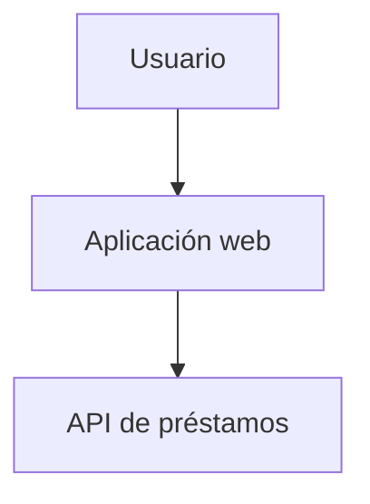

# C4 Model — <feature>
## Contexto (C4-1)

## Contenedores (C4-2)
Describe los contenedores: API, base de datos, integraciones.
## Componentes (C4-3)
Describe los componentes internos de cada contenedor afectado.
## Requisitos no funcionales
- Rendimiento, disponibilidad, seguridad y accesibilidad.
## Well-Architected
Mapea las decisiones a los pilares del marco de buena arquitectura que use el proyecto (por ejemplo, el de su proveedor de nube).
## Decisiones pendientes afectadas
```json bt-pending-decisions
[]
```
