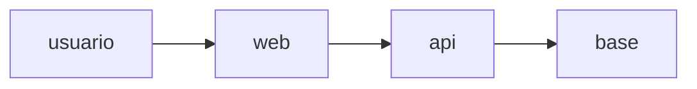

# Contexto del sistema existente (ejemplo)

## Contexto as-is

Aplicación de préstamos con un frontend web, una API y una base relacional, sin documentación previa.



## Contenedores

Frontend web, API de préstamos y base relacional.

## Componentes

La API tiene módulos de préstamos, miembros y notificaciones.

## Despliegue

Un entorno de dev y uno de producción en la misma cuenta.

## Datos

Datos de miembros con referencias opacas; sin datos de tarjeta.

## Seguridad observada

Secretos en variables del entorno de despliegue; sin rotación documentada.

## Deuda observada

Consultas sin índice y pruebas de rendimiento ausentes.

## Preguntas

- ¿Quién es el dueño del módulo de notificaciones?

```json mf-actions
[
  {
    "id": "AD1",
    "title": "Registrar la deuda de consultas sin índice",
    "entryType": "debt",
    "owner": "solutions-architect",
    "due": "2026-12-10"
  }
]
```
